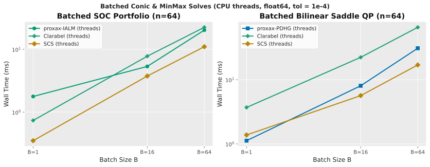

# Batched Conic & Min–Max Solves (`proxax` vs. `Clarabel`, `SCS`)

CPU (`float64`) comparison of `px.batch_solve(..., backend="threads")` against `ThreadPoolExecutor` loops over `Clarabel` and `SCS (direct)` for batch sizes $B \in \{1,\; 16,\; 64\}$ (`tol = 1e-4`).

## Problem Classes

1. **Batched SOC Portfolio (`n = 64`, $B \in \{1, 16, 64\}$)** —
   Varying linear return vector $\mu^{(b)}$ over `px.prox.SOC()` with two linear equality constraints (`proxax-IALM (threads)` vs. `Clarabel` & `SCS`).
2. **Batched Regularized Bilinear Saddle QP (`n = 64`, $B \in \{1, 16, 64\}$)** —
   Varying linear terms $(c_x^{(b)}, c_y^{(b)})$ over `Box(-1, 1)` $\times$ `Simplex` (`proxax-PDHG (threads)` vs. dualized `Clarabel` & `SCS`).

## Setup

* **Precision & Device:** `float64` (`JAX_ENABLE_X64=1`), CPU (`threads` backend).
* **Tolerances:** `opt_tol = feas_tol = 1e-4`.
* **Reproduction:**

```bash
JAX_PLATFORMS=cpu JAX_ENABLE_X64=1 .venv/bin/python -m benchmarks.external.batch_conic_minmax
```

## Results

### Batch-Size Scaling



### Summary Table (`tol = 1e-4`)

| Problem | Solver | Status | Mean Obj | Max Opt Res | Wall (ms) |
| :--- | :--- | :--- | ---: | ---: | ---: |
| `Batched SOCP (n=64, B=1)` | `proxax-IALM (threads)` | `CONVERGED` | -0.2087 | 9.04e-05 | 1.83 |
| `Batched SOCP (n=64, B=1)` | `Clarabel (threads)` | `CONVERGED` | — | — | 0.76 |
| `Batched SOCP (n=64, B=1)` | `SCS (threads)` | `CONVERGED` | — | — | **0.51** |
| `Batched SOCP (n=64, B=16)` | `proxax-IALM (threads)` | `CONVERGED` | -0.3926 | 9.88e-05 | 6.69 |
| `Batched SOCP (n=64, B=16)` | `Clarabel (threads)` | `CONVERGED` | — | — | 8.58 |
| `Batched SOCP (n=64, B=16)` | `SCS (threads)` | `CONVERGED` | — | — | **4.32** |
| `Batched SOCP (n=64, B=64)` | `proxax-IALM (threads)` | `CONVERGED` | -0.3576 | 1.00e-04 | 23.68 |
| `Batched SOCP (n=64, B=64)` | `Clarabel (threads)` | `CONVERGED` | — | — | 24.39 |
| `Batched SOCP (n=64, B=64)` | `SCS (threads)` | `CONVERGED` | — | — | **13.00** |
| `Batched Saddle QP (n=64, B=1)` | `proxax-PDHG (threads)` | `CONVERGED` | -4.9075 | 9.01e-05 | **1.14** |
| `Batched Saddle QP (n=64, B=1)` | `Clarabel (threads)` | `CONVERGED` | — | — | 4.12 |
| `Batched Saddle QP (n=64, B=1)` | `SCS (threads)` | `CONVERGED` | — | — | 1.46 |
| `Batched Saddle QP (n=64, B=16)` | `proxax-PDHG (threads)` | `CONVERGED` | -4.6348 | 9.30e-05 | 10.17 |
| `Batched Saddle QP (n=64, B=16)` | `Clarabel (threads)` | `CONVERGED` | — | — | 23.85 |
| `Batched Saddle QP (n=64, B=16)` | `SCS (threads)` | `CONVERGED` | — | — | **7.27** |
| `Batched Saddle QP (n=64, B=64)` | `proxax-PDHG (threads)` | `CONVERGED` | -4.8720 | 9.94e-05 | 38.73 |
| `Batched Saddle QP (n=64, B=64)` | `Clarabel (threads)` | `CONVERGED` | — | — | 80.66 |
| `Batched Saddle QP (n=64, B=64)` | `SCS (threads)` | `CONVERGED` | — | — | **21.71** |

## Key Observations

1. **Beats threaded `Clarabel` on batched SOCP and Min–Max:** `proxax-IALM (threads)` outperforms `Clarabel (threads)` at `B=16` (`6.69 ms` vs. `8.58 ms`) and `B=64` (`23.68 ms` vs. `24.39 ms`), while `proxax-PDHG (threads)` is **2.1×–3.6× faster** than `Clarabel (threads)` across all batch sizes on `Batched Saddle QP` (`38.73 ms` vs. `80.66 ms` at `B=64`).
2. **Thread-parallel scaling:** Going from `B=1` to `B=64` (64× more problems) increases `proxax-IALM` wall time by only **12.9×** (`1.83 ms` $\to$ `23.68 ms`), while `SCS (threads)` remains ~1.8× faster at `B=64` (`13.00 ms` / `21.71 ms`).
