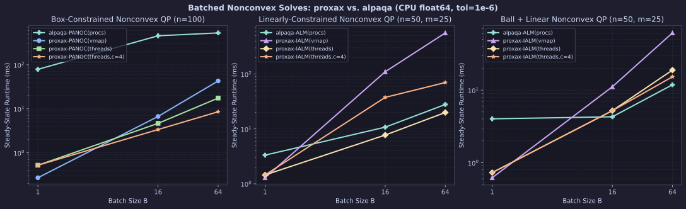
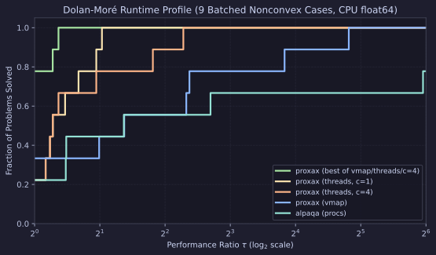

# Batched Nonconvex Solves (`proxax` vs. `alpaqa`)

CPU (`float64`) comparison of `proxax` (`px.batch_solve` with `backend="vmap"`, `backend="threads"` at `chunk_size=1`, and `backend="threads"` at `chunk_size=4` for $B > 1$) against `alpaqa` (`0.0.1`, parallelized across CPU cores with `ProcessPoolExecutor`) across batch sizes $B \in \{1, 16, 64\}$.

*(Note: `alpaqa` is parallelized with `ProcessPoolExecutor` using forked workers because its C++/Python `ALMSolver` bindings segfault under `ThreadPoolExecutor`.)*

## Problem Classes

1. **Batched Box-Constrained Nonconvex QP (`box_qp_batch`)** —
   $$\min_{x \in [0, 1]^n} \tfrac{1}{2} x^\top Q x + q_i^\top x \qquad (n=100, \; Q \text{ indefinite})$$
   Both solvers use PANOC + L-BFGS (`px.PANOC` vs. `alpaqa.panoc`).
2. **Batched Linearly-Constrained Nonconvex QP (`lin_qp_batch`)** —
   $$\min_{x \in [0, 1]^n} \tfrac{1}{2} x^\top Q x + q_i^\top x \quad \text{s.t.} \quad A x \le b \qquad (n=50, \; m=25, \; Q \text{ indefinite})$$
   Both solvers use augmented Lagrangian outer loops (`px.IALM` vs. `alpaqa.ALMSolver`).
3. **Batched Ball + Linear Nonconvex QP (`nl_ball_qp_batch`)** —
   $$\min_{\|x\|_2 \le 2} \tfrac{1}{2} x^\top Q x + q_i^\top x \quad \text{s.t.} \quad A x \le b \qquad (n=50, \; m=25, \; Q \text{ indefinite})$$
   `proxax` handles $\|x\|_2 \le 2$ directly via `px.prox.L2Ball(2.0)` in the proximal operator, whereas `alpaqa` lifts it into the smooth inequality vector $g(x)$ alongside $Ax - b$.

## Setup

* **Precision & Device:** `float64` (`JAX_ENABLE_X64=1`), CPU.
* **Tolerances:** `tol = 1e-6` (`ε = δ = 1e-6` for `alpaqa`).
* **Timing:** Steady-state minimum over `repeats = 3` after warmup (first call reported separately as `Compile (s)`).
* **Reproduction:**

```bash
JAX_PLATFORMS=cpu JAX_ENABLE_X64=1 PYTHONPATH=. .venv/bin/python benchmarks/external/batch_vs_alpaqa.py --tol 1e-6
```

## Results

### Batch Scaling



### Dolan–Moré Runtime Profile



### Full Results (`tol = 1e-6`)

| Suite | Problem | Solver | $B$ | Converged | Mean Obj | Compile (s) | Run (ms) | Speedup vs. `alpaqa` |
| :--- | :--- | :--- | ---: | :--- | ---: | ---: | ---: | ---: |
| `box_qp_batch` | `box_qp_n100_B1` | `proxax-PANOC(vmap)` | 1 | `True` | -28.5442 | 1.25 | **0.27** | **292.4×** |
| `box_qp_batch` | `box_qp_n100_B1` | `proxax-PANOC(threads)` | 1 | `True` | -28.5442 | 1.01 | 0.52 | 151.8× |
| `box_qp_batch` | `box_qp_n100_B1` | `alpaqa-PANOC(procs)` | 1 | `True` | -28.5442 | 0.12 | 78.94 | 1.0× |
| `box_qp_batch` | `box_qp_n100_B16` | `proxax-PANOC(vmap)` | 16 | `True` | -30.1039 | 0.37 | 6.69 | 68.3× |
| `box_qp_batch` | `box_qp_n100_B16` | `proxax-PANOC(threads)` | 16 | `True` | -30.1039 | 1.02 | 4.66 | 98.0× |
| `box_qp_batch` | `box_qp_n100_B16` | `proxax-PANOC(threads,c=4)` | 16 | `True` | -30.1039 | 0.43 | **3.37** | **135.5×** |
| `box_qp_batch` | `box_qp_n100_B16` | `alpaqa-PANOC(procs)` | 16 | `True` | -30.1039 | 0.46 | 456.67 | 1.0× |
| `box_qp_batch` | `box_qp_n100_B64` | `proxax-PANOC(vmap)` | 64 | `True` | -28.8731 | 0.37 | 42.91 | 12.4× |
| `box_qp_batch` | `box_qp_n100_B64` | `proxax-PANOC(threads)` | 64 | `True` | -28.8731 | 1.06 | 17.51 | 30.3× |
| `box_qp_batch` | `box_qp_n100_B64` | `proxax-PANOC(threads,c=4)` | 64 | `True` | -28.8731 | 0.37 | **8.56** | **62.0×** |
| `box_qp_batch` | `box_qp_n100_B64` | `alpaqa-PANOC(procs)` | 64 | `True` | -28.8744 | 1.74 | 531.07 | 1.0× |
| `lin_qp_batch` | `lin_qp_n50_B1` | `proxax-IALM(vmap)` | 1 | `True` | -13.2488 | 2.11 | **1.29** | **2.6×** |
| `lin_qp_batch` | `lin_qp_n50_B1` | `proxax-IALM(threads)` | 1 | `True` | -13.2488 | 1.56 | 1.45 | 2.3× |
| `lin_qp_batch` | `lin_qp_n50_B1` | `alpaqa-ALM(procs)` | 1 | `True` | -13.2488 | 0.03 | 3.33 | 1.0× |
| `lin_qp_batch` | `lin_qp_n50_B16` | `proxax-IALM(vmap)` | 16 | `True` | -14.4569 | 0.82 | 110.24 | 0.10× |
| `lin_qp_batch` | `lin_qp_n50_B16` | `proxax-IALM(threads)` | 16 | `True` | -14.4569 | 1.59 | **7.74** | **1.39×** |
| `lin_qp_batch` | `lin_qp_n50_B16` | `proxax-IALM(threads,c=4)` | 16 | `True` | -14.4569 | 0.80 | 37.60 | 0.29× |
| `lin_qp_batch` | `lin_qp_n50_B16` | `alpaqa-ALM(procs)` | 16 | `True` | -14.4646 | 0.03 | 10.78 | 1.0× |
| `lin_qp_batch` | `lin_qp_n50_B64` | `proxax-IALM(vmap)` | 64 | `True` | -13.8498 | 1.25 | 562.05 | 0.05× |
| `lin_qp_batch` | `lin_qp_n50_B64` | `proxax-IALM(threads)` | 64 | `True` | -13.8498 | 1.72 | **19.94** | **1.40×** |
| `lin_qp_batch` | `lin_qp_n50_B64` | `proxax-IALM(threads,c=4)` | 64 | `True` | -13.8498 | 0.79 | 70.07 | 0.40× |
| `lin_qp_batch` | `lin_qp_n50_B64` | `alpaqa-ALM(procs)` | 64 | `True` | -13.8485 | 0.05 | 27.91 | 1.0× |
| `nl_ball_qp_batch` | `nl_ball_qp_n50_B1` | `proxax-IALM(vmap)` | 1 | `True` | -13.4864 | 2.27 | **0.62** | **6.5×** |
| `nl_ball_qp_batch` | `nl_ball_qp_n50_B1` | `proxax-IALM(threads)` | 1 | `True` | -13.4864 | 1.68 | 0.73 | 5.5× |
| `nl_ball_qp_batch` | `nl_ball_qp_n50_B1` | `alpaqa-ALM(procs)` | 1 | `True` | -13.4864 | 0.02 | 4.02 | 1.0× |
| `nl_ball_qp_batch` | `nl_ball_qp_n50_B16` | `proxax-IALM(vmap)` | 16 | `True` | -13.5325 | 0.77 | 11.12 | 0.39× |
| `nl_ball_qp_batch` | `nl_ball_qp_n50_B16` | `proxax-IALM(threads)` | 16 | `True` | -13.5325 | 1.72 | 5.21 | 0.82× |
| `nl_ball_qp_batch` | `nl_ball_qp_n50_B16` | `proxax-IALM(threads,c=4)` | 16 | `True` | -13.5325 | 0.73 | 5.20 | 0.82× |
| `nl_ball_qp_batch` | `nl_ball_qp_n50_B16` | `alpaqa-ALM(procs)` | 16 | `True` | -13.5325 | 0.03 | **4.29** | 1.0× |
| `nl_ball_qp_batch` | `nl_ball_qp_n50_B64` | `proxax-IALM(vmap)` | 64 | `True` | -13.2180 | 0.81 | 61.36 | 0.19× |
| `nl_ball_qp_batch` | `nl_ball_qp_n50_B64` | `proxax-IALM(threads)` | 64 | `True` | -13.2180 | 1.78 | 18.88 | 0.63× |
| `nl_ball_qp_batch` | `nl_ball_qp_n50_B64` | `proxax-IALM(threads,c=4)` | 64 | `True` | -13.2180 | 0.73 | 15.26 | 0.78× |
| `nl_ball_qp_batch` | `nl_ball_qp_n50_B64` | `alpaqa-ALM(procs)` | 64 | `True` | -13.2180 | 0.04 | **11.84** | 1.0× |

## Key Takeaways

1. **Box-constrained PANOC:** `proxax-PANOC` is **62×–292× faster** than `alpaqa-PANOC(procs)` (`8.56 ms` with `chunk_size=4` vs. `531.07 ms` at $B=64$), with zero Python-callback overhead per iteration.
2. **Constrained ALM (`threads` vs. `chunk_size=4`):**
   * On high-variance active-set problems (`lin_qp_batch`), `chunk_size=1` (`19.94 ms` at $B=64$) beats both `alpaqa-ALM(procs)` (`27.91 ms`) and `chunk_size=4` (`70.07 ms`) because each problem exits early without waiting for intra-chunk stragglers.
   * On uniform problems (`box_qp_batch`, `nl_ball_qp_batch` at $B=64$), `chunk_size=4` cuts Python/XLA host dispatches 4× (`17.51 ms` $\to$ `8.56 ms` on `box_qp_batch`, `18.88 ms` $\to$ `15.26 ms` on `nl_ball_qp_batch`).
3. **Small-scale ALM (`n=50`):** On `nl_ball_qp_batch`, `proxax` wins at $B=1$ (`0.62 ms` vs. `4.02 ms`), while `alpaqa-ALM(procs)` edges out `proxax-IALM` at $B=16, 64$ (`4.29 ms / 11.84 ms` vs. `5.20 ms / 15.26 ms`), where per-problem solve time is ~0.2 ms and Python-to-XLA host dispatch + `jnp.concatenate` overhead dominates.

### Why Chunking Helps — and When It Doesn't

`px.batch_solve(..., backend="threads", chunk_size=c)` partitions the batch into slices of size `c` and dispatches one `jit(jax.vmap(...))` call per chunk across a persistent `ThreadPoolExecutor`:

* **Host-dispatch amortization (`c > 1`):** Each `chunk_size=1` call on CPU pays Python GIL / XLA client dispatch overhead (~0.2 ms per dispatch) plus PyTree slicing and stacking. On uniform workloads (`box_qp_batch`, `nl_ball_qp_batch` at $B=64$), `chunk_size=4` cuts dispatches 4× and unlocks intra-chunk SIMD vectorization, speeding up `box_qp_batch` ($B=64$) by **2.0×** (`17.51 ms` $\to$ `8.56 ms`) and `nl_ball_qp_batch` ($B=64$) by **1.24×** (`18.88 ms` $\to$ `15.26 ms`).
* **Intra-chunk lockstep (`c = 1`):** On high-variance active-set workloads (`lin_qp_batch`), one hard instance in a chunk forces the other `c - 1` instances to run the same outer/inner ALM iterations (`70.07 ms` at `c=4` vs. `19.94 ms` at `c=1`). For this reason, `chunk_size=1` is the default in `px.batch_solve`, while `chunk_size > 1` is an explicit opt-in knob for small, uniform batches.
