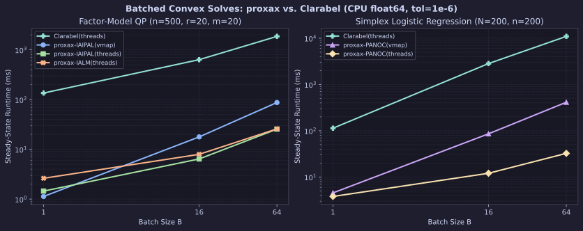
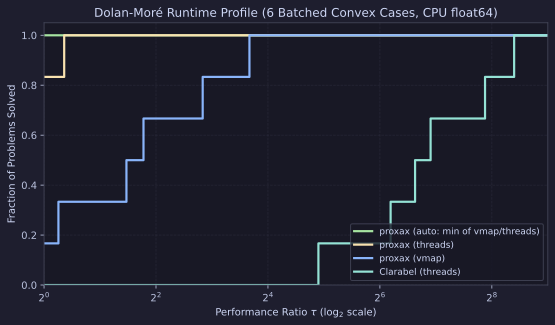

# Batched Convex Solves (`proxax` vs. `Clarabel`)

CPU (`float64`) comparison of `proxax` (`px.batch_solve` with `backend="vmap"` and `backend="threads"`) against `Clarabel` (`0.11.1`, parallelized with `ThreadPoolExecutor`) across batch sizes $B \in \{1, 16, 64\}$.

## Problem Classes

1. **Batched Factor-Model QP (`factor_qp_batch`)** —
   $$\min_{x \in [0, 1]^n} \tfrac{1}{2} x^\top (F D F^\top + \operatorname{diag}(d)) x + q_i^\top x \quad \text{s.t.} \quad A x \le b \qquad (n=500, \; r=20, \; m=20)$$
   Here $Q = F D F^\top + \operatorname{diag}(d)$ is dense ($500 \times 500$) with low-rank factor structure ($r=20$). `proxax` evaluates $Q x$ matrix-free via `F @ (d_fac * (F.T @ x)) + d_diag * x`, whereas `Clarabel` constructs and factors the sparse/dense KKT system per batch element.
2. **Batched Simplex-Constrained Logistic Regression (`logreg_simplex_batch`)** —
   $$\min_{x \in \Delta^n} \frac{1}{N} \sum_{j=1}^N \log(1 + \exp(-y_j (X_j^\top x + \text{shift}_{i}))) + \frac{\lambda}{2} \|x\|_2^2 \qquad (N=200, \; n=200)$$
   `proxax` solves the smooth objective directly over the probability simplex using `px.PANOC` with `px.prox.Simplex(1.0)`, whereas `Clarabel` reformulates the logistic loss using exponential cones (`ExponentialConeT`).

## Setup

* **Precision & Device:** `float64` (`JAX_ENABLE_X64=1`), CPU.
* **Tolerances:** `tol = 1e-6` (`tol_gap_abs = tol_gap_rel = tol_feas = 1e-6` for `Clarabel`).
* **Timing:** Steady-state minimum over `repeats = 3` after warmup (first call reported separately as `Compile (s)`).
* **Reproduction:**

```bash
JAX_PLATFORMS=cpu JAX_ENABLE_X64=1 PYTHONPATH=. .venv/bin/python benchmarks/external/batch_vs_clarabel.py --tol 1e-6
```

## Results

### Batch Scaling



### Dolan–Moré Runtime Profile



### Full Results (`tol = 1e-6`)

| Suite | Problem | Solver | $B$ | Converged | Mean Obj | Compile (s) | Run (ms) | Speedup vs. `Clarabel` |
| :--- | :--- | :--- | ---: | :--- | ---: | ---: | ---: | ---: |
| `factor_qp_batch` | `factor_qp_n500_B1` | `proxax-IAIPAL(vmap)` | 1 | `True` | -122.1982 | 1.54 | **1.13** | **119.9×** |
| `factor_qp_batch` | `factor_qp_n500_B1` | `proxax-IAIPAL(threads)` | 1 | `True` | -122.1982 | 1.31 | 1.45 | 93.5× |
| `factor_qp_batch` | `factor_qp_n500_B1` | `proxax-IALM(threads)` | 1 | `True` | -122.1982 | 1.87 | 2.62 | 51.7× |
| `factor_qp_batch` | `factor_qp_n500_B1` | `Clarabel(threads)` | 1 | `True` | -122.1982 | 0.16 | 135.51 | 1.0× |
| `factor_qp_batch` | `factor_qp_n500_B16` | `proxax-IAIPAL(vmap)` | 16 | `True` | -117.1622 | 0.59 | 17.78 | 35.7× |
| `factor_qp_batch` | `factor_qp_n500_B16` | `proxax-IAIPAL(threads)` | 16 | `True` | -117.1622 | 1.31 | **6.41** | **98.9×** |
| `factor_qp_batch` | `factor_qp_n500_B16` | `proxax-IALM(threads)` | 16 | `True` | -117.1622 | 1.79 | 7.94 | 79.9× |
| `factor_qp_batch` | `factor_qp_n500_B16` | `Clarabel(threads)` | 16 | `True` | -117.1622 | 0.70 | 634.22 | 1.0× |
| `factor_qp_batch` | `factor_qp_n500_B64` | `proxax-IAIPAL(vmap)` | 64 | `True` | -122.8100 | 0.66 | 87.33 | 21.3× |
| `factor_qp_batch` | `factor_qp_n500_B64` | `proxax-IAIPAL(threads)` | 64 | `True` | -122.8100 | 1.34 | **25.49** | **73.1×** |
| `factor_qp_batch` | `factor_qp_n500_B64` | `proxax-IALM(threads)` | 64 | `True` | -122.8100 | 1.85 | 25.79 | 72.2× |
| `factor_qp_batch` | `factor_qp_n500_B64` | `Clarabel(threads)` | 64 | `True` | -122.8100 | 2.14 | 1863.06 | 1.0× |
| `logreg_simplex_batch` | `logreg_simplex_n200_B1` | `proxax-PANOC(vmap)` | 1 | `True` | 0.6871 | 0.49 | 4.54 | 25.0× |
| `logreg_simplex_batch` | `logreg_simplex_n200_B1` | `proxax-PANOC(threads)` | 1 | `True` | 0.6871 | 0.29 | **3.80** | **29.9×** |
| `logreg_simplex_batch` | `logreg_simplex_n200_B1` | `Clarabel(threads)` | 1 | `True` | 0.6871 | 0.12 | 113.58 | 1.0× |
| `logreg_simplex_batch` | `logreg_simplex_n200_B16` | `proxax-PANOC(vmap)` | 16 | `True` | 0.6871 | 0.63 | 85.93 | 33.0× |
| `logreg_simplex_batch` | `logreg_simplex_n200_B16` | `proxax-PANOC(threads)` | 16 | `True` | 0.6871 | 0.34 | **12.05** | **235.3×** |
| `logreg_simplex_batch` | `logreg_simplex_n200_B16` | `Clarabel(threads)` | 16 | `True` | 0.6871 | 2.76 | 2835.77 | 1.0× |
| `logreg_simplex_batch` | `logreg_simplex_n200_B64` | `proxax-PANOC(vmap)` | 64 | `True` | 0.6870 | 0.94 | 413.27 | 26.5× |
| `logreg_simplex_batch` | `logreg_simplex_n200_B64` | `proxax-PANOC(threads)` | 64 | `True` | 0.6870 | 0.38 | **32.48** | **337.4×** |
| `logreg_simplex_batch` | `logreg_simplex_n200_B64` | `Clarabel(threads)` | 64 | `True` | 0.6870 | 11.05 | 10959.67 | 1.0× |

## Key Takeaways

1. **Matrix-free + proximal structure dominates even when `Clarabel` uses threads:** `proxax` is **73×–120× faster** than threaded `Clarabel` on the factor-model QP and **30×–337× faster** on simplex-constrained logistic regression.
2. **`threads` eliminates lockstep overhead on CPU:** At $B=64$, `proxax-IAIPAL(threads)` (`25.49 ms`) is **3.4× faster** than `vmap` (`87.33 ms`), and `proxax-PANOC(threads)` (`32.48 ms`) is **12.7× faster** than `vmap` (`413.27 ms`) because each batch element exits early upon reaching `tol = 1e-6`.
3. **Sublinear batch scaling:** With `px.batch_solve(..., backend="threads")`, solving 64 problems takes only **8.5×–17.6×** the $B=1$ runtime (`3.80 ms` $\to$ `32.48 ms` on logistic regression; `1.45 ms` $\to$ `25.49 ms` on factor QP).
