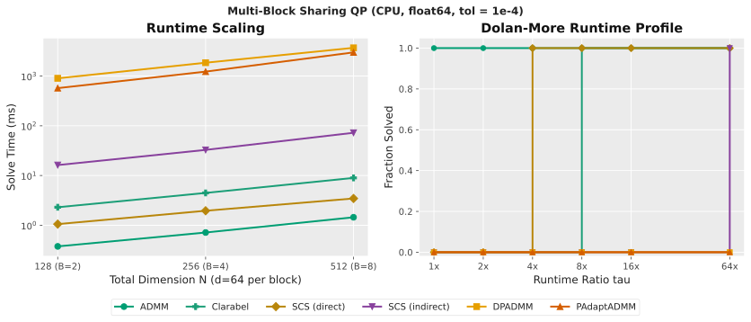

# Multi-Block Sharing QP Benchmarks (`proxax` `BlockProblem` vs. `Clarabel`, `SCS`)

CPU (`float64`) comparison of `proxax` multi-block solvers (`ADMM`, `DPADMM`, `PAdaptADMM`) against `Clarabel` and `SCS` (direct `QDLDL` and indirect `CG`) on $B$-block box-constrained convex QPs with linear coupling (`tol = 1e-4`).

## Problem Formulation

$$\min_{x_j \in [-1, 1]^d} \; \sum_{j=1}^B \left(\frac{1}{2} x_j^\top Q_j x_j + c_j^\top x_j\right) \quad \text{s.t.} \quad \sum_{j=1}^B A_j x_j = b \qquad (d = 64,\; m = 16,\; B \in \{2, 4, 8\})$$

## Setup

* **Precision & Device:** `float64` (`JAX_ENABLE_X64=1`), CPU.
* **Tolerances:** `opt_tol = feas_tol = 1e-4`.
* **Reproduction:**

```bash
JAX_PLATFORMS=cpu JAX_ENABLE_X64=1 .venv/bin/python -m benchmarks.external.block_vs_clarabel_scs
```

## Results

### Runtime Scaling & Dolan–Moré Profile



### Summary Table (`tol = 1e-4`)

| Problem | Solver | Status | Objective | Opt Res | Feas Res | Run (ms) |
| :--- | :--- | :--- | ---: | ---: | ---: | ---: |
| `Sharing QP (B=2, N=128)` | `DPADMM` | `MAX_ITER_REACHED` | -6.6073 | 1.93e-03 | 3.69e-06 | 898.12 |
| `Sharing QP (B=2, N=128)` | `PAdaptADMM` | `MAX_ITER_REACHED` | -6.6073 | 1.61e+00 | 2.80e-06 | 501.23 |
| `Sharing QP (B=2, N=128)` | `ADMM` | `CONVERGED` | -6.6073 | 9.33e-05 | 7.78e-06 | **0.39** |
| `Sharing QP (B=2, N=128)` | `Clarabel` | `CONVERGED` | -6.6072 | 3.12e-16 | 8.71e-12 | 2.32 |
| `Sharing QP (B=2, N=128)` | `SCS (direct)` | `CONVERGED` | -6.6073 | 5.33e-07 | 4.76e-05 | 1.04 |
| `Sharing QP (B=2, N=128)` | `SCS (indirect)` | `CONVERGED` | -6.6073 | 1.89e-06 | 4.80e-05 | 16.61 |
| `Sharing QP (B=4, N=256)` | `DPADMM` | `MAX_ITER_REACHED` | -20.7587 | 2.86e-03 | 3.78e-06 | 1,690.92 |
| `Sharing QP (B=4, N=256)` | `PAdaptADMM` | `MAX_ITER_REACHED` | -20.7587 | 3.42e+00 | 1.48e-05 | 1,242.40 |
| `Sharing QP (B=4, N=256)` | `ADMM` | `CONVERGED` | -20.7587 | 1.00e-04 | 5.09e-06 | **1.25** |
| `Sharing QP (B=4, N=256)` | `Clarabel` | `CONVERGED` | -20.7587 | 2.78e-16 | 1.08e-11 | 4.86 |
| `Sharing QP (B=4, N=256)` | `SCS (direct)` | `CONVERGED` | -20.7588 | 1.70e-06 | 1.01e-04 | 1.85 |
| `Sharing QP (B=4, N=256)` | `SCS (indirect)` | `CONVERGED` | -20.7588 | 3.20e-06 | 1.00e-04 | 34.43 |
| `Sharing QP (B=8, N=512)` | `DPADMM` | `MAX_ITER_REACHED` | -41.3055 | 3.16e-03 | 3.38e-06 | 3,399.65 |
| `Sharing QP (B=8, N=512)` | `PAdaptADMM` | `MAX_ITER_REACHED` | -41.3055 | 2.11e+00 | 5.29e-06 | 2,619.68 |
| `Sharing QP (B=8, N=512)` | `ADMM` | `CONVERGED` | -41.3055 | 9.80e-05 | 4.74e-06 | **1.37** |
| `Sharing QP (B=8, N=512)` | `Clarabel` | `CONVERGED` | -41.3054 | 3.19e-16 | 1.57e-11 | 9.90 |
| `Sharing QP (B=8, N=512)` | `SCS (direct)` | `CONVERGED` | -41.3056 | 9.37e-07 | 8.38e-05 | 3.92 |
| `Sharing QP (B=8, N=512)` | `SCS (indirect)` | `CONVERGED` | -41.3056 | 1.90e-06 | 8.43e-05 | 77.17 |

## Key Observations

1. **`proxax-ADMM` wins across all 3 sizes (`2.9×–7.2×` faster at `N=512`):** `ADMM` solves `B=8, N=512` in **1.37 ms** vs. `SCS (direct)` (**3.92 ms**) and `Clarabel` (**9.90 ms**), winning `3/3` in the Dolan–Moré profile.
2. **Use `ADMM` for convex block QPs; reserve `DPADMM`/`PAdaptADMM` for nonconvex rank-deficient splitting:** `DPADMM` and `PAdaptADMM` use nested proximal-point stages meant for nonconvex/rank-deficient problems and hit `max_stages=20` here, whereas `ADMM` converges in `< 1.4 ms`.
