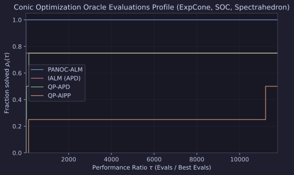

# Conic Optimization Benchmarks (`ExpCone`, `SOC`, `Spectrahedron`)

This report evaluates `PANOC-ALM` (`IALM(subproblem_solver="panoc")`) against `IALM (APD)`, `QP-APD`, and `QP-AIPP` across four linearly constrained conic and matrix-cone optimization problems.

## Problem Suite

1. **ExpCone Entropy**: Constrained optimization over the 3D primal exponential cone `px.prox.ExpCone()` with a linear equality constraint.
2. **Robust SOCP (`cond=50`)**: Ill-conditioned quadratic objective over the second-order cone `px.prox.SOC()` with a linear equality constraint.
3. **Spectrahedron SDP**: Matrix Frobenius minimization over `px.prox.Spectrahedron(scale=1.0)` with a diagonal linear constraint.
4. **SOC Portfolio**: Mean-variance portfolio optimization over `px.prox.SOC()` with two linear equality constraints.

## Results

All benchmarks were executed on CPU with `JAX_PLATFORMS=cpu` via [`experiments/conic_benchmarks/run.py`](https://github.com/wwkong/proxax/blob/main/experiments/conic_benchmarks/run.py).

| Problem | Solver | Status | Outer Iters | Oracle Evals |
| --- | --- | --- | ---: | ---: |
| ExpCone Entropy | `PANOC-ALM` | CONVERGED | 7 | 284 |
| ExpCone Entropy | `IALM (APD)` | CONVERGED | 7 | 247 |
| ExpCone Entropy | `QP-APD` | CONVERGED | 15 | 1387 |
| ExpCone Entropy | `QP-AIPP` | CONVERGED | 15 | 31937 |
| Robust SOCP (`cond=50`) | `PANOC-ALM` | CONVERGED | 5 | 508 |
| Robust SOCP (`cond=50`) | `IALM (APD)` | MAX_ITER_REACHED | 40 | 1253 |
| Robust SOCP (`cond=50`) | `QP-APD` | CONVERGED | 12 | 13952 |
| Robust SOCP (`cond=50`) | `QP-AIPP` | MAX_ITER_REACHED | 35 | 6993 |
| Spectrahedron SDP | `PANOC-ALM` | CONVERGED | 11 | 522 |
| Spectrahedron SDP | `IALM (APD)` | CONVERGED | 11 | 541 |
| Spectrahedron SDP | `QP-APD` | MAX_ITER_REACHED | 35 | 71271 |
| Spectrahedron SDP | `QP-AIPP` | MAX_ITER_REACHED | 35 | 4800198 |
| SOC Portfolio | `PANOC-ALM` | CONVERGED | 6 | 566 |
| SOC Portfolio | `IALM (APD)` | CONVERGED | 5 | 742 |
| SOC Portfolio | `QP-APD` | CONVERGED | 13 | 78610 |
| SOC Portfolio | `QP-AIPP` | CONVERGED | 25 | 6348776 |

## Performance Profile

`PANOC-ALM` is the only solver in the suite to converge across all four conic problems, beating `IALM (APD)` on both `Spectrahedron SDP` and `SOC Portfolio` while solving `Robust SOCP (cond=50)` in 508 oracle evaluations.
