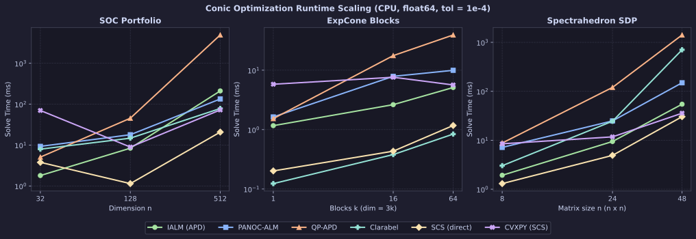
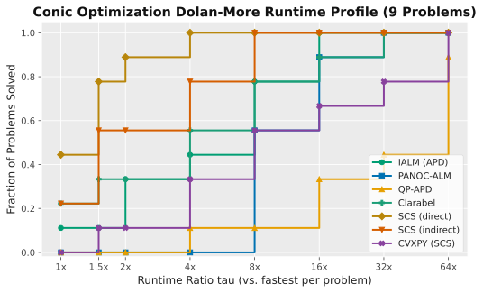

# Conic Optimization Benchmarks (`proxax` vs. `Clarabel`, `SCS`, `CVXPY`)

CPU (`float64`) comparison of `proxax` constrained solvers (`IALM (APD)`, `PANOC-ALM`, `QP-APD`, `QP-AIPP`) against `Clarabel` (IPM), `SCS` (direct `QDLDL` and indirect `CG` ADMM), and `CVXPY (SCS)` across Second-Order Cone (`SOC`), Exponential Cone (`ExpCone`), and Spectrahedron SDP (`Spectrahedron`) problems (`tol = 1e-4`).

## Problem Classes

1. **SOC Portfolio (`SOCP`, $n \in \{32,\; 128,\; 512\}$)** —
   $$\min_{x \in \mathcal{K}_{\text{SOC}}^n} \; \frac{1}{2} x^\top \Sigma x - \mu^\top x \quad \text{s.t.} \quad x_0 = 2,\; \mathbf{1}^\top x = 3$$
2. **Exponential Cone Blocks (`ExpCone`, $k \in \{1,\; 16,\; 64\}$ blocks, $n = 3k$)** —
   $$\min_{x^{(j)} \in \mathcal{K}_{\exp}} \; \sum_{j=1}^k \left(\frac{1}{2}\|x^{(j)} - v^{(j)}\|_2^2 + (c^{(j)})^\top x^{(j)}\right) \quad \text{s.t.} \quad x_0^{(j)} + x_1^{(j)} = 2$$
   (`proxax` vectorizes the $k$ projections via `jax.vmap` over a $(k, 3)$ array).
3. **Spectrahedron SDP (`SDP`, $n \in \{8,\; 24,\; 48\}$)** —
   $$\min_{X \succeq 0,\; \operatorname{Tr}(X)=1} \; \frac{1}{2}\|X - M\|_F^2 \quad \text{s.t.} \quad X_{00} + X_{11} = 0.5$$

## Setup

* **Precision & Device:** `float64` (`JAX_ENABLE_X64=1`), CPU.
* **Tolerances & Limits:** `opt_tol = feas_tol = 1e-4` (`time_limit = 5.0 s`).
* **Reproduction:**

```bash
JAX_PLATFORMS=cpu JAX_ENABLE_X64=1 .venv/bin/python -m benchmarks.external.conic_vs_clarabel_scs --time-limit 5.0 --include-cvxpy
```

## Results

### Runtime Scaling



### Dolan–Moré Runtime Profile



### Summary Table (`tol = 1e-4`)

| Problem | Solver | Status | Objective | Opt Res | Feas Res | Grad Evals | Run (ms) |
| :--- | :--- | :--- | ---: | ---: | ---: | ---: | ---: |
| `SOC Portfolio (n=32)` | `PANOC-ALM` | `CONVERGED` | -0.3392 | 7.40e-05 | 2.89e-05 | 614 | 9.31 |
| `SOC Portfolio (n=32)` | `IALM (APD)` | `CONVERGED` | -0.3392 | 9.14e-05 | 5.27e-05 | 1,459 | **1.80** |
| `SOC Portfolio (n=32)` | `QP-APD` | `CONVERGED` | -0.3392 | 1.00e-04 | 5.90e-05 | 10,994 | 5.08 |
| `SOC Portfolio (n=32)` | `QP-AIPP` | `CONVERGED` | -0.3392 | 6.47e-05 | 5.90e-05 | 19,352 | 24.19 |
| `SOC Portfolio (n=32)` | `Clarabel` | `CONVERGED` | -0.3392 | 1.10e-07 | 9.70e-16 | — | 7.95 |
| `SOC Portfolio (n=32)` | `SCS (direct)` | `CONVERGED` | -0.3392 | 6.02e-08 | 6.63e-08 | — | 3.78 |
| `SOC Portfolio (n=32)` | `SCS (indirect)` | `CONVERGED` | -0.3392 | 4.30e-06 | 2.93e-07 | — | 5.98 |
| `SOC Portfolio (n=32)` | `CVXPY (SCS)` | `CONVERGED` | -0.3392 | — | — | — | 70.11 |
| `SOC Portfolio (n=128)` | `PANOC-ALM` | `CONVERGED` | -0.4193 | 9.32e-05 | 6.37e-05 | 1,125 | 17.90 |
| `SOC Portfolio (n=128)` | `IALM (APD)` | `CONVERGED` | -0.4193 | 9.17e-05 | 8.10e-05 | 2,966 | 8.38 |
| `SOC Portfolio (n=128)` | `QP-APD` | `CONVERGED` | -0.4193 | 9.93e-05 | 8.15e-05 | 18,710 | 45.31 |
| `SOC Portfolio (n=128)` | `QP-AIPP` | `CONVERGED` | -0.4193 | 9.35e-05 | 8.15e-05 | 57,184 | 238.88 |
| `SOC Portfolio (n=128)` | `Clarabel` | `CONVERGED` | -0.4193 | 3.77e-11 | 3.41e-16 | — | 14.74 |
| `SOC Portfolio (n=128)` | `SCS (direct)` | `CONVERGED` | -0.4193 | 9.80e-08 | 8.47e-08 | — | **1.14** |
| `SOC Portfolio (n=128)` | `SCS (indirect)` | `CONVERGED` | -0.4193 | 1.04e-05 | 4.72e-07 | — | 6.77 |
| `SOC Portfolio (n=128)` | `CVXPY (SCS)` | `CONVERGED` | -0.4193 | — | — | — | 8.95 |
| `SOC Portfolio (n=512)` | `PANOC-ALM` | `CONVERGED` | -1.6135 | 5.68e-05 | 2.92e-05 | 2,348 | 134.05 |
| `SOC Portfolio (n=512)` | `IALM (APD)` | `CONVERGED` | -1.6135 | 9.84e-05 | 4.95e-05 | 5,441 | 211.10 |
| `SOC Portfolio (n=512)` | `QP-APD` | `CONVERGED` | -1.6135 | 1.00e-04 | 5.78e-05 | 134,052 | 4,926.69 |
| `SOC Portfolio (n=512)` | `QP-AIPP` | `CONVERGED` | -1.6135 | 9.83e-05 | 5.78e-05 | 115,191 | 5,766.31 |
| `SOC Portfolio (n=512)` | `Clarabel` | `CONVERGED` | -1.6135 | 7.15e-09 | 1.45e-14 | — | 78.41 |
| `SOC Portfolio (n=512)` | `SCS (direct)` | `CONVERGED` | -1.6135 | 2.58e-08 | 9.52e-08 | — | **20.78** |
| `SOC Portfolio (n=512)` | `SCS (indirect)` | `CONVERGED` | -1.6135 | 4.77e-07 | 9.50e-08 | — | 141.25 |
| `SOC Portfolio (n=512)` | `CVXPY (SCS)` | `CONVERGED` | -1.6135 | — | — | — | 72.24 |
| `ExpCone Blocks (k=1, n=3)` | `PANOC-ALM` | `CONVERGED` | 1.1403 | 9.92e-05 | 8.66e-05 | 168 | 1.64 |
| `ExpCone Blocks (k=1, n=3)` | `IALM (APD)` | `CONVERGED` | 1.1403 | 3.86e-05 | 4.97e-05 | 142 | 1.17 |
| `ExpCone Blocks (k=1, n=3)` | `QP-APD` | `CONVERGED` | 1.1403 | 9.97e-05 | 5.90e-05 | 475 | 1.53 |
| `ExpCone Blocks (k=1, n=3)` | `QP-AIPP` | `CONVERGED` | 1.1403 | 1.04e-05 | 5.90e-05 | 1,797 | 4.37 |
| `ExpCone Blocks (k=1, n=3)` | `Clarabel` | `CONVERGED` | 1.1403 | 3.84e-12 | 1.95e-12 | — | 0.12 |
| `ExpCone Blocks (k=1, n=3)` | `SCS (direct)` | `CONVERGED` | 1.1403 | 6.31e-08 | 1.76e-07 | — | 0.20 |
| `ExpCone Blocks (k=1, n=3)` | `SCS (indirect)` | `CONVERGED` | 1.1403 | 6.31e-08 | 1.76e-07 | — | **0.12** |
| `ExpCone Blocks (k=1, n=3)` | `CVXPY (SCS)` | `CONVERGED` | 1.1403 | — | — | — | 5.80 |
| `ExpCone Blocks (k=16, n=48)` | `PANOC-ALM` | `CONVERGED` | 20.0304 | 1.89e-05 | 5.36e-05 | 321 | 7.88 |
| `ExpCone Blocks (k=16, n=48)` | `IALM (APD)` | `CONVERGED` | 20.0303 | 9.42e-05 | 5.92e-05 | 260 | 2.63 |
| `ExpCone Blocks (k=16, n=48)` | `QP-APD` | `CONVERGED` | 20.0303 | 9.99e-05 | 7.59e-05 | 3,122 | 17.59 |
| `ExpCone Blocks (k=16, n=48)` | `QP-AIPP` | `CONVERGED` | 20.0303 | 1.94e-05 | 7.59e-05 | 6,725 | 70.45 |
| `ExpCone Blocks (k=16, n=48)` | `Clarabel` | `CONVERGED` | 20.0311 | 2.00e-12 | 9.05e-13 | — | **0.38** |
| `ExpCone Blocks (k=16, n=48)` | `SCS (direct)` | `CONVERGED` | 20.0306 | 4.16e-07 | 3.69e-05 | — | 0.43 |
| `ExpCone Blocks (k=16, n=48)` | `SCS (indirect)` | `CONVERGED` | 20.0306 | 5.69e-07 | 3.83e-05 | — | 0.57 |
| `ExpCone Blocks (k=16, n=48)` | `CVXPY (SCS)` | `CONVERGED` | 20.0306 | — | — | — | 7.61 |
| `ExpCone Blocks (k=64, n=192)` | `PANOC-ALM` | `CONVERGED` | 78.2354 | 1.10e-05 | 3.09e-05 | 360 | 9.95 |
| `ExpCone Blocks (k=64, n=192)` | `IALM (APD)` | `CONVERGED` | 78.2353 | 5.42e-05 | 3.42e-05 | 292 | 5.11 |
| `ExpCone Blocks (k=64, n=192)` | `QP-APD` | `CONVERGED` | 78.2350 | 9.99e-05 | 7.20e-05 | 5,119 | 39.16 |
| `ExpCone Blocks (k=64, n=192)` | `QP-AIPP` | `CONVERGED` | 78.2350 | 5.68e-06 | 7.20e-05 | 9,004 | 129.41 |
| `ExpCone Blocks (k=64, n=192)` | `Clarabel` | `CONVERGED` | 78.2381 | 2.64e-12 | 1.26e-12 | — | **0.84** |
| `ExpCone Blocks (k=64, n=192)` | `SCS (direct)` | `CONVERGED` | 78.2357 | 3.92e-07 | 3.66e-05 | — | 1.17 |
| `ExpCone Blocks (k=64, n=192)` | `SCS (indirect)` | `CONVERGED` | 78.2357 | 1.48e-06 | 3.82e-05 | — | 1.74 |
| `ExpCone Blocks (k=64, n=192)` | `CVXPY (SCS)` | `CONVERGED` | 78.2357 | — | — | — | 5.65 |
| `Spectrahedron SDP (n=8)` | `PANOC-ALM` | `CONVERGED` | 13.4554 | 3.97e-05 | 8.34e-05 | 301 | 7.14 |
| `Spectrahedron SDP (n=8)` | `IALM (APD)` | `CONVERGED` | 13.4554 | 4.26e-05 | 8.69e-05 | 206 | 1.93 |
| `Spectrahedron SDP (n=8)` | `QP-APD` | `CONVERGED` | 13.4554 | 9.79e-05 | 9.76e-05 | 2,631 | 8.77 |
| `Spectrahedron SDP (n=8)` | `QP-AIPP` | `CONVERGED` | 13.4554 | 2.56e-05 | 9.76e-05 | 4,488 | 26.19 |
| `Spectrahedron SDP (n=8)` | `Clarabel` | `CONVERGED` | 13.4556 | 9.13e-09 | 1.82e-08 | — | 3.02 |
| `Spectrahedron SDP (n=8)` | `SCS (direct)` | `CONVERGED` | 13.4556 | 1.65e-07 | 2.50e-05 | — | 1.30 |
| `Spectrahedron SDP (n=8)` | `SCS (indirect)` | `CONVERGED` | 13.4556 | 5.42e-06 | 2.51e-05 | — | **0.89** |
| `Spectrahedron SDP (n=8)` | `CVXPY (SCS)` | `CONVERGED` | 13.4556 | — | — | — | 8.48 |
| `Spectrahedron SDP (n=24)` | `PANOC-ALM` | `CONVERGED` | 140.0054 | 9.89e-05 | 5.85e-05 | 527 | 24.85 |
| `Spectrahedron SDP (n=24)` | `IALM (APD)` | `CONVERGED` | 140.0054 | 6.31e-05 | 5.62e-05 | 282 | 9.43 |
| `Spectrahedron SDP (n=24)` | `QP-APD` | `CONVERGED` | 140.0054 | 9.98e-05 | 7.30e-05 | 5,884 | 120.13 |
| `Spectrahedron SDP (n=24)` | `QP-AIPP` | `CONVERGED` | 140.0054 | 2.34e-05 | 7.30e-05 | 7,848 | 307.25 |
| `Spectrahedron SDP (n=24)` | `Clarabel` | `CONVERGED` | 140.0060 | 1.06e-09 | 4.13e-09 | — | 24.48 |
| `Spectrahedron SDP (n=24)` | `SCS (direct)` | `CONVERGED` | 140.0056 | 5.90e-06 | 2.64e-05 | — | **4.91** |
| `Spectrahedron SDP (n=24)` | `SCS (indirect)` | `CONVERGED` | 140.0056 | 5.92e-06 | 2.61e-05 | — | 6.12 |
| `Spectrahedron SDP (n=24)` | `CVXPY (SCS)` | `CONVERGED` | 140.0058 | — | — | — | 11.73 |
| `Spectrahedron SDP (n=48)` | `PANOC-ALM` | `CONVERGED` | 599.5343 | 8.54e-05 | 7.90e-05 | 621 | 149.44 |
| `Spectrahedron SDP (n=48)` | `IALM (APD)` | `CONVERGED` | 599.5343 | 9.49e-05 | 7.70e-05 | 367 | 54.54 |
| `Spectrahedron SDP (n=48)` | `QP-APD` | `CONVERGED` | 599.5345 | 9.98e-05 | 5.37e-05 | 6,483 | 1,415.68 |
| `Spectrahedron SDP (n=48)` | `QP-AIPP` | `CONVERGED` | 599.5345 | 1.85e-05 | 5.37e-05 | 9,444 | 3,836.38 |
| `Spectrahedron SDP (n=48)` | `Clarabel` | `CONVERGED` | 599.5352 | 2.47e-07 | 1.71e-06 | — | 705.27 |
| `Spectrahedron SDP (n=48)` | `SCS (direct)` | `CONVERGED` | 599.5349 | 5.48e-11 | 3.13e-11 | — | **30.31** |
| `Spectrahedron SDP (n=48)` | `SCS (indirect)` | `CONVERGED` | 599.5349 | 7.32e-07 | 2.91e-07 | — | 31.77 |
| `Spectrahedron SDP (n=48)` | `CVXPY (SCS)` | `CONVERGED` | 599.5346 | — | — | — | 35.71 |

## Key Observations

1. **`IALM (APD)` beats `Clarabel` by 2.6×–12.9× on `Spectrahedron SDP` (`n >= 24`):** At `n=48`, `Clarabel`'s interior-point KKT factorization over `48*49/2 = 1,176` `svec` variables takes **705.27 ms**, whereas `IALM (APD)` solves the matrix-space problem in **54.54 ms** (**12.9× faster**). `SCS (direct)` is fastest overall on single CPU SDP (**30.31 ms** at `n=48`) via C/LAPACK `syevd` + Anderson acceleration.
2. **`IALM (APD)` and `PANOC-ALM` vastly outperform `QP-APD` / `QP-AIPP` on conic problems:** On `SOC Portfolio (n=512)` and `Spectrahedron SDP (n=48)`, `IALM`/`PANOC-ALM` converge in **54.5–211.1 ms**, while `QP-APD` takes **1.4–4.9 s** and `QP-AIPP` takes **3.8–5.8 s**.
3. **`vmap` keeps `ExpCone` scaling nearly flat:** Vectorizing `ExpCone` projections over `(k, 3)` lets `IALM (APD)` scale from **1.17 ms** (`k=1`) to **5.11 ms** (`k=64`), beating `CVXPY (SCS)` (**5.65 ms**) at `k=64`, while `Clarabel` (`0.84 ms`) and `SCS` (`1.17 ms`) remain fastest on small unbatched `ExpCone` blocks.
