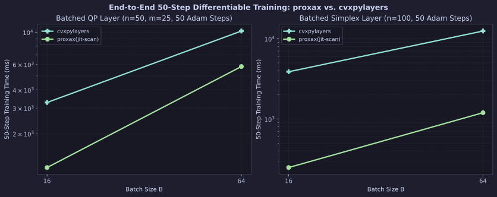
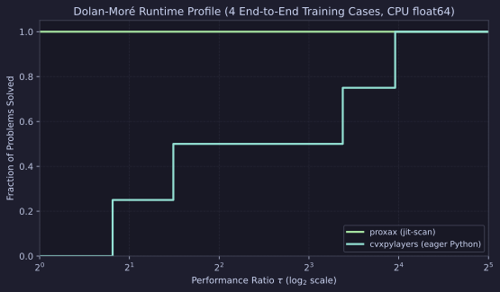

# End-to-End Differentiable Training Loop (`proxax` vs. `cvxpylayers`)

CPU (`float64`) comparison of a **50-step Adam training loop** learning linear cost parameters $\theta \in \mathbb{R}^n$ through a batched optimization layer across $B \in \{16, 64\}$ (`tol = 1e-6`).

Because `proxax` is fully XLA-traceable, `proxax(jit-scan)` compiles the **entire 50-step loop** (forward solve, implicit VJP, and Adam parameter updates via `jax.lax.scan`) into a single compiled XLA call, while `proxax(threads)` dispatches `px.batch_implicit_solve(..., backend="threads")` across a persistent CPU thread pool with cached per-problem executables (`_BATCH_IMPLICIT_CACHE`). Standard `cvxpylayers` (`diffcp` backend) is not `jax.jit`-compatible, so each training step returns to eager Python.

## Problem Classes

1. **Batched QP Layer Training (`qp_train`)** —
   $$\min_{\theta} \frac{1}{2B}\sum_{i=1}^B \left\|x^*(q_i + \theta) - x_{\text{target}, i}\right\|_2^2, \qquad x^*(q) = \arg\min_{x \ge 0,\; Ax \le b} \tfrac{1}{2}x^\top P x + q^\top x \qquad (n=50,\; m=25)$$
2. **Batched Simplex Layer Training (`simplex_train`)** —
   $$\min_{\theta} \frac{1}{2B}\sum_{i=1}^B \left\|x^*(\mu_i + \theta) - x_{\text{target}, i}\right\|_2^2, \qquad x^*(\mu) = \arg\min_{x \in \Delta^n} \tfrac{1}{2}x^\top P x - \mu^\top x \qquad (n=100)$$

## Setup

* **Precision & Device:** `float64` (`JAX_ENABLE_X64=1`), CPU.
* **Optimizer:** 50 Adam steps (`lr = 0.05`, $\beta_1=0.9$, $\beta_2=0.999$).
* **Tolerances:** `tol = 1e-6` (forward & implicit linear solve; `eps = eps_abs = eps_rel = 1e-6` for `cvxpylayers`).
* **Timing:** Minimum over `repeats = 2` after warmup (`Compile (s)` reports first-call XLA compile + warmup or `CvxpyLayer` setup + first run).
* **Reproduction:**

```bash
JAX_PLATFORMS=cpu JAX_ENABLE_X64=1 PYTHONPATH=. .venv/bin/python benchmarks/external/diff_training_loop.py --tol 1e-6
```

## Results

### 50-Step Training Scaling



### Dolan–Moré Runtime Profile



### Full Results (`tol = 1e-6`, 50 Adam Steps)

| Suite | Problem | Solver | $B$ | Init Loss | Final Loss | Compile (s) | 50-Step Train (ms) | Speedup vs. `cvxpylayers` |
| :--- | :--- | :--- | ---: | ---: | ---: | ---: | ---: | ---: |
| `qp_train` | `qp_train_n50_B16` | `proxax(jit-scan)` | 16 | 6.28084 | 1.21806 | 2.95 | 1164.90 | 2.81× |
| `qp_train` | `qp_train_n50_B16` | `proxax(threads)` | 16 | 6.28084 | 1.21806 | **0.67** | **189.04** | **17.30×** |
| `qp_train` | `qp_train_n50_B16` | `cvxpylayers` | 16 | 6.28084 | 1.21806 | 3.94 | 3270.79 | 1.0× |
| `simplex_train` | `simplex_train_n100_B16` | `proxax(jit-scan)` | 16 | 0.20976 | 0.14787 | 1.56 | 250.13 | 15.10× |
| `simplex_train` | `simplex_train_n100_B16` | `proxax(threads)` | 16 | 0.20976 | 0.14787 | **0.57** | **168.18** | **22.46×** |
| `simplex_train` | `simplex_train_n100_B16` | `cvxpylayers` | 16 | 0.20976 | 0.10458 | 4.68 | 3776.53 | 1.0× |
| `qp_train` | `qp_train_n50_B64` | `proxax(jit-scan)` | 64 | 6.47052 | 1.38402 | 7.50 | 5784.87 | 1.81× |
| `qp_train` | `qp_train_n50_B64` | `proxax(threads)` | 64 | 6.47052 | 1.38402 | **1.14** | **691.31** | **15.19×** |
| `qp_train` | `qp_train_n50_B64` | `cvxpylayers` | 64 | 6.47052 | 1.38402 | 11.19 | 10498.29 | 1.0× |
| `simplex_train` | `simplex_train_n100_B64` | `proxax(jit-scan)` | 64 | 0.20508 | 0.13569 | 2.38 | 1196.43 | 10.36× |
| `simplex_train` | `simplex_train_n100_B64` | `proxax(threads)` | 64 | 0.20508 | 0.13569 | **0.94** | **581.59** | **21.32×** |
| `simplex_train` | `simplex_train_n100_B64` | `cvxpylayers` | 64 | 0.20508 | 0.13178 | 13.09 | 12400.86 | 1.0× |

## Key Takeaways

1. **CPU thread-pool batching avoids `vmap` lockstep:** `proxax(threads)` is the fastest CPU option on all four cases, running **15.2×–17.3× faster** than `cvxpylayers` on `qp_train` (`189.04 ms` at $B=16$, `691.31 ms` at $B=64$, or **6.2×–8.4×** faster than `proxax(jit-scan)`) and **21.3×–22.5× faster** on `simplex_train` (`168.18 ms` at $B=16$, `581.59 ms` at $B=64$).
2. **Whole-loop XLA compilation:** Fusing 50 Adam steps (`forward + implicit VJP + update`) in `jax.lax.scan` (`proxax(jit-scan)`) still runs **10.4×–15.1× faster** than `cvxpylayers` on the simplex layer and **1.8×–2.8× faster** on the linearly constrained QP layer, with zero Python loop overhead (best suited for GPU/accelerator or uniform-iteration batches).
3. **Sub-second compile time:** With `_BATCH_IMPLICIT_CACHE` reusing a single compiled forward executable across batch elements and training steps, `proxax(threads)` compiles in **0.57 s–1.14 s** (compared to `1.56 s–7.50 s` for `jit-scan` and `3.94 s–13.09 s` for `cvxpylayers` setup + first run).
4. **Training-loop note:** `qp_train` achieves identical initial and final losses across all three solvers (`6.28084` $\to$ `1.21806` at $B=16$), while on `simplex_train` the GMRES-based implicit VJP (`linear_tol=1e-6`) follows a slightly different trajectory than `diffcp`'s direct KKT solve (`0.14787` vs. `0.10458` at $B=16$).

## Appendix: Execution & Async-Dispatch Details

* **Forward-executable caching & NumPy pre-slicing:** Under `backend="threads"`, `px.batch_implicit_solve` caches the pre-compiled forward executable and `custom_vjp` wrapper in `_BATCH_IMPLICIT_CACHE`, and converts `x_init` and `params_batch` to NumPy arrays before `pool.map` inside `_host_batch_fwd` so worker threads slice NumPy arrays rather than dispatching `jax.lax.slice` primitives inside `jax.pure_callback`.
* **Async XLA dispatch synchronization:** In `proxax(threads)`, calling `g.block_until_ready()` after `jit_val_and_grad(th)` prevents JAX's asynchronous CPU dispatch from queueing `adam_update` and the next step's `jit_val_and_grad` onto the XLA CPU runtime while `pure_callback` worker threads are still re-entering XLA to execute `compiled_fwd`.
* **`jit-scan` vs. `threads`:** `proxax(jit-scan)` fuses all 50 steps into one XLA graph with no Python loop or host synchronization, which is ideal on GPU/TPU or uniform-iteration batches; on CPU, `proxax(threads)` avoids `vmap` lockstep across the batch and compiles **2.5×–6.6× faster**.
