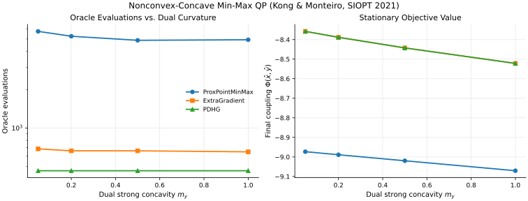

# Nonconvex-Concave Min-Max Optimization (Kong & Monteiro, SIOPT 2021)

Small-scale sequential-CPU replication of **Kong & Monteiro (SIOPT 2021)**, *An accelerated inexact proximal point method for solving nonconvex-concave min-max problems*, comparing `ProxPointMinMax` against direct primal-dual methods (`ExtraGradient` and `PDHG`).

## Setup & Reproduction

All runs execute sequentially on CPU via [`experiments/kong2021_minmax/run.py`](https://github.com/wwkong/proxax/blob/main/experiments/kong2021_minmax/run.py) (`opt_tol = 1e-4`), sweeping dual strong-concavity regularization $m_y \in \{0.05, 0.2, 0.5, 1.0\}$ on a `16x16` box/simplex-constrained nonconvex-concave QP:

```bash
JAX_PLATFORMS=cpu uv run python experiments/kong2021_minmax/run.py
```

## Convergence Trajectories (`m_y = 0.2`)



## Results

| Dual Curvature $m_y$ | Solver | Status | Outer Iters | Oracle Evals | Objective | Opt Residual | Wall (s) |
| ---: | --- | --- | ---: | ---: | ---: | ---: | ---: |
| 0.05 | `ProxPointMinMax` | CONVERGED | 15 | 5742 | -8.973287 | 8.10e-05 | 0.887 |
| 0.05 | `ExtraGradient` | CONVERGED | 80 | 686 | -8.358033 | 9.12e-05 | 0.124 |
| 0.05 | `PDHG` | CONVERGED | 60 | 462 | -8.358033 | 9.63e-05 | 0.149 |
| 0.20 | `ProxPointMinMax` | CONVERGED | 15 | 5258 | -8.988911 | 9.56e-05 | 0.265 |
| 0.20 | `ExtraGradient` | CONVERGED | 77 | 662 | -8.388439 | 9.07e-05 | 0.120 |
| 0.20 | `PDHG` | CONVERGED | 60 | 462 | -8.388439 | 5.38e-05 | 0.156 |
| 0.50 | `ProxPointMinMax` | CONVERGED | 16 | 4886 | -9.019752 | 7.37e-05 | 0.232 |
| 0.50 | `ExtraGradient` | CONVERGED | 77 | 662 | -8.442648 | 9.31e-05 | 0.121 |
| 0.50 | `PDHG` | CONVERGED | 60 | 462 | -8.442649 | 5.47e-05 | 0.158 |
| 1.00 | `ProxPointMinMax` | CONVERGED | 16 | 4934 | -9.070572 | 9.49e-05 | 0.222 |
| 1.00 | `ExtraGradient` | CONVERGED | 76 | 650 | -8.521862 | 9.24e-05 | 0.126 |
| 1.00 | `PDHG` | CONVERGED | 60 | 462 | -8.521861 | 6.27e-05 | 0.156 |

## Observations

- All three solvers converge in under 1 second on CPU across the full $m_y$ sweep.
- Direct primal-dual methods (`PDHG` and `ExtraGradient`) use ~8–12x fewer oracle evaluations (`462` and `650–686` vs. `4,886–5,742`), while `ProxPointMinMax` consistently settles at a **lower stationary objective** (`-8.973` to `-9.071` vs. `-8.358` to `-8.522`) on this nonconvex-concave landscape.
