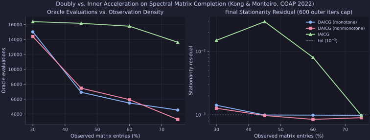

# Nonconvex Spectral Composite Optimization (Kong & Monteiro, COAP 2022)

Small-scale sequential-CPU replication of **Kong & Monteiro (COAP 2022)**, *Accelerated inexact composite gradient methods for nonconvex spectral optimization problems*, comparing doubly-accelerated (`DAICG`) and inner-accelerated (`IAICG`) methods.

## Setup & Reproduction

All runs execute sequentially on CPU via [`experiments/kong2022_spectral/run.py`](https://github.com/wwkong/proxax/blob/main/experiments/kong2022_spectral/run.py) (`opt_tol = 1e-3`, `max_outer_iters = 600`), sweeping observation density $p \in \{0.30, 0.45, 0.60, 0.75\}$ on `20x20` rank-3 noisy matrix completion with nonconvex log-sum singular-value regularization:

```bash
JAX_PLATFORMS=cpu uv run python experiments/kong2022_spectral/run.py
```

## Observation-Density Plot



## Results

| Obs. Density $p$ | Solver | Status | Outer Iters | Oracle Evals | Objective | Opt Residual | Wall (s) |
| ---: | --- | --- | ---: | ---: | ---: | ---: | ---: |
| 30% | `DAICG (monotone)` | MAX_ITER_REACHED | 600 | 15022 | 1.930574 | 1.42e-03 | 1.916 |
| 30% | `DAICG (nonmonotone)` | MAX_ITER_REACHED | 600 | 14398 | 1.930548 | 1.27e-03 | 0.648 |
| 30% | `IAICG` | MAX_ITER_REACHED | 600 | 16394 | 2.281321 | 1.50e-02 | 0.506 |
| 45% | `DAICG (monotone)` | CONVERGED | 297 | 6917 | 2.171382 | 9.96e-04 | 0.625 |
| 45% | `DAICG (nonmonotone)` | CONVERGED | 322 | 7468 | 2.171396 | 9.77e-04 | 0.550 |
| 45% | `IAICG` | MAX_ITER_REACHED | 600 | 16166 | 2.529692 | 2.95e-02 | 0.522 |
| 60% | `DAICG (monotone)` | CONVERGED | 228 | 5474 | 2.266230 | 9.92e-04 | 0.523 |
| 60% | `DAICG (nonmonotone)` | CONVERGED | 244 | 5934 | 2.266207 | 8.51e-04 | 0.531 |
| 60% | `IAICG` | MAX_ITER_REACHED | 600 | 15782 | 2.267107 | 8.07e-03 | 0.512 |
| 75% | `DAICG (monotone)` | CONVERGED | 176 | 4538 | 2.350787 | 9.84e-04 | 0.560 |
| 75% | `DAICG (nonmonotone)` | CONVERGED | 136 | 3286 | 2.350778 | 9.03e-04 | 0.525 |
| 75% | `IAICG` | CONVERGED | 509 | 13629 | 2.350776 | 9.83e-04 | 0.517 |

## Observations

- Across all four observation densities, `DAICG` consistently outperforms `IAICG`: `DAICG` converges at $p \in \{45\%, 60\%, 75\%\}$ in `136–322` outer iterations (`3,286–7,468` evals) and reaches `1.27e-3` residual at $30\%$.
- `IAICG` only reaches `opt_tol = 1e-3` at $p = 75\%$, where it needs **4.1x more** oracle evaluations than `DAICG (nonmonotone)` (`13,629` vs. `3,286`).
