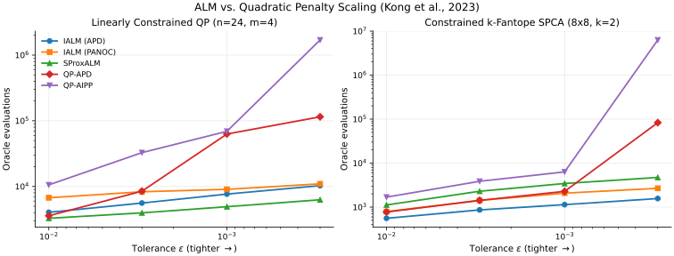

# ALM vs. Quadratic Penalty on Constrained NCO (Kong et al., 2023)

Small-scale sequential-CPU replication comparing proximal augmented Lagrangian methods (**Kong, Monteiro, & Melo, SIOPT 2023 `IAIPAL`**; **Kong & Monteiro, COAP 2023 `AIDAL` / `IALM`**) against earlier quadratic-penalty methods (**Kong, Melo, & Monteiro, SIOPT 2019 / COAP 2020 `QP-AIPP`**).

## Setup & Reproduction

All runs execute sequentially on CPU via [`experiments/kong2023_alm_vs_qp/run.py`](https://github.com/wwkong/proxax/blob/main/experiments/kong2023_alm_vs_qp/run.py), sweeping tolerance $\varepsilon \in \{10^{-2}, 3\times 10^{-3}, 10^{-3}, 3\times 10^{-4}\}$:

```bash
JAX_PLATFORMS=cpu uv run python experiments/kong2023_alm_vs_qp/run.py
```

1. **Linearly Constrained QP (`n=24, m=4`):** Indefinite quadratic over $[0, 1]^{24}$ with 4 linear equality constraints.
2. **Constrained $k$-Fantope SPCA (`8x8, k=2`):** Sparse-PCA-like objective over the $k$-Fantope $\{X : 0 \preceq X \preceq I,\, \operatorname{tr}(X) = 2\}$ with 2 linear equality constraints.

## Tolerance-Scaling Plot



## Summary Table ($\varepsilon = 10^{-2}$ to $\varepsilon = 3\times 10^{-4}$)

| Problem | Solver | $\varepsilon=10^{-2}$ (Evals) | $\varepsilon=3\times 10^{-3}$ (Evals) | $\varepsilon=10^{-3}$ (Evals) | $\varepsilon=3\times 10^{-4}$ (Evals) |
| --- | --- | --- | --- | --- | --- |
| Linearly Constrained QP (`n=24, m=4`) | `IALM (APD)` | CONVERGED (4042) | CONVERGED (5592) | CONVERGED (7658) | CONVERGED (10300) |
| Linearly Constrained QP (`n=24, m=4`) | `IALM (PANOC)` | CONVERGED (6732) | CONVERGED (8298) | CONVERGED (9042) | CONVERGED (10977) |
| Linearly Constrained QP (`n=24, m=4`) | `SProxALM` | CONVERGED (3278) | CONVERGED (3964) | CONVERGED (4916) | CONVERGED (6274) |
| Linearly Constrained QP (`n=24, m=4`) | `QP-APD` | CONVERGED (3580) | CONVERGED (8479) | CONVERGED (62860) | MAX_ITER (114869) |
| Linearly Constrained QP (`n=24, m=4`) | `QP-AIPP` | CONVERGED (10578) | CONVERGED (32752) | CONVERGED (69155) | CONVERGED (1697492) |
| Constrained $k$-Fantope SPCA (`8x8, k=2`) | `IALM (APD)` | CONVERGED (558) | CONVERGED (864) | CONVERGED (1140) | CONVERGED (1569) |
| Constrained $k$-Fantope SPCA (`8x8, k=2`) | `IALM (PANOC)` | CONVERGED (793) | CONVERGED (1417) | CONVERGED (2078) | CONVERGED (2682) |
| Constrained $k$-Fantope SPCA (`8x8, k=2`) | `SProxALM` | CONVERGED (1121) | CONVERGED (2297) | CONVERGED (3445) | CONVERGED (4733) |
| Constrained $k$-Fantope SPCA (`8x8, k=2`) | `QP-APD` | CONVERGED (774) | CONVERGED (1426) | CONVERGED (2282) | MAX_ITER (83191) |
| Constrained $k$-Fantope SPCA (`8x8, k=2`) | `QP-AIPP` | CONVERGED (1689) | CONVERGED (3871) | CONVERGED (6326) | MAX_ITER (6289196) |

## Observations

- Across all four tolerances, the ALM solvers (`IALM (APD)`, `IALM (PANOC)`, and `SProxALM`) scale gracefully (~2–3x increase in oracle evaluations from $10^{-2}$ to $3\times 10^{-4}$).
- By contrast, quadratic-penalty `QP-AIPP` blows up by **160x** on the constrained QP (`10,578` → `1,697,492` evals) and both `QP-APD` and `QP-AIPP` hit `MAX_ITER_REACHED` at $\varepsilon = 3\times 10^{-4}$ on $k$-Fantope SPCA, directly illustrating the $O(\varepsilon^{-5/2}\log^2\varepsilon^{-1})$ vs. $O(\varepsilon^{-3})$ gap.
