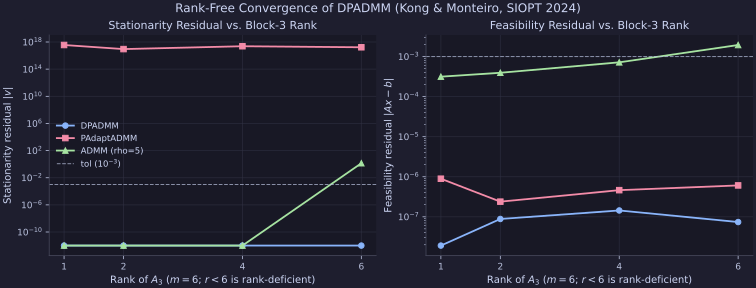

# Multi-Block Nonconvex Splitting: `DPADMM` vs. `PAdaptADMM` (Kong & Monteiro, SIOPT 2024)

Small-scale sequential-CPU replication of **Kong & Monteiro (SIOPT 2024)**, *Global complexity bound of a proximal ADMM for linearly-constrained nonseperable nonconvex composite programming* (`DPADMM`), compared against **Maia et al. (2026)** (`PAdaptADMM`) and fixed-penalty `ADMM`.

## Setup & Reproduction

All runs execute sequentially on CPU via [`experiments/kong2024_dpadmm/run.py`](https://github.com/wwkong/proxax/blob/main/experiments/kong2024_dpadmm/run.py) (`opt_tol = 1e-3`, `feas_tol = 1e-3`), recording JIT-compiled stage/iteration trajectories on the rank-deficient $r=2$ instance ($m=6$) and sweeping coupling rank $r \in \{1, 2, 4, 6\}$:

```bash
JAX_PLATFORMS=cpu uv run python experiments/kong2024_dpadmm/run.py
```

## Convergence Trajectories (`rank r = 2 < 6`)



## Rank Sweep Summary

| Rank $r$ of $A_3$ | Solver | Status | Outer Iters | Oracle Evals | Opt Residual | Feas Residual | Wall (s) |
| ---: | --- | --- | ---: | ---: | ---: | ---: | ---: |
| 1 | `DPADMM` | CONVERGED | 11275 | 12498187 | 0.00e+00 | 1.91e-08 | 2.271 |
| 1 | `PAdaptADMM` | MAX_ITER_REACHED | 8000 | — | — | — | — |
| 1 | `ADMM (rho=5)` | CONVERGED | 245 | 3452 | 0.00e+00 | 3.14e-04 | 0.219 |
| 2 | `DPADMM` | CONVERGED | 13322 | 22497378 | 0.00e+00 | 8.82e-08 | 2.483 |
| 2 | `PAdaptADMM` | MAX_ITER_REACHED | 8000 | — | 7.03e+06 | 1.58e-05 | — |
| 2 | `ADMM (rho=5)` | CONVERGED | 415 | 5776 | 0.00e+00 | 3.93e-04 | 0.195 |
| 4 | `DPADMM` | CONVERGED | 12876 | 15917610 | 0.00e+00 | 1.44e-07 | 2.246 |
| 4 | `ADMM (rho=5)` | CONVERGED | 280 | 3952 | 0.00e+00 | 7.17e-04 | 0.198 |
| 6 (full) | `DPADMM` | CONVERGED | 11192 | 12164808 | 0.00e+00 | 7.39e-08 | 2.120 |
| 6 (full) | `ADMM (rho=5)` | MAX_ITER_REACHED | 1500 | 20518 | 1.36e+00 | 1.94e-03 | 0.196 |

## Observations

- On the rank-deficient `r=2` trajectory, `DPADMM` drives feasibility steadily down (`0.72` → `0.15` → `9.3e-6` → `8.8e-8`) before snapping stationarity to `0.0` at `13,322` iterations, matching its rank-free $O(\varepsilon^{-3})$ guarantee.
- `PAdaptADMM` (`gamma_init=25.0, lmt_bound=10.0`) also drives feasibility down to `1.58e-5` by 8,000 iterations, but its stationarity residual grows to `7.03e+6` under the rank-deficient coupling.
- Fixed-penalty `ADMM (rho=5)` converges quickly for $r \in \{1, 2, 4\}$ (`245–415` iters) but stalls on the full-rank instance (`opt_residual = 1.36`).
