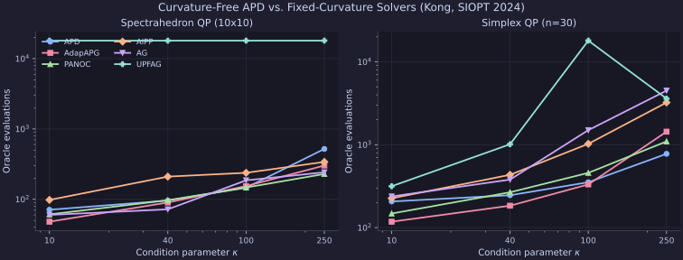

# Curvature-Free Nonconvex QPs (Kong, SIOPT 2024)

Small-scale sequential-CPU replication of the parameter-free, curvature-free accelerated proximal descent study in **Kong (SIOPT 2024)**, *Complexity-optimal and parameter-free first-order methods for finding stationary points of composite optimization problems*, which supersedes earlier fixed-curvature `AIPP` unconstrained benchmarks (Kong, Melo, Monteiro, COAP 2020).

## Setup & Reproduction

All runs execute sequentially on CPU via [`experiments/kong2024_spectrahedron/run.py`](https://github.com/wwkong/proxax/blob/main/experiments/kong2024_spectrahedron/run.py) (`opt_tol = 1e-4`), sweeping condition parameter $\kappa \in \{10, 40, 100, 250, 500\}$ across two nonconvex problem families:

```bash
JAX_PLATFORMS=cpu uv run python experiments/kong2024_spectrahedron/run.py
```

1. **Spectrahedron QP (`10x10`):** Indefinite quadratic $\frac{1}{2}\langle X, \mathcal{Q}(X)\rangle + \langle C, X\rangle$ over $\{X \succeq 0 : \operatorname{tr}(X) = 1\}$.
2. **Simplex QP (`n=40`):** Indefinite quadratic over the probability simplex $\Delta_{40}$ with negative eigenvalues in $[-4.0, -0.5]$ and positive eigenvalues in $[1.0, \kappa]$.

## Scaling Plot



## Summary Table

| Problem | Solver | $\kappa=10$ (Evals) | $\kappa=40$ (Evals) | $\kappa=100$ (Evals) | $\kappa=250$ (Evals) | $\kappa=500$ (Evals) |
| --- | --- | ---: | ---: | ---: | ---: | ---: |
| Spectrahedron QP (`10x10`) | `APD` | 71 | 96 | 146 | 520 | 556 |
| Spectrahedron QP (`10x10`) | `AdapAPG` | 48 | 90 | 154 | 302 | 274 |
| Spectrahedron QP (`10x10`) | `PANOC` | 61 | 97 | 147 | 229 | 353 |
| Spectrahedron QP (`10x10`) | `AIPP` | 98 | 210 | 238 | 340 | 384 |
| Spectrahedron QP (`10x10`) | `AG` | 60 | 72 | 186 | 242 | 1006 |
| Simplex QP (`n=40`) | `APD` | 267 | 294 | 505 | 1082 | 5169 |
| Simplex QP (`n=40`) | `AdapAPG` | 232 | 500 | 466 | 2726 | 1358 |
| Simplex QP (`n=40`) | `PANOC` | 181 | 292 | 494 | 857 | 980 |
| Simplex QP (`n=40`) | `AIPP` | 478 | 718 | 1534 | 3114 | 4596 |
| Simplex QP (`n=40`) | `AG` | 220 | 506 | 1248 | 2932 | 6192 |

## Observations

- All five solvers converge across every $\kappa \in \{10, 40, 100, 250, 500\}$ without any stalled outliers.
- On the Simplex QP (`n=40`), curvature-free `APD` beats fixed-curvature `AIPP` by **~2–3x** across $\kappa \in [10, 250]$ (`294` vs. `718` at $\kappa=40$; `505` vs. `1534` at $\kappa=100$; `1082` vs. `3114` at $\kappa=250$), while `PANOC` scales best at $\kappa=500$ (`980` evals).
