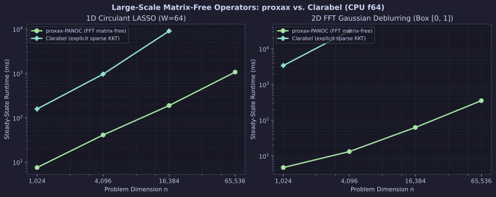
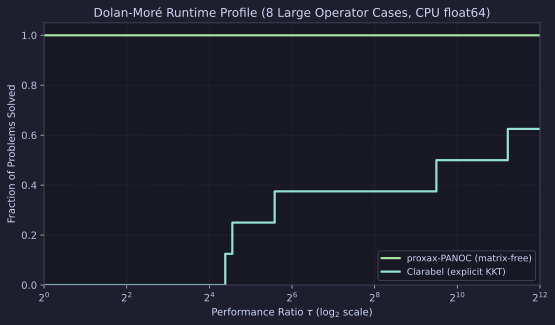

# Large-Scale Matrix-Free Operators (`proxax` vs. `Clarabel`)

CPU (`float64`) comparison of matrix-free $O(n \log n)$ FFT operators in `proxax-PANOC` against explicit sparse KKT factorization in `Clarabel` (`0.11.1`) across dimensions $n \in \{1{,}024,\; 4{,}096,\; 16{,}384,\; 65{,}536\}$ (`tol = 1e-6`).

## Problem Classes

1. **1D Circulant LASSO (`circulant_lasso`)** —
   $$\min_{x \in \mathbb{R}^n} \tfrac{1}{2}\|C x - y\|_2^2 + \lambda \|x\|_1$$
   where $C x = \operatorname{irfft}(\hat{c} \odot \operatorname{rfft}(x))$ is a circulant convolution of bandwidth $W=64$. `proxax` applies $C$ and $C^\top$ via 1D FFTs + `px.prox.L1`, while `Clarabel` materializes the sparse circular matrix and $\ell_1$ epigraph constraints.
2. **2D FFT Gaussian Deblurring (`deblur_2d_box`)** —
   $$\min_{x \in [0, 1]^{L \times L}} \tfrac{1}{2}\|K x - b\|_2^2 + \tfrac{\lambda}{2}\left(\|\nabla_x x\|_2^2 + \|\nabla_y x\|_2^2\right)$$
   across $L \in \{32, 64, 128, 256\}$ ($n = L^2$). `proxax` evaluates $K$ via 2D FFTs and periodic finite differences via `jnp.roll`, whereas `Clarabel` forms the explicit 2D convolution + Laplacian KKT system.

## Setup

* **Precision & Device:** `float64` (`JAX_ENABLE_X64=1`), CPU.
* **Tolerances:** `tol = 1e-6`.
* **Timing:** Minimum over `repeats = 3` after warmup (Clarabel skipped above $n=16{,}384$ on 1D LASSO and above $n=4{,}096$ on 2D deblurring, where `deblur_2d_n16384` exceeded 225 s due to 2D KKT fill-in).
* **Reproduction:**

```bash
JAX_PLATFORMS=cpu JAX_ENABLE_X64=1 PYTHONPATH=. .venv/bin/python benchmarks/external/large_matrix_free.py --tol 1e-6
```

## Results

### Dimension Scaling



### Dolan–Moré Runtime Profile



### Full Results (`tol = 1e-6`)

| Suite | Problem | Solver | $n$ | Converged | Obj | Compile (s) | Run (ms) | Speedup vs. `Clarabel` |
| :--- | :--- | :--- | ---: | :--- | ---: | ---: | ---: | ---: |
| `circulant_lasso` | `circ_lasso_n1024` | `proxax-PANOC` | 1,024 | `True` | 0.4000 | 0.31 | **7.56** | **20.9×** |
| `circulant_lasso` | `circ_lasso_n1024` | `Clarabel` | 1,024 | `True` | 0.4000 | 0.00 | 157.97 | 1.0× |
| `circulant_lasso` | `circ_lasso_n4096` | `proxax-PANOC` | 4,096 | `True` | 1.6983 | 0.28 | **40.98** | **23.5×** |
| `circulant_lasso` | `circ_lasso_n4096` | `Clarabel` | 4,096 | `True` | 1.6983 | 0.00 | 963.75 | 1.0× |
| `circulant_lasso` | `circ_lasso_n16384` | `proxax-PANOC` | 16,384 | `True` | 7.3439 | 0.43 | **188.92** | **47.8×** |
| `circulant_lasso` | `circ_lasso_n16384` | `Clarabel` | 16,384 | `True` | 7.3439 | 0.00 | 9037.82 | 1.0× |
| `circulant_lasso` | `circ_lasso_n65536` | `proxax-PANOC` | 65,536 | `True` | 28.2414 | 1.33 | **1072.64** | — |
| `deblur_2d_box` | `deblur_2d_n1024` | `proxax-PANOC` | 1,024 | `True` | 0.0277 | 0.34 | **4.70** | **720.9×** |
| `deblur_2d_box` | `deblur_2d_n1024` | `Clarabel` | 1,024 | `True` | 0.0277 | 0.00 | 3388.18 | 1.0× |
| `deblur_2d_box` | `deblur_2d_n4096` | `proxax-PANOC` | 4,096 | `True` | 0.0648 | 0.32 | **13.18** | **2388.1×** |
| `deblur_2d_box` | `deblur_2d_n4096` | `Clarabel` | 4,096 | `True` | 0.0648 | 0.00 | 31474.61 | 1.0× |
| `deblur_2d_box` | `deblur_2d_n16384` | `proxax-PANOC` | 16,384 | `True` | 0.2107 | 0.37 | **62.48** | — |
| `deblur_2d_box` | `deblur_2d_n65536` | `proxax-PANOC` | 65,536 | `True` | 0.7785 | 0.69 | **352.29** | — |

## Key Takeaways

1. **Near-linear $O(n \log n)$ scaling up to $n=65{,}536$:** `proxax-PANOC` solves $65{,}536$-variable 1D circulant LASSO in **1.07 s** (`1072.64 ms`) and $256 \times 256$ 2D FFT deblurring in **352.29 ms** with sub-second XLA compile time (`0.31 s`–`1.33 s`).
2. **2D KKT fill-in wall:** On `deblur_2d_box`, `Clarabel` slows **9.3×** from $n=1{,}024$ (`3,388.18 ms`) to $n=4{,}096$ (`31,474.61 ms`, **2,388× slower** than `proxax-PANOC`'s `13.18 ms`) and exceeds 225 s at $n=16{,}384$, whereas `proxax-PANOC` takes **62.48 ms**.
3. **1D circulant LASSO:** `proxax-PANOC` is **20.9×–47.8× faster** than `Clarabel` across $n \in \{1{,}024,\; 4{,}096,\; 16{,}384\}$ with identical objective values.
