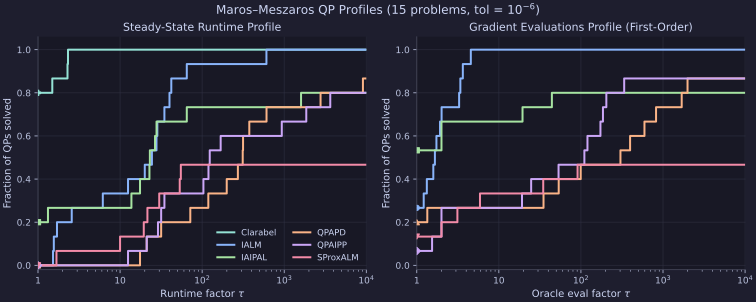
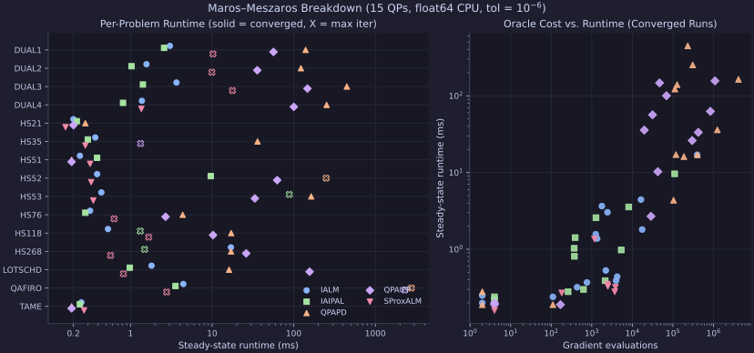
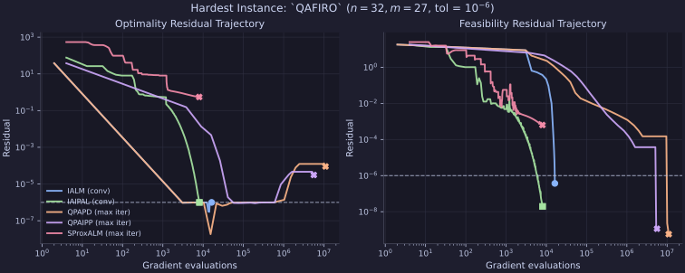

# Maros–Meszaros QP Benchmarks

Benchmarking `proxax` constrained solvers on 15 convex quadratic programs from
the Maros–Meszaros QPSIF suite (`DUAL1`–`DUAL4`, `HS21`, `HS35`, `HS51`–`HS53`,
`HS76`, `HS118`, `HS268`, `LOTSCHD`, `QAFIRO`, `TAME`).

## Setup

* **Precision & Device:** `float64` (`JAX_ENABLE_X64=1`), CPU.
* **Tolerances:** `opt_tol = 1e-6`, `feas_tol = 1e-6`.
* **Solvers:** `IALM`, `IAIPAL`, `QPAPD`, `QPAIPP`, `SProxALM`.
* **Timing:** Steady-state `solve_time` measured after JIT/AOT compilation warmup.

### Reproduction

```bash
JAX_ENABLE_X64=1 uv run python -m benchmarks.external.maros_meszaros --opt-tol 1e-6 --feas-tol 1e-6
```

## Results

### Summary

| Solver | Converged | Avg Runtime (ms) | Max Runtime (ms) |
| :--- | ---: | ---: | ---: |
| `IALM` | 15 / 15 | 2.38 | 17.00 |
| `IAIPAL` | 12 / 15 | 7.50 | 88.20 |
| `QPAPD` | 13 / 15 | 282.02 | 2762.97 |
| `QPAIPP` | 13 / 15 | 195.17 | 2294.20 |
| `SProxALM` | 7 / 15 | 3.16 | 17.74 |

## Plots

### Dolan–Moré Performance Profiles



`IALM` is the only solver to converge on all **15 / 15** problems, reaching 100% solved within a factor of $\approx 2.6\times$ of the fastest solver runtime. `IAIPAL` is the fastest solver on the largest share of problems ($\tau = 1$), especially on `DUAL1`–`DUAL4`, `LOTSCHD`, and `QAFIRO`, before plateauing at **12 / 15**.

### Per-Problem Breakdown & Oracle Scaling



### Hardest Instance Trajectory (`QAFIRO`)



On `QAFIRO` ($n=32, m=27$), `IAIPAL` and `IALM` both drive both residuals below $10^{-6}$ in $8.1 \times 10^3$ and $1.6 \times 10^4$ gradient evaluations, respectively, whereas `QPAPD` and `QPAIPP` satisfy feasibility early but stall near $\text{opt\_res} \approx 10^{-5}$ after millions of gradient evaluations.

### Full Results

| Problem | Solver | Status | Outer | Inner | Grad Evals | `opt_res` | `feas_res` | Runtime (ms) |
| :--- | :--- | :--- | ---: | ---: | ---: | ---: | ---: | ---: |
| `DUAL1 (n=85,m=1)` | `IALM` | `CONVERGED` | 3 | 1203 | 2436 | `9.65e-07` | `5.85e-07` | 3.04 |
| `DUAL1 (n=85,m=1)` | `IAIPAL` | `CONVERGED` | 30 | 1072 | 1269 | `8.61e-07` | `2.93e-09` | 2.58 |
| `DUAL1 (n=85,m=1)` | `QPAPD` | `CONVERGED` | 17 | 62969 | 126136 | `1.00e-06` | `5.65e-07` | 139.85 |
| `DUAL1 (n=85,m=1)` | `QPAIPP` | `CONVERGED` | 17 | 30809 | 31412 | `8.98e-07` | `5.65e-07` | 56.49 |
| `DUAL1 (n=85,m=1)` | `SProxALM` | `MAX_ITER_REACHED` | 4000 | 4000 | 8004 | `2.10e-02` | `2.26e-07` | 10.25 |
| `DUAL2 (n=96,m=1)` | `IALM` | `CONVERGED` | 3 | 612 | 1250 | `9.45e-07` | `6.59e-07` | 1.57 |
| `DUAL2 (n=96,m=1)` | `IAIPAL` | `CONVERGED` | 8 | 312 | 368 | `3.59e-07` | `1.89e-08` | 1.03 |
| `DUAL2 (n=96,m=1)` | `QPAPD` | `CONVERGED` | 17 | 55673 | 111526 | `1.00e-06` | `5.49e-07` | 122.48 |
| `DUAL2 (n=96,m=1)` | `QPAIPP` | `CONVERGED` | 17 | 19229 | 19644 | `9.00e-07` | `5.49e-07` | 35.74 |
| `DUAL2 (n=96,m=1)` | `SProxALM` | `MAX_ITER_REACHED` | 4000 | 4000 | 8004 | `1.28e-03` | `1.17e-08` | 9.94 |
| `DUAL3 (n=111,m=1)` | `IALM` | `CONVERGED` | 4 | 868 | 1772 | `9.02e-07` | `6.51e-07` | 3.66 |
| `DUAL3 (n=111,m=1)` | `IAIPAL` | `CONVERGED` | 7 | 330 | 389 | `6.01e-07` | `4.54e-07` | 1.42 |
| `DUAL3 (n=111,m=1)` | `QPAPD` | `CONVERGED` | 19 | 115449 | 231212 | `1.00e-06` | `5.56e-07` | 447.35 |
| `DUAL3 (n=111,m=1)` | `QPAIPP` | `CONVERGED` | 19 | 46121 | 46723 | `9.58e-07` | `5.56e-07` | 147.16 |
| `DUAL3 (n=111,m=1)` | `SProxALM` | `MAX_ITER_REACHED` | 4000 | 4000 | 8004 | `3.59e-05` | `3.28e-10` | 17.74 |
| `DUAL4 (n=75,m=1)` | `IALM` | `CONVERGED` | 7 | 656 | 1358 | `9.74e-07` | `1.29e-07` | 1.38 |
| `DUAL4 (n=75,m=1)` | `IAIPAL` | `CONVERGED` | 7 | 322 | 373 | `3.68e-08` | `1.36e-07` | 0.81 |
| `DUAL4 (n=75,m=1)` | `QPAPD` | `CONVERGED` | 21 | 153260 | 306914 | `1.00e-06` | `8.00e-07` | 252.80 |
| `DUAL4 (n=75,m=1)` | `QPAIPP` | `CONVERGED` | 21 | 68546 | 69213 | `9.35e-07` | `8.00e-07` | 100.23 |
| `DUAL4 (n=75,m=1)` | `SProxALM` | `CONVERGED` | 581 | 581 | 1166 | `9.92e-07` | `2.45e-13` | 1.36 |
| `HS21 (n=2,m=1)` | `IALM` | `CONVERGED` | 0 | 0 | 2 | `0.00e+00` | `0.00e+00` | 0.20 |
| `HS21 (n=2,m=1)` | `IAIPAL` | `CONVERGED` | 0 | 0 | 4 | `0.00e+00` | `0.00e+00` | 0.22 |
| `HS21 (n=2,m=1)` | `QPAPD` | `CONVERGED` | 0 | 0 | 2 | `0.00e+00` | `0.00e+00` | 0.28 |
| `HS21 (n=2,m=1)` | `QPAIPP` | `CONVERGED` | 0 | 0 | 4 | `0.00e+00` | `0.00e+00` | 0.20 |
| `HS21 (n=2,m=1)` | `SProxALM` | `CONVERGED` | 0 | 0 | 4 | `0.00e+00` | `0.00e+00` | 0.16 |
| `HS35 (n=3,m=1)` | `IALM` | `CONVERGED` | 5 | 359 | 758 | `9.99e-07` | `2.96e-07` | 0.37 |
| `HS35 (n=3,m=1)` | `IAIPAL` | `CONVERGED` | 117 | 338 | 624 | `9.50e-07` | `4.31e-09` | 0.30 |
| `HS35 (n=3,m=1)` | `QPAPD` | `CONVERGED` | 19 | 620547 | 1241892 | `1.00e-06` | `8.48e-07` | 36.03 |
| `HS35 (n=3,m=1)` | `QPAIPP` | `MAX_ITER_REACHED` | 35 | 18723 | 19133 | `0.00e+00` | `3.48e-03` | 1.33 |
| `HS35 (n=3,m=1)` | `SProxALM` | `CONVERGED` | 1836 | 1861 | 3676 | `9.63e-07` | `2.56e-10` | 0.28 |
| `HS51 (n=5,m=3)` | `IALM` | `CONVERGED` | 1 | 47 | 110 | `8.83e-07` | `2.02e-07` | 0.24 |
| `HS51 (n=5,m=3)` | `IAIPAL` | `CONVERGED` | 129 | 1693 | 2137 | `9.24e-07` | `1.61e-10` | 0.39 |
| `HS51 (n=5,m=3)` | `QPAPD` | `CONVERGED` | 1 | 47 | 110 | `8.83e-07` | `2.02e-07` | 0.19 |
| `HS51 (n=5,m=3)` | `QPAIPP` | `CONVERGED` | 1 | 122 | 169 | `3.33e-07` | `9.73e-08` | 0.19 |
| `HS51 (n=5,m=3)` | `SProxALM` | `CONVERGED` | 1908 | 1908 | 3820 | `9.92e-07` | `7.48e-09` | 0.32 |
| `HS52 (n=5,m=3)` | `IALM` | `CONVERGED` | 22 | 1925 | 3960 | `7.38e-07` | `3.73e-07` | 0.39 |
| `HS52 (n=5,m=3)` | `IAIPAL` | `CONVERGED` | 165 | 103892 | 110241 | `9.83e-07` | `1.42e-13` | 9.62 |
| `HS52 (n=5,m=3)` | `QPAPD` | `MAX_ITER_REACHED` | 35 | 3605244 | 7218590 | `1.25e-06` | `2.12e-06` | 249.74 |
| `HS52 (n=5,m=3)` | `QPAIPP` | `CONVERGED` | 25 | 834389 | 837981 | `9.97e-07` | `5.31e-07` | 62.73 |
| `HS52 (n=5,m=3)` | `SProxALM` | `CONVERGED` | 1243 | 1243 | 2490 | `9.90e-07` | `1.00e-09` | 0.33 |
| `HS53 (n=5,m=3)` | `IALM` | `CONVERGED` | 18 | 2066 | 4228 | `9.04e-07` | `7.08e-07` | 0.44 |
| `HS53 (n=5,m=3)` | `IAIPAL` | `MAX_ITER_REACHED` | 1000 | 973998 | 979950 | `2.80e-02` | `1.34e-15` | 88.20 |
| `HS53 (n=5,m=3)` | `QPAPD` | `CONVERGED` | 29 | 2055690 | 4116004 | `9.77e-07` | `2.49e-08` | 163.76 |
| `HS53 (n=5,m=3)` | `QPAIPP` | `CONVERGED` | 24 | 419061 | 421208 | `9.94e-07` | `7.96e-07` | 33.42 |
| `HS53 (n=5,m=3)` | `SProxALM` | `CONVERGED` | 1216 | 1216 | 2436 | `9.98e-07` | `5.85e-10` | 0.35 |
| `HS76 (n=4,m=3)` | `IALM` | `CONVERGED` | 5 | 198 | 434 | `9.18e-07` | `3.52e-07` | 0.32 |
| `HS76 (n=4,m=3)` | `IAIPAL` | `CONVERGED` | 45 | 148 | 261 | `9.82e-07` | `3.01e-08` | 0.28 |
| `HS76 (n=4,m=3)` | `QPAPD` | `CONVERGED` | 20 | 51743 | 103666 | `1.00e-06` | `8.67e-07` | 4.36 |
| `HS76 (n=4,m=3)` | `QPAIPP` | `CONVERGED` | 20 | 28308 | 28753 | `9.09e-07` | `8.67e-07` | 2.69 |
| `HS76 (n=4,m=3)` | `SProxALM` | `MAX_ITER_REACHED` | 4000 | 4000 | 8004 | `1.12e-04` | `2.18e-10` | 0.63 |
| `HS118 (n=15,m=17)` | `IALM` | `CONVERGED` | 5 | 1080 | 2212 | `9.88e-07` | `1.16e-07` | 0.53 |
| `HS118 (n=15,m=17)` | `IAIPAL` | `MAX_ITER_REACHED` | 1000 | 2556 | 4943 | `1.95e-02` | `3.94e-03` | 1.32 |
| `HS118 (n=15,m=17)` | `QPAPD` | `CONVERGED` | 24 | 59199 | 118610 | `7.69e-07` | `6.41e-07` | 17.14 |
| `HS118 (n=15,m=17)` | `QPAIPP` | `CONVERGED` | 24 | 40459 | 42349 | `4.06e-07` | `6.41e-07` | 10.27 |
| `HS118 (n=15,m=17)` | `SProxALM` | `MAX_ITER_REACHED` | 4000 | 4000 | 8004 | `7.87e-01` | `3.01e-06` | 1.67 |
| `HS268 (n=5,m=5)` | `IALM` | `CONVERGED` | 12 | 196271 | 395432 | `7.65e-13` | `0.00e+00` | 17.00 |
| `HS268 (n=5,m=5)` | `IAIPAL` | `MAX_ITER_REACHED` | 1000 | 11153 | 14740 | `6.56e+01` | `5.87e-05` | 1.49 |
| `HS268 (n=5,m=5)` | `QPAPD` | `CONVERGED` | 11 | 198866 | 400580 | `2.51e-12` | `0.00e+00` | 17.04 |
| `HS268 (n=5,m=5)` | `QPAIPP` | `CONVERGED` | 20 | 251057 | 298175 | `0.00e+00` | `9.19e-09` | 26.15 |
| `HS268 (n=5,m=5)` | `SProxALM` | `MAX_ITER_REACHED` | 4000 | 4000 | 8004 | `4.74e+01` | `0.00e+00` | 0.57 |
| `LOTSCHD (n=12,m=7)` | `IALM` | `CONVERGED` | 24 | 8652 | 17440 | `2.92e-07` | `4.53e-07` | 1.81 |
| `LOTSCHD (n=12,m=7)` | `IAIPAL` | `CONVERGED` | 25 | 4876 | 5316 | `8.46e-07` | `3.50e-09` | 0.98 |
| `LOTSCHD (n=12,m=7)` | `QPAPD` | `CONVERGED` | 27 | 92900 | 186124 | `2.59e-10` | `8.01e-07` | 16.14 |
| `LOTSCHD (n=12,m=7)` | `QPAIPP` | `CONVERGED` | 30 | 1079755 | 1084641 | `0.00e+00` | `1.00e-07` | 156.48 |
| `LOTSCHD (n=12,m=7)` | `SProxALM` | `MAX_ITER_REACHED` | 4000 | 4000 | 8004 | `5.45e-05` | `2.82e-04` | 0.82 |
| `QAFIRO (n=32,m=27)` | `IALM` | `CONVERGED` | 18 | 8078 | 16270 | `9.99e-07` | `3.71e-07` | 4.44 |
| `QAFIRO (n=32,m=27)` | `IAIPAL` | `CONVERGED` | 710 | 5931 | 8109 | `9.97e-07` | `1.94e-08` | 3.56 |
| `QAFIRO (n=32,m=27)` | `QPAPD` | `MAX_ITER_REACHED` | 35 | 5472069 | 10955866 | `7.53e-05` | `5.73e-10` | 2762.97 |
| `QAFIRO (n=32,m=27)` | `QPAIPP` | `MAX_ITER_REACHED` | 35 | 5538871 | 5587404 | `9.19e-06` | `1.15e-09` | 2294.20 |
| `QAFIRO (n=32,m=27)` | `SProxALM` | `MAX_ITER_REACHED` | 4000 | 4000 | 8004 | `5.51e-01` | `6.35e-04` | 2.77 |
| `TAME (n=2,m=1)` | `IALM` | `CONVERGED` | 0 | 0 | 2 | `0.00e+00` | `0.00e+00` | 0.25 |
| `TAME (n=2,m=1)` | `IAIPAL` | `CONVERGED` | 0 | 0 | 4 | `0.00e+00` | `0.00e+00` | 0.24 |
| `TAME (n=2,m=1)` | `QPAPD` | `CONVERGED` | 0 | 0 | 2 | `0.00e+00` | `0.00e+00` | 0.19 |
| `TAME (n=2,m=1)` | `QPAIPP` | `CONVERGED` | 0 | 0 | 4 | `0.00e+00` | `0.00e+00` | 0.19 |
| `TAME (n=2,m=1)` | `SProxALM` | `CONVERGED` | 89 | 89 | 182 | `3.55e-08` | `3.52e-07` | 0.27 |
