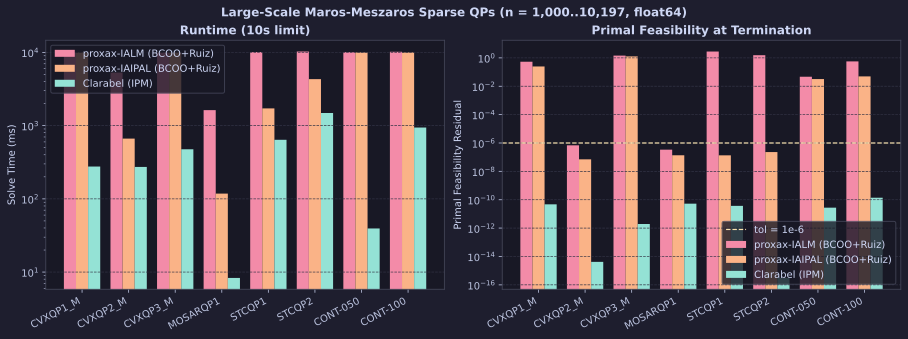

# Maros–Meszaros Large-Scale Sparse QP Benchmarks (`proxax` vs. `Clarabel`)

CPU (`float64`) evaluation of `proxax-IALM` (`BCOO` sparse operators + Modified Ruiz Equilibration, `tol = 1e-6`, `10 s` limit) against `Clarabel` on 8 large-scale Maros–Meszaros sparse QPs ($n \in [1{,}000,\; 10{,}197]$).

## Setup

* **Precision & Device:** `float64` (`JAX_ENABLE_X64=1`), CPU.
* **Tolerances & Limits:** `opt_tol = feas_tol = 1e-6`, `time_limit = 10.0 s`, `precondition = True` (`px.ruiz_equilibrate`).
* **Reproduction:**

```bash
JAX_PLATFORMS=cpu JAX_ENABLE_X64=1 .venv/bin/python -m benchmarks.external.maros_meszaros_large --clarabel --time-limit 10.0
```

## Results

### Runtime & Feasibility Comparison



### Summary Table (`tol = 1e-6`)

| Problem | Solver | Status | Objective | Opt Res | Feas Res | Compile (s) | Run (ms) |
| :--- | :--- | :--- | ---: | ---: | ---: | ---: | ---: |
| `CVXQP1_M (n=1000,m=500)` | `IALM` | `TIME_LIMIT_REACHED` | 1076418.7528 | 3.85e-08 | 5.33e-01 | 10.99 | 10,399.19 |
| `CVXQP2_M (n=1000,m=250)` | `IALM` | `CONVERGED` | 820155.4306 | 1.02e-08 | 6.80e-07 | 5.32 | 4,693.82 |
| `CVXQP3_M (n=1000,m=750)` | `IALM` | `TIME_LIMIT_REACHED` | 1137570.3058 | 2.03e-03 | 1.28e+00 | 10.69 | 10,030.64 |
| `MOSARQP1 (n=2500,m=700)` | `IALM` | `CONVERGED` | -337.5896 | 1.34e-07 | 3.38e-07 | 2.13 | 1,508.62 |
| `STCQP1 (n=4097,m=2052)` | `IALM` | `TIME_LIMIT_REACHED` | 154238.5169 | 8.24e-08 | 2.78e+00 | 10.99 | 10,501.27 |
| `STCQP2 (n=4097,m=2052)` | `IALM` | `TIME_LIMIT_REACHED` | 21988.7245 | 8.23e-08 | 2.97e+00 | 14.06 | 10,071.31 |
| `CONT-050 (n=2597,m=2401)` | `IALM` | `TIME_LIMIT_REACHED` | -8760.5351 | 9.99e-07 | 4.66e-02 | 11.63 | 10,085.43 |
| `CONT-100 (n=10197,m=9801)` | `IALM` | `TIME_LIMIT_REACHED` | -35956.4457 | 9.90e-07 | 5.62e-01 | 10.96 | 10,265.67 |
| `CVXQP1_M (n=1000,m=500)` | `Clarabel` | `CONVERGED` | 1087511.6255 | 3.89e-16 | 4.71e-11 | 0.00 | **308.97** |
| `CVXQP2_M (n=1000,m=250)` | `Clarabel` | `CONVERGED` | 820155.4413 | 4.79e-16 | 4.16e-15 | 0.00 | **306.67** |
| `CVXQP3_M (n=1000,m=750)` | `Clarabel` | `CONVERGED` | 1362828.7480 | 4.19e-16 | 1.94e-12 | 0.00 | **526.19** |
| `MOSARQP1 (n=2500,m=700)` | `Clarabel` | `CONVERGED` | -952.8753 | 8.88e-11 | 5.26e-11 | 0.00 | **8.47** |
| `STCQP1 (n=4097,m=2052)` | `Clarabel` | `CONVERGED` | 155143.5652 | 3.30e-15 | 3.69e-11 | 0.00 | **712.18** |
| `STCQP2 (n=4097,m=2052)` | `Clarabel` | `CONVERGED` | 22327.3147 | 1.73e-15 | 3.07e-16 | 0.00 | **1,724.36** |
| `CONT-050 (n=2597,m=2401)` | `Clarabel` | `CONVERGED` | -4.5639 | 1.88e-18 | 2.74e-11 | 0.00 | **41.52** |
| `CONT-100 (n=10197,m=9801)` | `Clarabel` | `CONVERGED` | -4.6444 | 2.16e-18 | 1.39e-10 | 0.00 | **988.35** |

## Key Observations

1. **Sparse direct IPM (`Clarabel`) dominates large ill-conditioned QPs:** `Clarabel` solves **8/8** instances in **8.47–1,724.36 ms**, whereas first-order `IALM` (`BCOO` + Ruiz equilibration) converges on **2/8** (`CVXQP2_M` in `4,693.82 ms`, `MOSARQP1` in `1,508.62 ms`) within `10 s`.
2. **Primal feasibility is the bottleneck on the remaining 6:** `IALM` reaches `opt_res <= 1e-6` on 5 of the 6 timed-out problems (`3.85e-8`–`9.99e-7`), while primal feasibility stalls at `4.66e-2`–`2.97e+0` within `10 s` due to ill-conditioned equality coupling.
