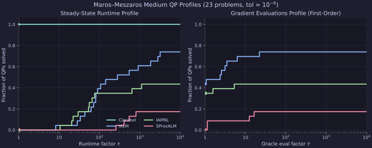
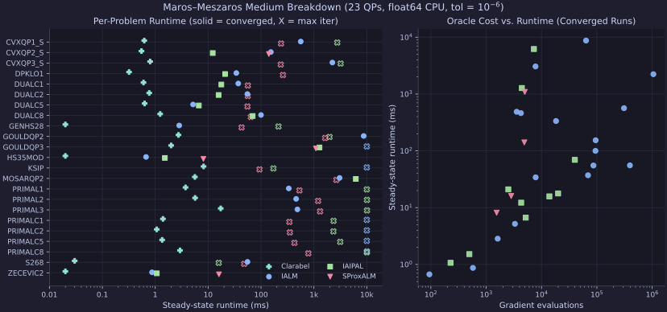

# Maros–Meszaros Medium-Scale QP Benchmarks

Benchmarking `proxax` constrained solvers (`IALM`, `IAIPAL`, `SProxALM`) against
`Clarabel` (`0.11.1`, Rust IPM baseline) on 23 medium-scale convex quadratic
programs from the Maros–Meszaros QPSIF suite (`n = 2..900`, `m = 1..1001`).

## Setup

* **Precision & Device:** `float64` (`JAX_ENABLE_X64=1`), CPU.
* **Tolerances:** `opt_tol = 1e-6`, `feas_tol = 1e-6`.
* **Time Limit:** `time_limit = 10.0` seconds per solve (`jit=True` wall-clock cap via `io_callback`).
* **Solvers:** `IALM`, `IAIPAL`, `SProxALM`, plus `Clarabel` (`0.11.1`) as a baseline reference.

### Reproduction

```bash
JAX_ENABLE_X64=1 uv run python -m benchmarks.external.maros_meszaros_medium --opt-tol 1e-6 --feas-tol 1e-6 --time-limit 10.0 --clarabel
```

## Results

### Summary

| Solver | Converged | Avg Runtime (ms) | Max Runtime (ms) |
| :--- | ---: | ---: | ---: |
| `Clarabel` (baseline) | 23 / 23 | 2.51 | 17.30 |
| `IALM` | 17 / 23 | 3323.38 | 10061.84 |
| `IAIPAL` | 10 / 23 | 2782.37 | 10091.54 |
| `SProxALM` | 4 / 23 | 506.09 | 2655.18 |

### Modified Ruiz Preconditioning (`IALM` + `IAIPAL`, Original-Space Tolerances)

Running with `--precondition` (Modified Ruiz Equilibration, scaling tolerances by `min(1, c * min(d_x))` and `min(1, min(d_y))` to certify `1e-6` in original coordinates):

| Solver | Converged | Avg Runtime (ms) | Max Runtime (ms) |
| :--- | ---: | ---: | ---: |
| `IALM` (Ruiz + orig-tol) | 18 / 23 | 2562.24 | 10036.62 |
| `IAIPAL` (Ruiz + orig-tol) | 5 / 23 | 2323.04 | 10044.88 |

* **`IALM` highlights:** Solves `PRIMALC1` (`1,594.60 ms` vs. `>10 s` timeout / `157 s` without limit), `PRIMALC2` (`328.33 ms` vs. `>10 s`), and `PRIMALC5` (`385.62 ms` vs. `>10 s`), and speeds up `DUALC2` (`14.69 ms` vs. `55.22 ms`), `DUALC8` (`7.31 ms` vs. `99.93 ms`), and `MOSARQP2` (`1,953.82 ms` vs. `3,058.77 ms`).
* **`IAIPAL` note:** Solves `DPKLO1`, `GENHS28`, `GOULDQP3`, `HS35MOD`, `ZECEVIC2` with Ruiz scaling, whereas unpreconditioned `IAIPAL` solves more problems (`10 / 23`) overall.

## Plots

### Dolan–Moré Performance Profiles



### Per-Problem Breakdown & Oracle Scaling



### Full Results

| Problem | Solver | Status | Outer | Inner | Grad Evals | `opt_res` | `feas_res` | Runtime (ms) |
| :--- | :--- | :--- | ---: | ---: | ---: | ---: | ---: | ---: |
| `CVXQP1_S (n=100,m=50)` | `Clarabel` | `CONVERGED` | 8 | 0 | 0 | `4.44e-16` | `6.19e-15` | 0.62 |
| `CVXQP1_S (n=100,m=50)` | `IALM` | `CONVERGED` | 28 | 154393 | 309230 | `9.97e-07` | `5.04e-07` | 563.45 |
| `CVXQP1_S (n=100,m=50)` | `IAIPAL` | `MAX_ITER_REACHED` | 1000 | 979143 | 982537 | `2.26e-06` | `1.62e-14` | 2764.33 |
| `CVXQP1_S (n=100,m=50)` | `SProxALM` | `MAX_ITER_REACHED` | 4000 | 4000 | 8004 | `3.28e-01` | `3.24e-02` | 239.15 |
| `CVXQP2_S (n=100,m=25)` | `Clarabel` | `CONVERGED` | 8 | 0 | 0 | `5.03e-16` | `5.57e-14` | 0.55 |
| `CVXQP2_S (n=100,m=25)` | `IALM` | `CONVERGED` | 24 | 47457 | 95116 | `8.99e-07` | `9.35e-07` | 153.59 |
| `CVXQP2_S (n=100,m=25)` | `IAIPAL` | `CONVERGED` | 25 | 3947 | 4290 | `3.54e-07` | `9.54e-09` | 12.23 |
| `CVXQP2_S (n=100,m=25)` | `SProxALM` | `CONVERGED` | 2442 | 2442 | 4888 | `9.95e-07` | `1.30e-09` | 140.69 |
| `CVXQP3_S (n=100,m=75)` | `Clarabel` | `CONVERGED` | 9 | 0 | 0 | `4.98e-16` | `2.50e-11` | 0.80 |
| `CVXQP3_S (n=100,m=75)` | `IALM` | `CONVERGED` | 28 | 524370 | 1049942 | `9.99e-07` | `6.50e-07` | 2236.50 |
| `CVXQP3_S (n=100,m=75)` | `IAIPAL` | `MAX_ITER_REACHED` | 1000 | 980068 | 984841 | `1.48e-02` | `1.31e-13` | 3200.36 |
| `CVXQP3_S (n=100,m=75)` | `SProxALM` | `MAX_ITER_REACHED` | 4000 | 4000 | 8004 | `2.35e-01` | `2.52e-02` | 236.20 |
| `DPKLO1 (n=133,m=77)` | `Clarabel` | `CONVERGED` | 0 | 0 | 0 | `6.00e-16` | `9.94e-16` | 0.32 |
| `DPKLO1 (n=133,m=77)` | `IALM` | `CONVERGED` | 14 | 3877 | 7834 | `9.47e-07` | `6.59e-07` | 34.14 |
| `DPKLO1 (n=133,m=77)` | `IAIPAL` | `CONVERGED` | 63 | 2115 | 2510 | `9.45e-07` | `1.44e-07` | 20.97 |
| `DPKLO1 (n=133,m=77)` | `SProxALM` | `MAX_ITER_REACHED` | 4000 | 4000 | 8004 | `1.23e+01` | `2.48e-01` | 259.79 |
| `DUALC1 (n=9,m=215)` | `Clarabel` | `CONVERGED` | 10 | 0 | 0 | `1.10e-09` | `6.30e-14` | 0.60 |
| `DUALC1 (n=9,m=215)` | `IALM` | `CONVERGED` | 25 | 34511 | 69174 | `2.90e-07` | `3.91e-07` | 37.15 |
| `DUALC1 (n=9,m=215)` | `IAIPAL` | `CONVERGED` | 35 | 19100 | 19927 | `7.37e-07` | `5.31e-08` | 17.77 |
| `DUALC1 (n=9,m=215)` | `SProxALM` | `MAX_ITER_REACHED` | 4000 | 4002 | 8004 | `1.32e-01` | `9.95e-01` | 56.37 |
| `DUALC2 (n=7,m=229)` | `Clarabel` | `CONVERGED` | 10 | 0 | 0 | `3.06e-10` | `6.66e-15` | 0.77 |
| `DUALC2 (n=7,m=229)` | `IALM` | `CONVERGED` | 21 | 43262 | 86678 | `5.12e-07` | `6.76e-07` | 55.22 |
| `DUALC2 (n=7,m=229)` | `IAIPAL` | `CONVERGED` | 31 | 13194 | 13862 | `2.87e-07` | `7.84e-09` | 15.79 |
| `DUALC2 (n=7,m=229)` | `SProxALM` | `MAX_ITER_REACHED` | 4000 | 4001 | 8004 | `8.10e-01` | `2.89e-03` | 56.18 |
| `DUALC5 (n=8,m=278)` | `Clarabel` | `CONVERGED` | 9 | 0 | 0 | `5.36e-09` | `9.05e-14` | 0.63 |
| `DUALC5 (n=8,m=278)` | `IALM` | `CONVERGED` | 14 | 1631 | 3308 | `4.25e-07` | `6.73e-07` | 5.19 |
| `DUALC5 (n=8,m=278)` | `IAIPAL` | `CONVERGED` | 22 | 4986 | 5177 | `2.89e-07` | `1.56e-08` | 6.67 |
| `DUALC5 (n=8,m=278)` | `SProxALM` | `MAX_ITER_REACHED` | 4000 | 4001 | 8004 | `3.71e-02` | `5.67e-03` | 55.48 |
| `DUALC8 (n=8,m=503)` | `Clarabel` | `CONVERGED` | 9 | 0 | 0 | `2.16e-08` | `7.91e-13` | 1.24 |
| `DUALC8 (n=8,m=503)` | `IALM` | `CONVERGED` | 33 | 47065 | 94306 | `4.80e-07` | `6.76e-07` | 99.93 |
| `DUALC8 (n=8,m=503)` | `IAIPAL` | `CONVERGED` | 39 | 38988 | 39955 | `6.90e-07` | `7.09e-08` | 69.44 |
| `DUALC8 (n=8,m=503)` | `SProxALM` | `MAX_ITER_REACHED` | 4000 | 4000 | 8004 | `6.12e+00` | `1.00e+00` | 64.12 |
| `GENHS28 (n=10,m=8)` | `Clarabel` | `CONVERGED` | 0 | 0 | 0 | `4.96e-16` | `0.00e+00` | 0.02 |
| `GENHS28 (n=10,m=8)` | `IALM` | `CONVERGED` | 12 | 774 | 1614 | `9.99e-07` | `8.83e-07` | 2.84 |
| `GENHS28 (n=10,m=8)` | `IAIPAL` | `MAX_ITER_REACHED` | 1000 | 977239 | 980273 | `1.91e-04` | `4.97e-16` | 213.83 |
| `GENHS28 (n=10,m=8)` | `SProxALM` | `MAX_ITER_REACHED` | 4000 | 4000 | 8004 | `1.26e-02` | `1.60e-06` | 42.87 |
| `GOULDQP2 (n=699,m=349)` | `Clarabel` | `CONVERGED` | 10 | 0 | 0 | `1.66e-16` | `9.27e-10` | 2.75 |
| `GOULDQP2 (n=699,m=349)` | `IALM` | `CONVERGED` | 5 | 31784 | 63688 | `1.00e-06` | `5.09e-07` | 8740.62 |
| `GOULDQP2 (n=699,m=349)` | `IAIPAL` | `MAX_ITER_REACHED` | 1000 | 2704 | 5088 | `1.01e-04` | `8.06e-07` | 1979.16 |
| `GOULDQP2 (n=699,m=349)` | `SProxALM` | `MAX_ITER_REACHED` | 4000 | 4000 | 8004 | `1.86e-04` | `3.29e-08` | 1629.32 |
| `GOULDQP3 (n=699,m=349)` | `Clarabel` | `CONVERGED` | 6 | 0 | 0 | `1.14e-15` | `1.47e-07` | 2.00 |
| `GOULDQP3 (n=699,m=349)` | `IALM` | `TIME_LIMIT_REACHED` | 1 | 37138 | 74418 | `3.69e-06` | `4.50e-01` | 10009.95 |
| `GOULDQP3 (n=699,m=349)` | `IAIPAL` | `CONVERGED` | 31 | 3807 | 4408 | `0.00e+00` | `1.06e-08` | 1275.81 |
| `GOULDQP3 (n=699,m=349)` | `SProxALM` | `CONVERGED` | 2489 | 2535 | 4982 | `1.03e-13` | `6.24e-07` | 1088.48 |
| `HS35MOD (n=3,m=1)` | `Clarabel` | `CONVERGED` | 9 | 0 | 0 | `2.58e-16` | `8.13e-17` | 0.02 |
| `HS35MOD (n=3,m=1)` | `IALM` | `CONVERGED` | 1 | 38 | 94 | `8.88e-07` | `3.36e-07` | 0.67 |
| `HS35MOD (n=3,m=1)` | `IAIPAL` | `CONVERGED` | 96 | 263 | 496 | `9.08e-07` | `9.64e-09` | 1.52 |
| `HS35MOD (n=3,m=1)` | `SProxALM` | `CONVERGED` | 770 | 771 | 1544 | `9.83e-07` | `3.44e-09` | 8.14 |
| `KSIP (n=20,m=1001)` | `Clarabel` | `CONVERGED` | 13 | 0 | 0 | `1.39e-07` | `2.67e-09` | 8.21 |
| `KSIP (n=20,m=1001)` | `IALM` | `TIME_LIMIT_REACHED` | 22 | 1627024 | 3257784 | `1.85e-06` | `7.00e-07` | 10003.56 |
| `KSIP (n=20,m=1001)` | `IAIPAL` | `MAX_ITER_REACHED` | 1000 | 13917 | 17254 | `6.19e-07` | `1.10e-04` | 171.62 |
| `KSIP (n=20,m=1001)` | `SProxALM` | `MAX_ITER_REACHED` | 4000 | 4000 | 8004 | `1.61e+00` | `0.00e+00` | 93.71 |
| `MOSARQP2 (n=900,m=600)` | `Clarabel` | `CONVERGED` | 8 | 0 | 0 | `6.50e-13` | `2.41e-13` | 5.62 |
| `MOSARQP2 (n=900,m=600)` | `IALM` | `CONVERGED` | 16 | 3845 | 7782 | `9.68e-07` | `9.25e-07` | 3058.77 |
| `MOSARQP2 (n=900,m=600)` | `IAIPAL` | `CONVERGED` | 574 | 5705 | 7281 | `9.92e-07` | `1.02e-11` | 6200.58 |
| `MOSARQP2 (n=900,m=600)` | `SProxALM` | `MAX_ITER_REACHED` | 4000 | 4002 | 8004 | `1.10e-04` | `7.52e-10` | 2655.18 |
| `PRIMAL1 (n=325,m=85)` | `Clarabel` | `CONVERGED` | 8 | 0 | 0 | `2.62e-07` | `2.25e-08` | 3.74 |
| `PRIMAL1 (n=325,m=85)` | `IALM` | `CONVERGED` | 10 | 9097 | 18272 | `9.77e-07` | `7.49e-07` | 334.91 |
| `PRIMAL1 (n=325,m=85)` | `IAIPAL` | `TIME_LIMIT_REACHED` | 323 | 308724 | 309944 | `3.69e-05` | `5.76e-16` | 10002.89 |
| `PRIMAL1 (n=325,m=85)` | `SProxALM` | `MAX_ITER_REACHED` | 4000 | 4006 | 8004 | `2.51e-02` | `1.65e-06` | 532.74 |
| `PRIMAL2 (n=649,m=96)` | `Clarabel` | `CONVERGED` | 7 | 0 | 0 | `6.77e-07` | `6.12e-08` | 5.67 |
| `PRIMAL2 (n=649,m=96)` | `IALM` | `CONVERGED` | 6 | 2094 | 4240 | `8.24e-07` | `3.22e-07` | 461.39 |
| `PRIMAL2 (n=649,m=96)` | `IAIPAL` | `TIME_LIMIT_REACHED` | 83 | 68921 | 69669 | `3.01e-05` | `4.73e-16` | 10070.98 |
| `PRIMAL2 (n=649,m=96)` | `SProxALM` | `MAX_ITER_REACHED` | 4000 | 4006 | 8004 | `2.63e-02` | `2.14e-08` | 1201.80 |
| `PRIMAL3 (n=745,m=111)` | `Clarabel` | `CONVERGED` | 8 | 0 | 0 | `1.52e-08` | `1.30e-09` | 17.30 |
| `PRIMAL3 (n=745,m=111)` | `IALM` | `CONVERGED` | 5 | 1752 | 3554 | `8.14e-07` | `1.76e-07` | 487.20 |
| `PRIMAL3 (n=745,m=111)` | `IAIPAL` | `TIME_LIMIT_REACHED` | 66 | 52717 | 53778 | `1.03e-04` | `3.49e-15` | 10091.54 |
| `PRIMAL3 (n=745,m=111)` | `SProxALM` | `MAX_ITER_REACHED` | 4000 | 4008 | 8004 | `8.59e-02` | `4.14e-06` | 1306.73 |
| `PRIMALC1 (n=230,m=9)` | `Clarabel` | `CONVERGED` | 16 | 0 | 0 | `1.58e-14` | `3.14e-16` | 1.40 |
| `PRIMALC1 (n=230,m=9)` | `IALM` | `TIME_LIMIT_REACHED` | 3 | 660218 | 1321936 | `9.43e-01` | `5.05e-03` | 10004.06 |
| `PRIMALC1 (n=230,m=9)` | `IAIPAL` | `MAX_ITER_REACHED` | 1000 | 167518 | 194941 | `9.78e-01` | `2.79e-03` | 2352.27 |
| `PRIMALC1 (n=230,m=9)` | `SProxALM` | `MAX_ITER_REACHED` | 4000 | 4014 | 8004 | `1.00e+00` | `0.00e+00` | 344.10 |
| `PRIMALC2 (n=231,m=7)` | `Clarabel` | `CONVERGED` | 14 | 0 | 0 | `2.86e-09` | `4.74e-12` | 1.07 |
| `PRIMALC2 (n=231,m=7)` | `IALM` | `TIME_LIMIT_REACHED` | 3 | 603341 | 1208042 | `8.83e-01` | `7.93e-03` | 10016.81 |
| `PRIMALC2 (n=231,m=7)` | `IAIPAL` | `MAX_ITER_REACHED` | 1000 | 153071 | 178299 | `9.75e-01` | `1.11e-03` | 2338.26 |
| `PRIMALC2 (n=231,m=7)` | `SProxALM` | `MAX_ITER_REACHED` | 4000 | 4013 | 8004 | `1.00e+00` | `1.09e-10` | 350.97 |
| `PRIMALC5 (n=287,m=8)` | `Clarabel` | `CONVERGED` | 13 | 0 | 0 | `3.75e-15` | `2.55e-15` | 1.35 |
| `PRIMALC5 (n=287,m=8)` | `IALM` | `TIME_LIMIT_REACHED` | 2 | 427712 | 856382 | `5.52e-05` | `1.17e-01` | 10013.71 |
| `PRIMALC5 (n=287,m=8)` | `IAIPAL` | `MAX_ITER_REACHED` | 1000 | 143116 | 166832 | `9.65e-01` | `3.78e-04` | 3145.55 |
| `PRIMALC5 (n=287,m=8)` | `SProxALM` | `MAX_ITER_REACHED` | 4000 | 4013 | 8004 | `1.00e+00` | `1.42e-10` | 428.48 |
| `PRIMALC8 (n=520,m=8)` | `Clarabel` | `CONVERGED` | 11 | 0 | 0 | `1.03e-08` | `8.11e-11` | 2.94 |
| `PRIMALC8 (n=520,m=8)` | `IALM` | `TIME_LIMIT_REACHED` | 1 | 140423 | 281120 | `1.00e+00` | `2.06e-04` | 10061.84 |
| `PRIMALC8 (n=520,m=8)` | `IAIPAL` | `TIME_LIMIT_REACHED` | 342 | 142543 | 164789 | `9.99e-01` | `2.34e-06` | 10026.05 |
| `PRIMALC8 (n=520,m=8)` | `SProxALM` | `MAX_ITER_REACHED` | 4000 | 4018 | 8004 | `1.00e+00` | `0.00e+00` | 785.37 |
| `S268 (n=5,m=5)` | `Clarabel` | `CONVERGED` | 9 | 0 | 0 | `1.26e-11` | `4.88e-16` | 0.03 |
| `S268 (n=5,m=5)` | `IALM` | `CONVERGED` | 12 | 196271 | 395432 | `7.65e-13` | `0.00e+00` | 55.49 |
| `S268 (n=5,m=5)` | `IAIPAL` | `MAX_ITER_REACHED` | 1000 | 11153 | 14740 | `6.56e+01` | `5.87e-05` | 15.88 |
| `S268 (n=5,m=5)` | `SProxALM` | `MAX_ITER_REACHED` | 4000 | 4000 | 8004 | `4.74e+01` | `0.00e+00` | 48.10 |
| `ZECEVIC2 (n=2,m=2)` | `Clarabel` | `CONVERGED` | 7 | 0 | 0 | `8.47e-11` | `3.66e-12` | 0.02 |
| `ZECEVIC2 (n=2,m=2)` | `IALM` | `CONVERGED` | 3 | 272 | 576 | `6.87e-07` | `1.01e-08` | 0.87 |
| `ZECEVIC2 (n=2,m=2)` | `IAIPAL` | `CONVERGED` | 47 | 113 | 227 | `9.32e-07` | `4.65e-08` | 1.07 |
| `ZECEVIC2 (n=2,m=2)` | `SProxALM` | `CONVERGED` | 1412 | 1415 | 2828 | `9.94e-07` | `2.96e-09` | 16.03 |
