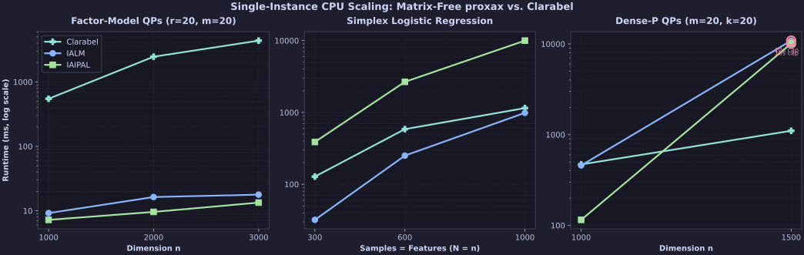
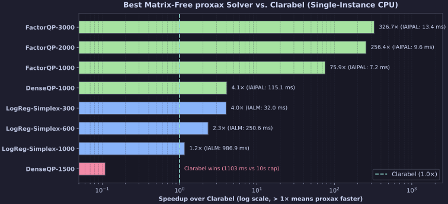

# Matrix-Free CPU Benchmarks (`proxax` vs. `Clarabel`)

Single-instance **CPU-only** benchmarks (`float64`, no `jax.vmap`, no GPU) comparing `proxax` (`IALM` and `IAIPAL`) against `Clarabel` (`0.11.1`, Rust sparse IPM) on problem classes where matrix-free first-order methods avoid $O(n^3)$ KKT factorizations or exponential-cone lifting.

## Problem Classes

1. **Factor-Model QPs (`FactorQP`)** — $\min_{x \ge 0,\, Ax \le b} \tfrac{1}{2}(\|F^\top x\|_2^2 + \|x\|_2^2) + q^\top x$ with $F \in \mathbb{R}^{n \times r}$ ($r=20, m=20$). `proxax` evaluates $F(F^\top x) + x$ in $O(nr)$ matrix-free, while `Clarabel` must form and factorize the dense $n \times n$ Hessian $P = F F^\top + I$.
2. **Simplex-Constrained Logistic Regression (`LogReg-Simplex`)** — $\min_{\mathbf{1}^\top x = 1,\, x \ge 0} \tfrac{1}{N}\sum_{i=1}^N \log(1 + \exp(-y_i a_i^\top x)) + \tfrac{\lambda}{2}\|x\|_2^2$ ($\lambda = 10^{-2}$). `proxax` differentiates `softplus` directly, while `Clarabel` introduces $3N$ auxiliary variables and $2N$ exponential cones.
3. **Dense-$P$ QPs (`DenseQP`)** — $\min_{x \ge 0,\, Ax \le b} \tfrac{1}{2} x^\top P x + q^\top x$ with dense $P \succ 0$ ($\kappa(P)=20, m=20$).

## Setup

* **Precision & Device:** `float64` (`JAX_ENABLE_X64=1`), CPU.
* **Tolerances:** `opt_tol = 1e-6`, `feas_tol = 1e-6`, `time_limit = 10.0 s`.
* **Reproduction:**

```bash
JAX_PLATFORMS=cpu JAX_ENABLE_X64=1 uv run python -m benchmarks.external.matrix_free_vs_clarabel --time-limit 10.0
```

## Results

### Runtime Scaling Across Problem Families



### Speedup vs. Clarabel



### Full Results

| Problem | Solver | Status | Outer Iters | `opt_res` | `feas_res` | Runtime (ms) | Speedup vs. Clarabel |
| :--- | :--- | :--- | ---: | ---: | ---: | ---: | ---: |
| `FactorQP-1000 (n=1000,r=20,m=20)` | `IAIPAL` | `CONVERGED` | 43 | `9.60e-07` | `3.13e-07` | **7.23** | **75.9×** |
| `FactorQP-1000 (n=1000,r=20,m=20)` | `IALM` | `CONVERGED` | 15 | `2.48e-07` | `4.39e-07` | 9.21 | 59.6× |
| `FactorQP-1000 (n=1000,r=20,m=20)` | `Clarabel` | `CONVERGED` | 12 | `2.40e-12` | `1.88e-13` | 548.65 | 1.0× |
| `FactorQP-2000 (n=2000,r=20,m=20)` | `IAIPAL` | `CONVERGED` | 43 | `8.87e-07` | `4.86e-07` | **9.61** | **256.4×** |
| `FactorQP-2000 (n=2000,r=20,m=20)` | `IALM` | `CONVERGED` | 20 | `1.01e-07` | `5.00e-07` | 16.35 | 150.7× |
| `FactorQP-2000 (n=2000,r=20,m=20)` | `Clarabel` | `CONVERGED` | 15 | `3.99e-12` | `2.75e-13` | 2464.37 | 1.0× |
| `FactorQP-3000 (n=3000,r=20,m=20)` | `IAIPAL` | `CONVERGED` | 46 | `7.25e-07` | `2.58e-07` | **13.40** | **326.7×** |
| `FactorQP-3000 (n=3000,r=20,m=20)` | `IALM` | `CONVERGED` | 16 | `5.02e-07` | `4.81e-07` | 17.81 | 245.8× |
| `FactorQP-3000 (n=3000,r=20,m=20)` | `Clarabel` | `CONVERGED` | 12 | `1.26e-11` | `8.52e-13` | 4378.19 | 1.0× |
| `LogReg-Simplex-300 (N=300,n=300)` | `IALM` | `CONVERGED` | 3 | `9.61e-07` | `6.75e-09` | **31.97** | **4.0×** |
| `LogReg-Simplex-300 (N=300,n=300)` | `IAIPAL` | `CONVERGED` | 1533 | `9.99e-07` | `5.34e-12` | 388.10 | 0.3× |
| `LogReg-Simplex-300 (N=300,n=300)` | `Clarabel` | `CONVERGED` | 10 | `9.43e-11` | `1.02e-08` | 127.98 | 1.0× |
| `LogReg-Simplex-600 (N=600,n=600)` | `IALM` | `CONVERGED` | 2 | `9.91e-07` | `3.76e-07` | **250.64** | **2.3×** |
| `LogReg-Simplex-600 (N=600,n=600)` | `IAIPAL` | `CONVERGED` | 1753 | `9.98e-07` | `1.41e-12` | 2666.76 | 0.2× |
| `LogReg-Simplex-600 (N=600,n=600)` | `Clarabel` | `CONVERGED` | 12 | `3.63e-10` | `6.33e-08` | 585.63 | 1.0× |
| `LogReg-Simplex-1000 (N=1000,n=1000)` | `IALM` | `CONVERGED` | 2 | `9.98e-07` | `1.40e-07` | **986.93** | **1.2×** |
| `LogReg-Simplex-1000 (N=1000,n=1000)` | `IAIPAL` | `CONVERGED` | 1786 | `9.97e-07` | `8.66e-14` | 9988.55 | 0.1× |
| `LogReg-Simplex-1000 (N=1000,n=1000)` | `Clarabel` | `CONVERGED` | 11 | `1.98e-10` | `4.62e-08` | 1149.28 | 1.0× |
| `DenseQP-1000 (n=1000,m=20,k=20)` | `IAIPAL` | `CONVERGED` | 82 | `9.81e-07` | `4.85e-09` | **115.07** | **4.1×** |
| `DenseQP-1000 (n=1000,m=20,k=20)` | `IALM` | `CONVERGED` | 16 | `8.57e-07` | `7.30e-07` | 458.15 | 1.0× |
| `DenseQP-1000 (n=1000,m=20,k=20)` | `Clarabel` | `CONVERGED` | 11 | `1.55e-15` | `1.20e-15` | 470.00 | 1.0× |
| `DenseQP-1500 (n=1500,m=20,k=20)` | `IALM` | `TIME_LIMIT_REACHED` | 8 | `3.81e-07` | `6.12e-02` | 10871.00 | — |
| `DenseQP-1500 (n=1500,m=20,k=20)` | `IAIPAL` | `TIME_LIMIT_REACHED` | 82 | `8.31e-03` | `9.70e-09` | 10106.08 | — |
| `DenseQP-1500 (n=1500,m=20,k=20)` | `Clarabel` | `CONVERGED` | 13 | `3.02e-13` | `1.08e-13` | **1103.15** | 1.0× |

## Key Takeaways

- **Structured operators (`FactorQP`):** `IAIPAL` solves `n=3000` in **13.40 ms** vs. `Clarabel`'s **4,378.19 ms** (**326.7× faster**) because matrix-free $O(nr)$ matvecs avoid $O(n^3)$ KKT factorizations.
- **Non-quadratic objectives (`LogReg-Simplex`):** `IALM` solves all three sizes in **2–3 outer iterations**, beating `Clarabel`'s exponential-cone reformulation by **1.2×–4.0×** without adding slack variables.
- **Dense unstructured QPs (`DenseQP`):** `IAIPAL` is **4.1× faster** than `Clarabel` at `n=1000` (**115.07 ms** vs. **470.00 ms**), while at `n=1500` dense CPU matvecs inside the inner loops hit the 10 s limit before `Clarabel` (`1103.15 ms`).
