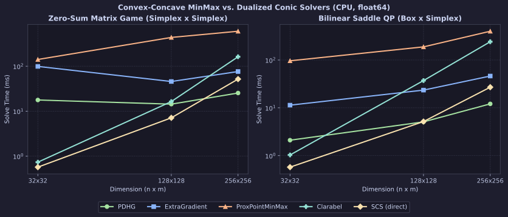
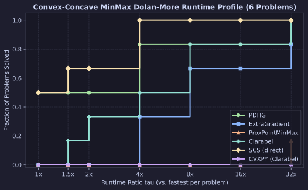

# Convex–Concave Min–Max Benchmarks (`proxax` vs. `Clarabel`, `SCS`, `CVXPY`)

CPU (`float64`) comparison of `proxax` primal–dual min–max solvers (`PDHG`, `ExtraGradient`, `ProxPointMinMax`) against dualized conic reformulations solved by `Clarabel` (IPM), `SCS` (direct `QDLDL` and indirect `CG` ADMM), and `CVXPY (Clarabel)` (`tol = 1e-4`).

## Problem Classes

1. **Zero-Sum Matrix Game (`Simplex` $\times$ `Simplex`)** —
   $$\min_{x \in \Delta_n} \max_{y \in \Delta_m} \; x^\top A y \qquad \Longleftrightarrow \qquad \min_{x \in \Delta_n,\; t \in \mathbb{R}} \; t \quad \text{s.t.} \quad A^\top x \le t \mathbf{1}_m$$
   Tested at $(n, m) \in \{(32, 32),\; (128, 128),\; (256, 256)\}$.

2. **Regularized Bilinear Saddle-Point QP (`Box` $\times$ `Simplex`)** —
   $$\min_{x \in [-1, 1]^n} \max_{y \in \Delta_m} \; \frac{1}{2} x^\top Q_x x + x^\top K y - \frac{1}{2} y^\top Q_y y + c_x^\top x - c_y^\top y \qquad (Q_x \succeq 0,\; Q_y \succ 0)$$
   Dualized to a QP over $(x, z, \nu, \mu)$ with $Q_y = L_y L_y^\top$ for `Clarabel`, `SCS`, and `CVXPY`.

## Setup

* **Precision & Device:** `float64` (`JAX_ENABLE_X64=1`), CPU.
* **Tolerances:** `opt_tol = 1e-4` for `proxax` (`PDHG`, `ExtraGradient`, `ProxPointMinMax`); `tol_gap_abs = tol_gap_rel = tol_feas = 1e-4` for `Clarabel`; `eps_abs = eps_rel = 1e-4` for `SCS`.
* **Reproduction:**

```bash
JAX_PLATFORMS=cpu JAX_ENABLE_X64=1 .venv/bin/python -m benchmarks.external.minmax_convex_concave --include-cvxpy
```

## Results

### Runtime Scaling



### Dolan–Moré Runtime Profile



### Summary Table (`tol = 1e-4`)

| Problem | Solver | Status | Objective | Opt Res | Grad Evals | Run (ms) |
| :--- | :--- | :--- | ---: | ---: | ---: | ---: |
| `Matrix Game (32x32)` | `PDHG` | `CONVERGED` | 0.0000 | 9.69e-05 | 3,970 | 17.71 |
| `Matrix Game (32x32)` | `ExtraGradient` | `CONVERGED` | 0.0000 | 9.95e-05 | 4,039 | 98.77 |
| `Matrix Game (32x32)` | `ProxPointMinMax` | `CONVERGED` | 0.0000 | 7.27e-05 | 5,512 | 140.91 |
| `Matrix Game (32x32)` | `Clarabel` | `CONVERGED` | 0.0000 | 2.78e-05 | — | 0.74 |
| `Matrix Game (32x32)` | `SCS (direct)` | `CONVERGED` | 0.0000 | 2.05e-05 | — | **0.57** |
| `Matrix Game (32x32)` | `SCS (indirect)` | `CONVERGED` | 0.0000 | 1.69e-05 | — | 2.97 |
| `Matrix Game (128x128)` | `PDHG` | `CONVERGED` | -0.0004 | 8.87e-05 | 1,442 | 14.33 |
| `Matrix Game (128x128)` | `ExtraGradient` | `CONVERGED` | -0.0004 | 9.98e-05 | 987 | 45.64 |
| `Matrix Game (128x128)` | `ProxPointMinMax` | `CONVERGED` | -0.0004 | 9.87e-05 | 11,069 | 435.24 |
| `Matrix Game (128x128)` | `Clarabel` | `CONVERGED` | -0.0004 | 2.72e-05 | — | 16.37 |
| `Matrix Game (128x128)` | `SCS (direct)` | `CONVERGED` | -0.0004 | 1.17e-04 | — | **7.12** |
| `Matrix Game (128x128)` | `SCS (indirect)` | `CONVERGED` | -0.0004 | 1.50e-04 | — | 77.40 |
| `Matrix Game (256x256)` | `PDHG` | `CONVERGED` | -0.0001 | 9.88e-05 | 1,250 | **25.32** |
| `Matrix Game (256x256)` | `ExtraGradient` | `CONVERGED` | -0.0001 | 9.99e-05 | 1,006 | 76.07 |
| `Matrix Game (256x256)` | `ProxPointMinMax` | `CONVERGED` | -0.0001 | 8.96e-05 | 8,501 | 597.48 |
| `Matrix Game (256x256)` | `Clarabel` | `CONVERGED` | -0.0001 | 9.36e-05 | — | 161.81 |
| `Matrix Game (256x256)` | `SCS (direct)` | `CONVERGED` | -0.0001 | 9.42e-05 | — | 51.64 |
| `Matrix Game (256x256)` | `SCS (indirect)` | `CONVERGED` | -0.0001 | 1.29e-04 | — | 690.73 |
| `Bilinear Saddle QP (32x32)` | `PDHG` | `CONVERGED` | -2.4130 | 7.94e-05 | 386 | 2.10 |
| `Bilinear Saddle QP (32x32)` | `ExtraGradient` | `CONVERGED` | -2.4130 | 9.81e-05 | 454 | 11.37 |
| `Bilinear Saddle QP (32x32)` | `ProxPointMinMax` | `CONVERGED` | -2.4130 | 9.25e-05 | 3,928 | 96.33 |
| `Bilinear Saddle QP (32x32)` | `Clarabel` | `CONVERGED` | -2.4130 | 8.99e-10 | — | 1.03 |
| `Bilinear Saddle QP (32x32)` | `SCS (direct)` | `CONVERGED` | -2.4130 | 2.66e-07 | — | **0.57** |
| `Bilinear Saddle QP (32x32)` | `SCS (indirect)` | `CONVERGED` | -2.4130 | 4.51e-06 | — | 8.74 |
| `Bilinear Saddle QP (128x128)` | `PDHG` | `CONVERGED` | -11.8179 | 5.52e-05 | 450 | **5.08** |
| `Bilinear Saddle QP (128x128)` | `ExtraGradient` | `CONVERGED` | -11.8179 | 9.78e-05 | 492 | 23.47 |
| `Bilinear Saddle QP (128x128)` | `ProxPointMinMax` | `CONVERGED` | -11.8179 | 9.06e-05 | 4,471 | 188.32 |
| `Bilinear Saddle QP (128x128)` | `Clarabel` | `CONVERGED` | -11.8178 | 1.78e-08 | — | 37.16 |
| `Bilinear Saddle QP (128x128)` | `SCS (direct)` | `CONVERGED` | -11.8179 | 3.04e-06 | — | 5.16 |
| `Bilinear Saddle QP (128x128)` | `SCS (indirect)` | `CONVERGED` | -11.8179 | 7.27e-06 | — | 108.46 |
| `Bilinear Saddle QP (256x256)` | `PDHG` | `CONVERGED` | -21.5770 | 7.66e-05 | 418 | **12.10** |
| `Bilinear Saddle QP (256x256)` | `ExtraGradient` | `CONVERGED` | -21.5770 | 9.96e-05 | 541 | 46.23 |
| `Bilinear Saddle QP (256x256)` | `ProxPointMinMax` | `CONVERGED` | -21.5770 | 9.59e-05 | 4,995 | 399.89 |
| `Bilinear Saddle QP (256x256)` | `Clarabel` | `CONVERGED` | -21.5770 | 1.85e-08 | — | 241.12 |
| `Bilinear Saddle QP (256x256)` | `SCS (direct)` | `CONVERGED` | -21.5770 | 2.46e-06 | — | 27.00 |
| `Bilinear Saddle QP (256x256)` | `SCS (indirect)` | `CONVERGED` | -21.5770 | 1.06e-05 | — | 638.84 |

## Key Observations

1. **All solvers converge to identical saddle-point values** across all 6 problems (e.g., `-2.4130`, `-11.8179`, `-21.5770` on `Bilinear Saddle QP`).
2. **`PDHG` leads at scale (`256x256`):** By avoiding dualization and dense KKT factorizations, `PDHG` solves `Matrix Game (256x256)` in **25.32 ms** (**2.0×** faster than `SCS (direct)` at `51.64 ms`, **6.4×** faster than `Clarabel` at `161.81 ms`) and `Bilinear Saddle QP (256x256)` in **12.10 ms** (**2.2×** faster than `SCS (direct)` at `27.00 ms`, **19.9×** faster than `Clarabel` at `241.12 ms`).
3. **Dense dualization hurts IPMs and indirect CG:** Dualizing `Bilinear Saddle QP` introduces a dense $m \times n$ block plus Cholesky factor $L_y$, making `Clarabel` scale cubically (`1.03 ms` $\to$ `37.16 ms` $\to$ `241.12 ms`) and `SCS (indirect)` slow down (`638.84 ms` at `256x256`), whereas `PDHG` only needs cheap matrix–vector products.
