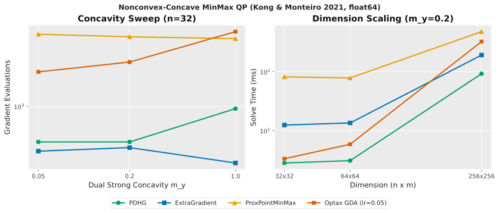

# Nonconvex–Concave Min–Max Benchmarks (`proxax` vs. `Optax` GDA)

CPU (`float64`) scaling study on the Kong & Monteiro (SIOPT 2021) nonconvex–concave QP over `Box(-1, 1)` $\times$ `Simplex`, comparing `proxax` primal–dual solvers (`ProxPointMinMax`, `ExtraGradient`, `PDHG`) against a projected Gradient Descent–Ascent (`Optax` SGD) baseline (`tol = 1e-4`).

## Problem Formulation

$$\min_{x \in [-1, 1]^n} \max_{y \in \Delta_m} \; \frac{1}{2} x^\top Q_x x + x^\top K y - \frac{1}{2} y^\top Q_y y + c_x^\top x - c_y^\top y$$

where $Q_x$ is indefinite (one-third negative eigenvalues in $[-2.0, -0.5]$, two-thirds positive in $[0.5, 8.0]$) and $Q_y = V^\top V + m_y I \succeq m_y I$. Standard conic solvers (`Clarabel`, `SCS`, `CVXPY`) cannot solve this problem class due to primal nonconvexity.

## Setup

* **Precision & Device:** `float64` (`JAX_ENABLE_X64=1`), CPU.
* **Sweep 1 (Dual Concavity):** $m_y \in \{0.05,\; 0.20,\; 1.00\}$ at $(n, m) = (32, 32)$.
* **Sweep 2 (Dimension Scaling):** $(n, m) \in \{(32, 32),\; (64, 64),\; (256, 256)\}$ at $m_y = 0.20$.
* **Reproduction:**

```bash
JAX_PLATFORMS=cpu JAX_ENABLE_X64=1 .venv/bin/python -m benchmarks.external.minmax_nonconvex_concave
```

## Results

### Concavity Sweep & Dimension Scaling



### Summary Table (`tol = 1e-4`)

| Problem | Solver | Status | Objective | Opt Res | Grad Evals | Run (ms) |
| :--- | :--- | :--- | ---: | ---: | ---: | ---: |
| `NC-C QP (n=32, m_y=0.05)` | `ProxPointMinMax` | `CONVERGED` | -20.7787 | 8.88e-05 | 3,405 | 7.82 |
| `NC-C QP (n=32, m_y=0.05)` | `ExtraGradient` | `CONVERGED` | -19.5098 | 8.81e-05 | 467 | 3.20 |
| `NC-C QP (n=32, m_y=0.05)` | `PDHG` | `CONVERGED` | -19.7452 | 8.68e-05 | 546 | **1.56** |
| `NC-C QP (n=32, m_y=0.05)` | `Optax GDA (lr=0.05)` | `CONVERGED` | -19.3747 | 9.99e-05 | 1,798 | 3.44 |
| `NC-C QP (n=32, m_y=0.2)` | `ProxPointMinMax` | `CONVERGED` | -20.8202 | 9.19e-05 | 3,264 | 7.58 |
| `NC-C QP (n=32, m_y=0.2)` | `ExtraGradient` | `CONVERGED` | -19.5546 | 9.83e-05 | 496 | 3.49 |
| `NC-C QP (n=32, m_y=0.2)` | `PDHG` | `CONVERGED` | -19.7748 | 9.51e-05 | 546 | **1.15** |
| `NC-C QP (n=32, m_y=0.2)` | `Optax GDA (lr=0.05)` | `CONVERGED` | -19.7748 | 9.97e-05 | 2,124 | 3.48 |
| `NC-C QP (n=32, m_y=1.0)` | `ProxPointMinMax` | `CONVERGED` | -20.9804 | 9.08e-05 | 3,162 | 10.06 |
| `NC-C QP (n=32, m_y=1.0)` | `ExtraGradient` | `CONVERGED` | -19.7506 | 9.50e-05 | 382 | 3.16 |
| `NC-C QP (n=32, m_y=1.0)` | `PDHG` | `CONVERGED` | -19.9065 | 6.04e-05 | 962 | **1.76** |
| `NC-C QP (n=32, m_y=1.0)` | `Optax GDA (lr=0.05)` | `CONVERGED` | -19.9065 | 9.93e-05 | 3,562 | 5.51 |
| `NC-C QP (n=64, m_y=0.2)` | `ProxPointMinMax` | `CONVERGED` | -40.7925 | 9.24e-05 | 2,652 | 12.83 |
| `NC-C QP (n=64, m_y=0.2)` | `ExtraGradient` | `CONVERGED` | -39.8149 | 9.90e-05 | 384 | 4.14 |
| `NC-C QP (n=64, m_y=0.2)` | `PDHG` | `CONVERGED` | -39.8149 | 6.95e-05 | 450 | **3.78** |
| `NC-C QP (n=64, m_y=0.2)` | `Optax GDA (lr=0.05)` | `CONVERGED` | -39.8149 | 9.95e-05 | 1,504 | 6.21 |
| `NC-C QP (n=256, m_y=0.2)` | `ProxPointMinMax` | `CONVERGED` | **-180.3306** | 9.75e-05 | 5,538 | 308.40 |
| `NC-C QP (n=256, m_y=0.2)` | `ExtraGradient` | `CONVERGED` | -175.1123 | 9.86e-05 | 2,280 | 143.65 |
| `NC-C QP (n=256, m_y=0.2)` | `PDHG` | `CONVERGED` | -175.1123 | 8.69e-05 | 3,298 | **95.37** |
| `NC-C QP (n=256, m_y=0.2)` | `Optax GDA (lr=0.05)` | `MAX_ITERS` | -175.1121 | 4.45e-03 | 10,000 | 359.53 |

## Key Observations

1. **`PDHG` and `ExtraGradient` are 2.5×–3.8× faster than `Optax GDA`:** `PDHG` converges on every problem in **1.15–95.37 ms**, whereas `Optax GDA` requires **3.3×–4.4×** more gradient evaluations on `n=32..64` and hits `MAX_ITERS` (`10,000` gradient evals, `opt_res = 4.45e-3`) at `n=256`.
2. **`ProxPointMinMax` finds strictly better stationary points:** On every problem, `ProxPointMinMax` converges to a lower minimax objective (`-20.82` vs. `-19.77` at `n=32`, `-180.33` vs. `-175.11` at `n=256`) by solving regularized proximal subproblems rather than taking raw local GDA steps.
3. **`ExtraGradient` uses the fewest gradient evaluations** (`382–2,280` across all 5 runs), making it attractive when gradient evaluations dominate runtime.
