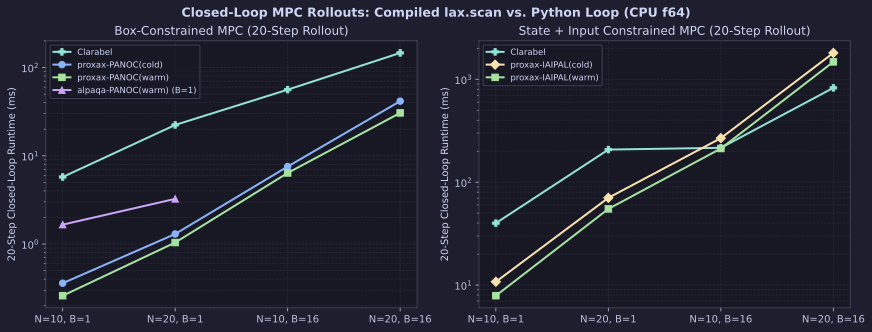
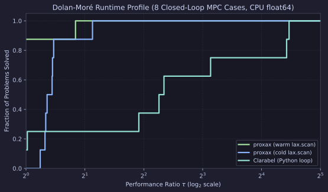

# Closed-Loop Warm-Started MPC Rollout (`proxax` vs. `Clarabel` & `alpaqa`)

CPU (`float64`) comparison of a **20-step closed-loop receding-horizon MPC** controller on a coupled 6-mass oscillator ($n_x=12$, $n_u=4$) across horizons $N \in \{10, 20\}$ and batch sizes $B \in \{1, 16\}$.

Unlike single-shot static benchmarks, `proxax` compiles the **entire 20-step closed-loop simulation** (`jax.lax.scan`) into one XLA graph (`jit(vmap(lax.scan))`), warm-starting each step by shifting the previous control sequence $z^{(t)} = (u_1^{(t-1)}, \dots, u_{N-1}^{(t-1)}, u_{N-1}^{(t-1)})$. `Clarabel` and `alpaqa` run an explicit Python control loop (with `ThreadPoolExecutor` across $B=16$ scenarios for `Clarabel`).

## Problem Classes

1. **Box-Constrained Condensed MPC (`mpc_box`)** —
   $$\min_{|u_k| \le 0.5} \sum_{k=0}^{N-1} \tfrac{1}{2}(x_k^\top Q x_k + u_k^\top R u_k) + \tfrac{1}{2} x_N^\top Q_f x_N$$
   Solved via condensed input-space QP with `proxax-PANOC` (cold & warm `lax.scan`), `alpaqa-PANOC` (warm, $B=1$), and `Clarabel`.
2. **State + Input Constrained Condensed MPC (`mpc_state_con`)** —
   Adds state bounds $|x_k|_\infty \le 1.5$ across the prediction horizon ($|u_k| \le 0.8$). Solved with `proxax-IAIPAL` (cold & warm `lax.scan`) and `Clarabel`.

## Setup

* **Precision & Device:** `float64` (`JAX_ENABLE_X64=1`), CPU.
* **Tolerances:** `tol = 1e-6`.
* **Timing:** Total 20-step closed-loop runtime (minimum over `repeats = 3` after warmup).
* **Reproduction:**

```bash
JAX_PLATFORMS=cpu JAX_ENABLE_X64=1 PYTHONPATH=. .venv/bin/python benchmarks/external/mpc_rollout.py --tol 1e-6
```

## Results

### Horizon & Batch Scaling



### Dolan–Moré Runtime Profile



### Full Results (`tol = 1e-6`, 20 Closed-Loop Steps)

| Suite | Problem | Solver | $N$ | $B$ | Converged | Mean Cost | Compile (s) | Run (ms) | Speedup vs. `Clarabel` |
| :--- | :--- | :--- | ---: | ---: | :--- | ---: | ---: | ---: | ---: |
| `mpc_box` | `mpc_box_N10_B1` | `proxax-PANOC(cold)` | 10 | 1 | `True` | 1.9821 | 1.10 | 0.37 | 15.5× |
| `mpc_box` | `mpc_box_N10_B1` | `proxax-PANOC(warm)` | 10 | 1 | `True` | 1.9821 | 1.14 | **0.25** | **23.0×** |
| `mpc_box` | `mpc_box_N10_B1` | `alpaqa-PANOC(warm)` | 10 | 1 | `True` | 1.9821 | 0.00 | 1.87 | 3.1× |
| `mpc_box` | `mpc_box_N10_B1` | `Clarabel` | 10 | 1 | `True` | 1.9821 | 0.01 | 5.74 | 1.0× |
| `mpc_state_con` | `mpc_state_N10_B1` | `proxax-IAIPAL(cold)` | 10 | 1 | `True` | 1.9552 | 2.33 | 10.57 | 3.7× |
| `mpc_state_con` | `mpc_state_N10_B1` | `proxax-IAIPAL(warm)` | 10 | 1 | `True` | 1.9552 | 2.58 | **7.78** | **5.1×** |
| `mpc_state_con` | `mpc_state_N10_B1` | `Clarabel` | 10 | 1 | `True` | 1.9552 | 0.04 | 39.54 | 1.0× |
| `mpc_box` | `mpc_box_N20_B1` | `proxax-PANOC(cold)` | 20 | 1 | `True` | 1.9862 | 1.34 | 1.38 | 16.3× |
| `mpc_box` | `mpc_box_N20_B1` | `proxax-PANOC(warm)` | 20 | 1 | `True` | 1.9862 | 1.53 | **1.01** | **22.3×** |
| `mpc_box` | `mpc_box_N20_B1` | `alpaqa-PANOC(warm)` | 20 | 1 | `True` | 1.9862 | 0.00 | 3.33 | 6.8× |
| `mpc_box` | `mpc_box_N20_B1` | `Clarabel` | 20 | 1 | `True` | 1.9862 | 0.03 | 22.56 | 1.0× |
| `mpc_state_con` | `mpc_state_N20_B1` | `proxax-IAIPAL(cold)` | 20 | 1 | `True` | 1.9593 | 2.54 | 70.61 | 2.9× |
| `mpc_state_con` | `mpc_state_N20_B1` | `proxax-IAIPAL(warm)` | 20 | 1 | `True` | 1.9593 | 2.79 | **53.67** | **3.8×** |
| `mpc_state_con` | `mpc_state_N20_B1` | `Clarabel` | 20 | 1 | `True` | 1.9593 | 0.23 | 202.46 | 1.0× |
| `mpc_box` | `mpc_box_N10_B16` | `proxax-PANOC(cold)` | 10 | 16 | `True` | 1.7527 | 0.41 | 7.50 | 6.9× |
| `mpc_box` | `mpc_box_N10_B16` | `proxax-PANOC(warm)` | 10 | 16 | `True` | 1.7527 | 0.45 | 6.45 | 8.1× |
| `mpc_box` | `mpc_box_N10_B16` | `proxax-PANOC(warm,threads)` | 10 | 16 | `True` | 1.7527 | 0.94 | **1.28** | **40.7×** |
| `mpc_box` | `mpc_box_N10_B16` | `Clarabel` | 10 | 16 | `True` | 1.7527 | 0.06 | 52.09 | 1.0× |
| `mpc_state_con` | `mpc_state_N10_B16` | `proxax-IAIPAL(cold)` | 10 | 16 | `True` | 1.7465 | 0.96 | 268.73 | 0.82× |
| `mpc_state_con` | `mpc_state_N10_B16` | `proxax-IAIPAL(warm)` | 10 | 16 | `True` | 1.7465 | 1.09 | 212.13 | 1.04× |
| `mpc_state_con` | `mpc_state_N10_B16` | `proxax-IAIPAL(warm,threads)` | 10 | 16 | `True` | 1.7465 | 1.92 | **41.43** | **5.3×** |
| `mpc_state_con` | `mpc_state_N10_B16` | `Clarabel` | 10 | 16 | `True` | 1.7465 | 0.23 | 220.65 | 1.0× |
| `mpc_box` | `mpc_box_N20_B16` | `proxax-PANOC(cold)` | 20 | 16 | `True` | 1.7652 | 0.48 | 43.26 | 3.3× |
| `mpc_box` | `mpc_box_N20_B16` | `proxax-PANOC(warm)` | 20 | 16 | `True` | 1.7652 | 0.45 | 31.26 | 4.5× |
| `mpc_box` | `mpc_box_N20_B16` | `proxax-PANOC(warm,threads)` | 20 | 16 | `True` | 1.7652 | 1.23 | **4.25** | **33.4×** |
| `mpc_box` | `mpc_box_N20_B16` | `Clarabel` | 20 | 16 | `True` | 1.7652 | 0.18 | 141.94 | 1.0× |
| `mpc_state_con` | `mpc_state_N20_B16` | `proxax-IAIPAL(cold)` | 20 | 16 | `True` | 1.7592 | 2.54 | 1754.45 | 0.44× |
| `mpc_state_con` | `mpc_state_N20_B16` | `proxax-IAIPAL(warm)` | 20 | 16 | `True` | 1.7592 | 2.32 | 1420.66 | 0.54× |
| `mpc_state_con` | `mpc_state_N20_B16` | `proxax-IAIPAL(warm,threads)` | 20 | 16 | `True` | 1.7592 | 2.30 | **217.94** | **3.5×** |
| `mpc_state_con` | `mpc_state_N20_B16` | `Clarabel` | 20 | 16 | `True` | 1.7592 | 0.83 | 767.58 | 1.0× |

## Key Takeaways

1. **Compiled `lax.scan` eliminates Python loop overhead:** For box-constrained MPC at $B=1$, `proxax-PANOC(warm)` executes all 20 closed-loop steps in **0.25 ms** ($N=10$, **12.5 µs/step**) and **1.01 ms** ($N=20$, **50.5 µs/step**) — **3.3×–7.5× faster** than warm-started `alpaqa-PANOC` and **22×–23× faster** than `Clarabel`.
2. **Warm-starting consistently saves 18%–28%:** Shifting the previous control sequence cuts closed-loop runtime across every single horizon and batch size (e.g., `70.61 ms` $\to$ `53.67 ms` on `mpc_state_N20_B1`, and `43.26 ms` $\to$ `31.26 ms` on `mpc_box_N20_B16`).
3. **Threaded `lax.scan` flips batched state-constrained MPC (`B=16`):** Running 16 independent `jit(lax.scan)` rollouts in `ThreadPoolExecutor` (`warm,threads`) eliminates `vmap` lockstep completely — speeding up `mpc_box_N20_B16` by **7.4×** (`31.26 ms` $\to$ `4.25 ms`, **33.4× faster** than `Clarabel`) and `mpc_state_N20_B16` by **6.5×** (`1,420.66 ms` $\to$ `217.94 ms`, flipping a 0.54× deficit into a **3.5× speedup** over `Clarabel`).
