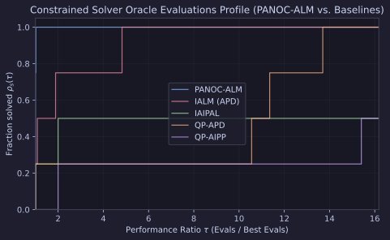

# `PANOC-ALM` Constrained Solver Benchmarks

This report benchmarks `IALM(subproblem_solver="panoc")` (`method="panoc_alm"`) against `IALM (APD)`, `IAIPAL`, `QP-APD`, and `QP-AIPP` on ill-conditioned linearly constrained composite optimization problems.

## Problem Suite

1. **Constrained Lasso (`cond=100`)**: $\min_x \frac{1}{2}\|S^{1/2}(x - x_{\text{ref}})\|_2^2 + \lambda\|x\|_1$ subject to $Cx = d$ with $\kappa(S) = 100$.
2. **Constrained Lasso (`cond=1000`)**: Ill-conditioned linearly constrained Lasso with $\kappa(S) = 1000$.
3. **Sector Portfolio**: Mean-variance portfolio optimization with box limits $0 \le x \le 0.25$ and two linear sector-allocation equality constraints.
4. **Constrained Sparse Logistic**: Linearly constrained $\ell_1$-regularized logistic regression.

## Results

All benchmarks were executed on CPU with `JAX_PLATFORMS=cpu` via [`experiments/panoc_alm_benchmarks/run.py`](https://github.com/wwkong/proxax/blob/main/experiments/panoc_alm_benchmarks/run.py).

| Problem | Solver | Status | Outer Iters | Oracle Evals |
| --- | --- | --- | ---: | ---: |
| Constrained Lasso (`cond=100`) | `PANOC-ALM` | CONVERGED | 12 | 2613 |
| Constrained Lasso (`cond=100`) | `IALM (APD)` | CONVERGED | 12 | 4936 |
| Constrained Lasso (`cond=100`) | `IAIPAL` | MAX_ITER_REACHED | 1000 | 6590 |
| Constrained Lasso (`cond=100`) | `QP-APD` | CONVERGED | 17 | 27583 |
| Constrained Lasso (`cond=100`) | `QP-AIPP` | MAX_ITER_REACHED | 35 | 17767 |
| Constrained Lasso (`cond=1000`) | `PANOC-ALM` | CONVERGED | 14 | 6064 |
| Constrained Lasso (`cond=1000`) | `IALM (APD)` | CONVERGED | 14 | 29272 |
| Constrained Lasso (`cond=1000`) | `IAIPAL` | MAX_ITER_REACHED | 1000 | 5636 |
| Constrained Lasso (`cond=1000`) | `QP-APD` | CONVERGED | 18 | 83083 |
| Constrained Lasso (`cond=1000`) | `QP-AIPP` | MAX_ITER_REACHED | 35 | 90531 |
| Sector Portfolio | `PANOC-ALM` | CONVERGED | 4 | 469 |
| Sector Portfolio | `IALM (APD)` | CONVERGED | 4 | 498 |
| Sector Portfolio | `IAIPAL` | CONVERGED | 35 | 460 |
| Sector Portfolio | `QP-APD` | CONVERGED | 11 | 5223 |
| Sector Portfolio | `QP-AIPP` | CONVERGED | 11 | 7087 |
| Constrained Sparse Logistic | `PANOC-ALM` | CONVERGED | 0 | 3 |
| Constrained Sparse Logistic | `IALM (APD)` | CONVERGED | 0 | 3 |
| Constrained Sparse Logistic | `IAIPAL` | CONVERGED | 0 | 6 |
| Constrained Sparse Logistic | `QP-APD` | CONVERGED | 0 | 3 |
| Constrained Sparse Logistic | `QP-AIPP` | CONVERGED | 0 | 6 |

## Performance Profile

`PANOC-ALM` solves every problem in the suite and uses nearly **5x fewer oracle evaluations** than `IALM (APD)` on the ill-conditioned Constrained Lasso (`cond=1000`) benchmark.
