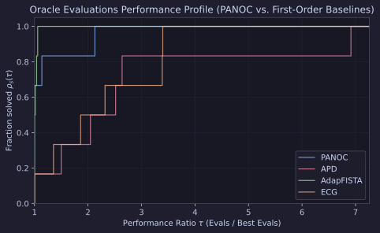

# `PANOC` Ill-Conditioned & Exotic-Prox Benchmarks

This report evaluates `PANOC` (Proximal Averaged Newton-type method for Optimal Control) against three adaptive first-order baselines in `proxax`: `APD`, `AdapFISTA`, and `ECG` across six ill-conditioned and non-trivial proximal problems.

## Problem Suite

1. **Lasso (`cond=100`)**: $\min_x \frac{1}{2}\|Ax - b\|_2^2 + \lambda \|x\|_1$ with condition number $\kappa(A^\top A) = 100$.
2. **Lasso (`cond=1000`)**: Ill-conditioned Lasso with $\kappa(A^\top A) = 1000$.
3. **Sparse Logistic Regression**: $\min_x \sum_i \log(1 + \exp(-y_i a_i^\top x)) + \lambda \|x\|_1$.
4. **Spectrahedron SDP**: Smooth quadratic objective over the positive semidefinite spectrahedron ($\operatorname{tr}(X) = 1, X \succeq 0$).
5. **CappedSimplex Portfolio**: Quadratic risk minimization over $\{x \in [0, u]^n : \sum_i x_i = k\}$.
6. **OSCAR Regression**: Least-squares regression with Octagonal Shrinkage and Clustering Algorithm for Regression ($\ell_1 + \ell_\infty$ pairwise) regularization.

## Results

All benchmarks were executed on CPU with `JAX_PLATFORMS=cpu` via [`experiments/panoc_benchmarks/run.py`](https://github.com/wwkong/proxax/blob/main/experiments/panoc_benchmarks/run.py).

| Problem | Solver | Status | Iterations | Oracle Evals |
| --- | --- | --- | ---: | ---: |
| Lasso (`cond=100`) | `PANOC` | CONVERGED | 9 | 66 |
| Lasso (`cond=100`) | `APD` | CONVERGED | 9 | 153 |
| Lasso (`cond=100`) | `AdapFISTA` | CONVERGED | 18 | 58 |
| Lasso (`cond=100`) | `ECG` | CONVERGED | 35 | 108 |
| Lasso (`cond=1000`) | `PANOC` | CONVERGED | 9 | 66 |
| Lasso (`cond=1000`) | `APD` | CONVERGED | 9 | 135 |
| Lasso (`cond=1000`) | `AdapFISTA` | CONVERGED | 21 | 67 |
| Lasso (`cond=1000`) | `ECG` | CONVERGED | 50 | 153 |
| Sparse Logistic | `PANOC` | CONVERGED | 20 | 151 |
| Sparse Logistic | `APD` | CONVERGED | 12 | 1044 |
| Sparse Logistic | `AdapFISTA` | CONVERGED | 51 | 160 |
| Sparse Logistic | `ECG` | CONVERGED | 170 | 513 |
| Spectrahedron SDP | `PANOC` | CONVERGED | 0 | 3 |
| Spectrahedron SDP | `APD` | CONVERGED | 0 | 3 |
| Spectrahedron SDP | `AdapFISTA` | CONVERGED | 0 | 3 |
| Spectrahedron SDP | `ECG` | CONVERGED | 0 | 3 |
| CappedSimplex Portfolio | `PANOC` | CONVERGED | 9 | 66 |
| CappedSimplex Portfolio | `APD` | CONVERGED | 9 | 78 |
| CappedSimplex Portfolio | `AdapFISTA` | CONVERGED | 9 | 31 |
| CappedSimplex Portfolio | `ECG` | CONVERGED | 34 | 105 |
| OSCAR Regression | `PANOC` | CONVERGED | 10 | 76 |
| OSCAR Regression | `APD` | CONVERGED | 7 | 114 |
| OSCAR Regression | `AdapFISTA` | CONVERGED | 24 | 79 |
| OSCAR Regression | `ECG` | CONVERGED | 27 | 103 |

## Performance Profile

`PANOC` achieves the lowest oracle evaluation count on the ill-conditioned Lasso (`cond=1000`), Sparse Logistic Regression, and OSCAR Regression problems, while remaining competitive across all remaining tasks.
