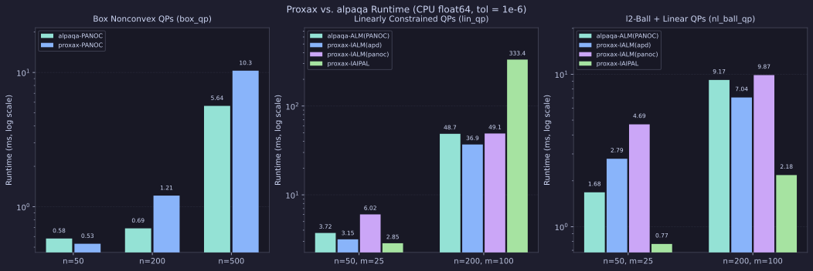
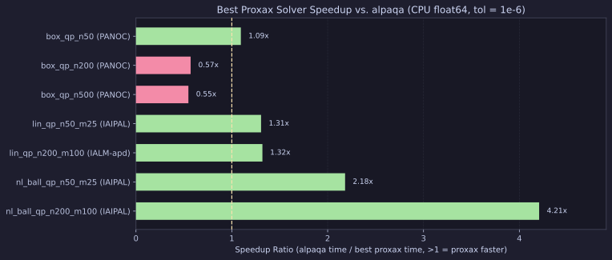

# Nonconvex CPU Benchmarks (`proxax` vs. `alpaqa`)

Single-instance **CPU-only** benchmarks (`float64`, no `jax.vmap`, no GPU) comparing `proxax` (`PANOC`, `IALM(apd)`, `IALM(panoc)`, `IAIPAL`) against `alpaqa` (`0.0.1`, C++/Python `PANOC` and `ALMSolver(PANOC)`) across box-, linearly-, and nonlinear-constrained nonconvex QPs.

## Problem Classes

1. **Box-Constrained Nonconvex QPs (`box_qp`)** — $\min_{x \in [0, 1]^n} \tfrac{1}{2} x^\top Q x + c^\top x$ with symmetric indefinite $Q$ (20% negative eigenvalues in $[-1, -0.1]$, 80% in $[-1, 4]$). Both `proxax-PANOC` and `alpaqa-PANOC` solve this directly with $L$-BFGS memory $10$.
2. **Linearly-Constrained Nonconvex QPs (`lin_qp`)** — $\min_{x \in [0, 1]^n} \tfrac{1}{2} x^\top Q x + c^\top x$ subject to $Ax \le b$.
3. **Nonlinear-Constrained Nonconvex QPs (`nl_ball_qp`)** — $\min_{x \in \mathbb{R}^n} \tfrac{1}{2} x^\top Q x + c^\top x$ subject to $\|x\|_2 \le 2$ and $Ax \le b$. `proxax` places $\|x\|_2 \le 2$ in `proximal=px.prox.L2Ball(2.0)` with $Ax \le b$ in `constraints`, whereas `alpaqa` places both $Ax - b \le 0$ and $\tfrac{1}{2}(\|x\|_2^2 - 4) \le 0$ in `ALMSolver`.

## Setup

* **Precision & Device:** `float64` (`JAX_ENABLE_X64=1`), CPU.
* **Tolerances:** `opt_tol = 1e-6`, `feas_tol = 1e-6`, `time_limit = 30.0 s`, `repeats = 3` (steady-state minimum after JIT warmup for `proxax`).
* **Independent Verification:** Objective, optimality residual $\|x - \Pi_C(x - (\nabla f(x) + A^\top \lambda_+))\|_2$, and primal feasibility residual are evaluated by the exact same NumPy verifier for both solvers.
* **Reproduction:**

```bash
JAX_PLATFORMS=cpu JAX_ENABLE_X64=1 PYTHONPATH=. .venv/bin/python benchmarks/external/panoc_vs_alpaqa.py --tol 1e-6
```

## Results

### Runtime Comparison Across Problem Families



### Speedup vs. `alpaqa`



### Full Results (`tol = 1e-6`)

| Suite | Problem | Solver | Status | Obj | `opt_res` | `feas_res` | Grad Evals | Run (ms) | Speedup vs. `alpaqa` |
| :--- | :--- | :--- | :--- | ---: | ---: | ---: | ---: | ---: | ---: |
| `box_qp` | `box_qp_n50` | `proxax-PANOC` | `CONVERGED` | -10.8425 | `2.39e-07` | `0.00e+00` | 126 | **0.53** | **1.09×** |
| `box_qp` | `box_qp_n50` | `alpaqa-PANOC` | `Converged` | -10.8425 | `5.60e-07` | `0.00e+00` | 79 | 0.58 | 1.00× |
| `box_qp` | `box_qp_n200` | `proxax-PANOC` | `CONVERGED` | -59.9894 | `4.88e-07` | `0.00e+00` | 102 | 1.21 | 0.57× |
| `box_qp` | `box_qp_n200` | `alpaqa-PANOC` | `Converged` | -59.9894 | `1.57e-06` | `0.00e+00` | 50 | **0.69** | 1.00× |
| `box_qp` | `box_qp_n500` | `proxax-PANOC` | `CONVERGED` | -156.7139 | `5.35e-07` | `0.00e+00` | 276 | 10.31 | 0.55× |
| `box_qp` | `box_qp_n500` | `alpaqa-PANOC` | `Converged` | -156.7139 | `2.98e-06` | `0.00e+00` | 141 | **5.64** | 1.00× |
| `lin_qp` | `lin_qp_n50_m25` | `proxax-IAIPAL` | `CONVERGED` | -16.1001 | `5.67e-07` | `1.84e-07` | 441 | **2.85** | **1.31×** |
| `lin_qp` | `lin_qp_n50_m25` | `proxax-IALM(apd)` | `CONVERGED` | -16.1001 | `6.71e-07` | `2.85e-07` | 1818 | 3.15 | 1.18× |
| `lin_qp` | `lin_qp_n50_m25` | `proxax-IALM(panoc)` | `CONVERGED` | -16.1001 | `6.51e-07` | `2.78e-07` | 1226 | 6.02 | 0.62× |
| `lin_qp` | `lin_qp_n50_m25` | `alpaqa-ALM(PANOC)` | `Converged` | -16.1001 | `6.39e-07` | `7.38e-08` | 308 | 3.72 | 1.00× |
| `lin_qp` | `lin_qp_n200_m100` | `proxax-IALM(apd)` | `CONVERGED` | -54.0660 | `9.87e-07` | `5.03e-07` | 5432 | **36.89** | **1.32×** |
| `lin_qp` | `lin_qp_n200_m100` | `alpaqa-ALM(PANOC)` | `Converged` | -54.0660 | `2.09e-06` | `7.75e-07` | 589 | 48.67 | 1.00× |
| `lin_qp` | `lin_qp_n200_m100` | `proxax-IALM(panoc)` | `CONVERGED` | -54.0660 | `6.44e-07` | `4.75e-07` | 4134 | 49.06 | 0.99× |
| `lin_qp` | `lin_qp_n200_m100` | `proxax-IAIPAL` | `CONVERGED` | -54.0660 | `9.94e-07` | `2.47e-11` | 32060 | 333.44 | 0.15× |
| `nl_ball_qp` | `nl_ball_qp_n50_m25` | `proxax-IAIPAL` | `CONVERGED` | -13.8982 | `2.01e-07` | `0.00e+00` | 176 | **0.77** | **2.18×** |
| `nl_ball_qp` | `nl_ball_qp_n50_m25` | `proxax-IALM(apd)` | `CONVERGED` | -13.8982 | `1.40e-07` | `5.01e-07` | 718 | 2.79 | 0.60× |
| `nl_ball_qp` | `nl_ball_qp_n50_m25` | `proxax-IALM(panoc)` | `CONVERGED` | -13.8982 | `1.89e-07` | `5.09e-07` | 730 | 4.69 | 0.36× |
| `nl_ball_qp` | `nl_ball_qp_n50_m25` | `alpaqa-ALM(PANOC)` | `Converged` | -13.8982 | `1.60e-07` | `4.37e-07` | 110 | 1.68 | 1.00× |
| `nl_ball_qp` | `nl_ball_qp_n200_m100` | `proxax-IAIPAL` | `CONVERGED` | -27.3389 | `8.79e-08` | `4.44e-16` | 110 | **2.18** | **4.21×** |
| `nl_ball_qp` | `nl_ball_qp_n200_m100` | `proxax-IALM(apd)` | `CONVERGED` | -27.3389 | `5.82e-08` | `5.07e-07` | 456 | 7.04 | 1.30× |
| `nl_ball_qp` | `nl_ball_qp_n200_m100` | `alpaqa-ALM(PANOC)` | `Converged` | -27.3389 | `4.61e-07` | `6.74e-09` | 134 | 9.17 | 1.00× |
| `nl_ball_qp` | `nl_ball_qp_n200_m100` | `proxax-IALM(panoc)` | `CONVERGED` | -27.3389 | `4.75e-08` | `5.04e-07` | 588 | 9.87 | 0.93× |

### Dolan–Moré Summary (by `run_s`)

| Solver | Solved | $\tau \le 1$ | $\tau \le 2$ | $\tau \le 4$ | $\tau \le 8$ |
| :--- | ---: | ---: | ---: | ---: | ---: |
| `proxax-IAIPAL` | 4/7 | **0.43** | 0.43 | 0.43 | 0.43 |
| `proxax-IALM(apd)` | 4/7 | 0.14 | 0.29 | **0.57** | **0.57** |
| `proxax-PANOC` | 3/7 | 0.14 | 0.43 | 0.43 | 0.43 |
| `alpaqa-PANOC` | 3/7 | 0.29 | 0.43 | 0.43 | 0.43 |
| `alpaqa-ALM(PANOC)` | 4/7 | 0.00 | 0.29 | 0.43 | **0.57** |
| `proxax-IALM(panoc)` | 4/7 | 0.00 | 0.14 | 0.29 | **0.57** |

## Key Takeaways

* **Constrained problems (`lin_qp`, `nl_ball_qp`):** `proxax` is the fastest solver on every constrained instance (`1.31–1.32×` faster than `alpaqa-ALM(PANOC)` on `lin_qp`, and `2.18–4.21×` faster on `nl_ball_qp`).
* **Richer proximal splitting:** Handling $\|x\|_2 \le 2$ directly via `px.prox.L2Ball(2.0)` avoids lifting a nonlinear quadratic constraint into the ALM outer loop, keeping `proxax-IAIPAL` at `4.44e-16` feasibility residual and `2.18 ms` on `nl_ball_qp_n200_m100`.
* **Box-only QPs (`box_qp`):** On small box QPs (`n=50`), `proxax-PANOC` edges out `alpaqa-PANOC` (`0.53 ms` vs `0.58 ms`); on larger box QPs (`n=200, 500`), C++ `alpaqa-PANOC` is ~1.8× faster per single CPU solve while `proxax-PANOC` achieves tighter unscaled KKT residuals (`5.35e-07` vs `2.98e-06` at `n=500`).
