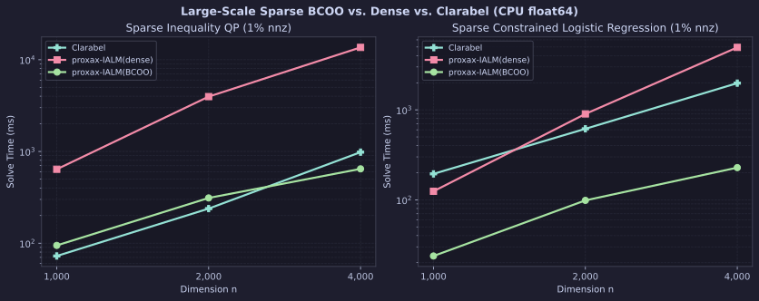
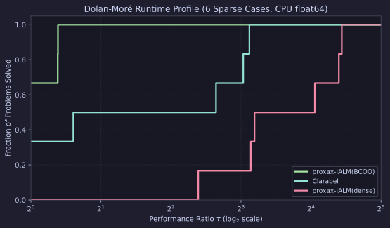

# Large-Scale Sparse `BCOO` Benchmarks (`proxax` vs. `Clarabel`)

CPU (`float64`) comparison of `proxax-IALM(BCOO)` (`jax.experimental.sparse.BCOO` via `px.constraints.MatrixLinearOperator`) and `proxax-IALM(dense)` against `Clarabel` on large-scale sparse constrained optimization problems ($n \in \{1{,}000,\; 2{,}000,\; 4{,}000\}$, $1\%$ nonzeros, `tol = 1e-6`).

## Problem Classes

1. **Sparse Inequality QP (`sparse_qp`)** —
   $$\min_{x \ge 0} \; \frac{1}{2} x^\top D x + q^\top x \quad \text{s.t.} \quad C x \le d \qquad (m = n/2,\; 1\%\text{ nnz})$$
2. **Sparse Constrained Logistic Regression (`sparse_logreg`)** —
   $$\min_{x \in [-1, 1]^n} \; \frac{1}{m}\sum_{i=1}^m \log\!\left(1 + \exp(-y_i (Ax)_i)\right) + \frac{\lambda}{2}\|x\|_2^2 \quad \text{s.t.} \quad C x \le d \qquad (m = n/2,\; m_c = n/4,\; 1\%\text{ nnz})$$

## Setup

* **Precision & Device:** `float64` (`JAX_ENABLE_X64=1`), CPU.
* **Tolerances:** `opt_tol = feas_tol = 1e-6` for `proxax-IALM`; `tol_gap_abs = tol_gap_rel = tol_feas = 1e-6` for `Clarabel`.
* **Timing:** Minimum solve time over `repeats = 2` after warmup (`Compile (s)` reports first-call XLA compilation).
* **Reproduction:**

```bash
JAX_PLATFORMS=cpu JAX_ENABLE_X64=1 PYTHONPATH=. .venv/bin/python benchmarks/external/sparse_bcoo_vs_clarabel.py --tol 1e-6 --repeats 2
```

## Results

### Dimension Scaling



### Dolan–Moré Runtime Profile



### Full Results (`tol = 1e-6`)

| Suite | Problem | Solver | $n$ | Converged | Objective | Compile (s) | Run (ms) | Speedup vs. `Clarabel` |
| :--- | :--- | :--- | ---: | :--- | ---: | ---: | ---: | ---: |
| `sparse_qp` | `sparse_qp_n1000` | `proxax-IALM(BCOO)` | 1,000 | `True` | -52.0317 | 0.63 | 94.61 | 0.77× |
| `sparse_qp` | `sparse_qp_n1000` | `proxax-IALM(dense)` | 1,000 | `True` | -52.0317 | 1.82 | 639.55 | 0.11× |
| `sparse_qp` | `sparse_qp_n1000` | `Clarabel` | 1,000 | `True` | -52.0317 | 0.00 | **72.56** | 1.0× |
| `sparse_qp` | `sparse_qp_n2000` | `proxax-IALM(BCOO)` | 2,000 | `True` | -104.4032 | 0.87 | 311.35 | 0.77× |
| `sparse_qp` | `sparse_qp_n2000` | `proxax-IALM(dense)` | 2,000 | `True` | -104.4032 | 7.35 | 3959.61 | 0.06× |
| `sparse_qp` | `sparse_qp_n2000` | `Clarabel` | 2,000 | `True` | -104.4032 | 0.00 | **238.32** | 1.0× |
| `sparse_qp` | `sparse_qp_n4000` | `proxax-IALM(BCOO)` | 4,000 | `True` | -216.4889 | 1.38 | **645.90** | **1.52×** |
| `sparse_qp` | `sparse_qp_n4000` | `proxax-IALM(dense)` | 4,000 | `True` | -216.4889 | 18.82 | 13614.60 | 0.07× |
| `sparse_qp` | `sparse_qp_n4000` | `Clarabel` | 4,000 | `True` | -216.4888 | 0.00 | 982.29 | 1.0× |
| `sparse_logreg` | `sparse_logreg_n1000` | `proxax-IALM(BCOO)` | 1,000 | `True` | 0.6642 | 0.59 | **23.74** | **8.18×** |
| `sparse_logreg` | `sparse_logreg_n1000` | `proxax-IALM(dense)` | 1,000 | `True` | 0.6642 | 1.27 | 124.40 | 1.56× |
| `sparse_logreg` | `sparse_logreg_n1000` | `Clarabel` | 1,000 | `True` | 0.6642 | 0.00 | 194.21 | 1.0× |
| `sparse_logreg` | `sparse_logreg_n2000` | `proxax-IALM(BCOO)` | 2,000 | `True` | 0.6877 | 0.72 | **98.55** | **6.25×** |
| `sparse_logreg` | `sparse_logreg_n2000` | `proxax-IALM(dense)` | 2,000 | `True` | 0.6877 | 2.87 | 901.13 | 0.68× |
| `sparse_logreg` | `sparse_logreg_n2000` | `Clarabel` | 2,000 | `True` | 0.6877 | 0.00 | 615.59 | 1.0× |
| `sparse_logreg` | `sparse_logreg_n4000` | `proxax-IALM(BCOO)` | 4,000 | `True` | 0.7070 | 1.11 | **227.87** | **8.69×** |
| `sparse_logreg` | `sparse_logreg_n4000` | `proxax-IALM(dense)` | 4,000 | `True` | 0.7070 | 8.82 | 4945.23 | 0.40× |
| `sparse_logreg` | `sparse_logreg_n4000` | `Clarabel` | 4,000 | `True` | 0.7070 | 0.00 | 1980.60 | 1.0× |

## Key Takeaways

1. **Up to 21.7× faster than dense arrays in `proxax`:** Switching from dense `jax.Array` to `jsparse.BCOO` cuts `proxax-IALM` runtime by **5.2×–21.7×** (`13,614.60 ms` $\to$ `645.90 ms` on `sparse_qp_n4000`; `4,945.23 ms` $\to$ `227.87 ms` on `sparse_logreg_n4000`) and cuts XLA compile time by up to **13.6×** (`18.82 s` $\to$ `1.38 s`).
2. **Beats `Clarabel` on sparse non-quadratic problems (`6.3×–8.7×` faster):** On `sparse_logreg`, `proxax-IALM(BCOO)` avoids exponential-cone slack reformulations and solves `n=4,000` in **227.87 ms** vs. `Clarabel`'s **1,980.60 ms**.
3. **Crosses over `Clarabel` on sparse QPs at `n=4,000`:** As KKT factorization fill-in grows with $n$, `proxax-IALM(BCOO)` (`645.90 ms`) overtakes `Clarabel` (`982.29 ms`, **1.52× faster**) at `n=4,000`.
