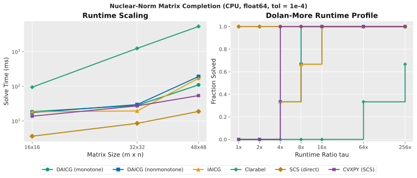

# Spectral Nuclear-Norm Matrix Completion (`proxax` vs. `Clarabel`, `SCS`, `CVXPY`)

CPU (`float64`) comparison of `proxax` spectral conditional-gradient solvers (`DAICG (monotone)`, `DAICG (nonmonotone)`, `IAICG`) in $m \times n$ matrix space against lifted $(m+n) \times (m+n)$ SDP formulations in `Clarabel`, `SCS`, and `CVXPY (SCS)` (`tol = 1e-4`).

## Problem Formulation

$$\min_{X \in \mathbb{R}^{m \times n}} \; \frac{1}{2} \|P_\Omega(X - M_{\text{obs}})\|_F^2 + \lambda \|X\|_* \qquad (\text{rank}=3,\; |\Omega|/(mn) = 0.50,\; \lambda = 0.5\sqrt{\max(m, n)})$$

Tested at $(m, n) \in \{(16, 16),\; (32, 32),\; (48, 48)\}$. For `Clarabel` and `SCS`, $\|X\|_*$ is lifted to a $(m+n) \times (m+n)$ PSD cone constraint $\begin{bmatrix} W_1 & X \\ X^\top & W_2 \end{bmatrix} \succeq 0$.

## Setup

* **Precision & Device:** `float64` (`JAX_ENABLE_X64=1`), CPU.
* **Tolerances:** `opt_tol = 1e-4` (`time_limit = 15.0 s`).
* **Reproduction:**

```bash
JAX_PLATFORMS=cpu JAX_ENABLE_X64=1 .venv/bin/python -m benchmarks.external.spectral_vs_clarabel_scs --include-cvxpy
```

## Results

### Runtime Scaling & Dolan–Moré Profile



### Summary Table (`tol = 1e-4`)

| Problem | Solver | Status | Objective | Opt Res | Run (ms) |
| :--- | :--- | :--- | ---: | ---: | ---: |
| `Nuclear MC (16x16)` | `DAICG (monotone)` | `CONVERGED` | 97.9982 | 9.75e-05 | 18.52 |
| `Nuclear MC (16x16)` | `DAICG (nonmonotone)` | `CONVERGED` | 97.9982 | 8.89e-05 | 17.33 |
| `Nuclear MC (16x16)` | `IAICG` | `CONVERGED` | 97.9982 | 9.33e-05 | 18.34 |
| `Nuclear MC (16x16)` | `Clarabel` | `CONVERGED` | 98.0106 | 1.88e-06 | 93.71 |
| `Nuclear MC (16x16)` | `SCS (direct)` | `CONVERGED` | 97.9982 | 5.01e-07 | **3.61** |
| `Nuclear MC (16x16)` | `SCS (indirect)` | `CONVERGED` | 97.9982 | 1.49e-06 | 3.89 |
| `Nuclear MC (16x16)` | `CVXPY (SCS)` | `CONVERGED` | 98.0115 | — | 13.63 |
| `Nuclear MC (32x32)` | `DAICG (monotone)` | `CONVERGED` | 299.3581 | 9.96e-05 | 27.91 |
| `Nuclear MC (32x32)` | `DAICG (nonmonotone)` | `CONVERGED` | 299.3581 | 5.96e-05 | 29.46 |
| `Nuclear MC (32x32)` | `IAICG` | `CONVERGED` | 299.3581 | 9.60e-05 | 19.33 |
| `Nuclear MC (32x32)` | `Clarabel` | `CONVERGED` | 299.4063 | 4.62e-06 | 1,235.80 |
| `Nuclear MC (32x32)` | `SCS (direct)` | `CONVERGED` | 299.3604 | 1.17e-04 | **8.47** |
| `Nuclear MC (32x32)` | `SCS (indirect)` | `CONVERGED` | 299.3581 | 4.47e-06 | 18.02 |
| `Nuclear MC (32x32)` | `CVXPY (SCS)` | `CONVERGED` | 299.3582 | — | 27.07 |
| `Nuclear MC (48x48)` | `DAICG (monotone)` | `CONVERGED` | 553.2504 | 9.50e-05 | 109.27 |
| `Nuclear MC (48x48)` | `DAICG (nonmonotone)` | `CONVERGED` | 553.2504 | 9.15e-05 | 190.05 |
| `Nuclear MC (48x48)` | `IAICG` | `CONVERGED` | 553.2504 | 9.21e-05 | 168.99 |
| `Nuclear MC (48x48)` | `Clarabel` | `CONVERGED` | 553.2621 | 3.74e-07 | 5,301.38 |
| `Nuclear MC (48x48)` | `SCS (direct)` | `CONVERGED` | 553.2519 | 1.10e-04 | **18.69** |
| `Nuclear MC (48x48)` | `SCS (indirect)` | `CONVERGED` | 553.2504 | 1.71e-06 | 36.24 |
| `Nuclear MC (48x48)` | `CVXPY (SCS)` | `CONVERGED` | 553.2504 | — | 53.66 |

## Key Observations

1. **5.4×–63.9× faster than `Clarabel`:** Operating directly in $m \times n$ matrix space avoids lifting to $(m+n) \times (m+n)$ SDP triangles (`4,656` `svec` variables at `48x48`), making `DAICG`/`IAICG` **5.4×** faster at `16x16` (`17.33 ms` vs. `93.71 ms`), **63.9×** faster at `32x32` (`19.33 ms` vs. `1,235.80 ms`), and **48.5×** faster at `48x48` (`109.27 ms` vs. `5,301.38 ms`).
2. **`SCS (direct)` leads on convex nuclear-norm SDPs:** `SCS` leverages C/LAPACK `syevd` + Anderson acceleration to solve `48x48` in `18.69 ms`, whereas `proxax`'s `SpectralProblem` is primarily designed for *nonconvex* spectral penalties (where `Clarabel` and `SCS` cannot run).
