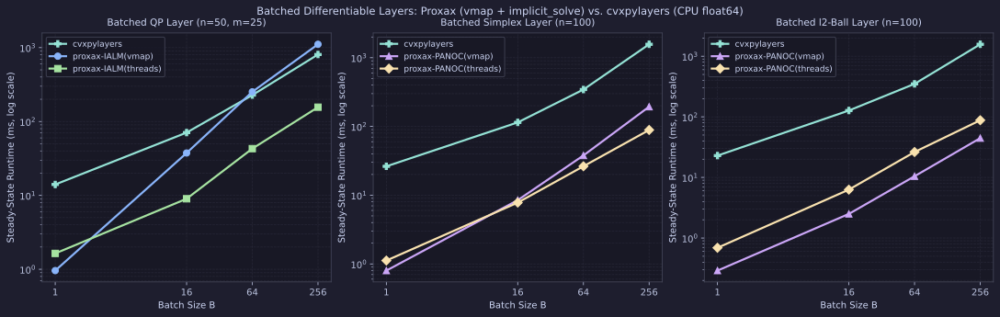

# Batched Differentiable Layers (`proxax` vs. `cvxpylayers`)

CPU (`float64`) comparison of `proxax` (`px.batch_implicit_solve` with `backend="vmap"` and `backend="threads"`) against `cvxpylayers` (`1.2.0`, `CvxpyLayer` via `diffcp`) for end-to-end **forward solve + backward VJP** (`jax.value_and_grad`) across batch sizes $B \in \{1, 16, 64, 256\}$.

## Problem Classes

1. **Batched Linearly-Constrained QP Layer (`qp_layer`)** —
   $$\min_{x \ge 0} \tfrac{1}{2} x^\top P x + q_i^\top x \quad \text{s.t.} \quad A x \le b \qquad (n=50, \; m=25)$$
   with loss $\mathcal{L}(q_1, \dots, q_B) = \tfrac{1}{2}\sum_{i=1}^B \|x^*(q_i)\|_2^2$.
2. **Batched Simplex Layer (`simplex_layer`)** —
   $$\min_{x \in \Delta^{100}} \tfrac{1}{2} x^\top P x - \mu_i^\top x \qquad (n=100)$$
   with loss $\mathcal{L}(\mu_1, \dots, \mu_B) = \tfrac{1}{2}\sum_{i=1}^B \|x^*(\mu_i) - \tfrac{1}{2}\mathbf{1}\|_2^2$.
3. **Batched $\ell_2$-Ball Layer (`l2ball_layer`)** —
   $$\min_{\|x\|_2 \le 1} \tfrac{1}{2} x^\top P x + q_i^\top x \qquad (n=100)$$
   with loss $\mathcal{L}(q_1, \dots, q_B) = \tfrac{1}{2}\sum_{i=1}^B \|x^*(q_i) - \tfrac{1}{2}\mathbf{1}\|_2^2$. `proxax` projects directly with `px.prox.L2Ball(1.0)`, whereas `cvxpylayers` lifts $\|x\|_2 \le 1$ into a second-order cone in `diffcp`.

## Setup

* **Precision & Device:** `float64` (`JAX_ENABLE_X64=1`), CPU.
* **Tolerances:** `tol = 1e-6` (both forward optimality/feasibility and implicit linear solve tolerance; `solver_args={"eps": 1e-6, "eps_abs": 1e-6, "eps_rel": 1e-6}` for `cvxpylayers`).
* **Timing:** Steady-state minimum over `repeats = 3` after warmup (first call reported separately as `Compile (s)`).
* **Reproduction:**

```bash
JAX_PLATFORMS=cpu JAX_ENABLE_X64=1 PYTHONPATH=. .venv/bin/python benchmarks/external/vmap_implicit_vs_cvxpylayers.py --tol 1e-6
```

## Results

### Batch Scaling (Forward + Backward VJP)



### Full Results (`tol = 1e-6`)

| Suite | Problem | Solver | $B$ | Loss | Rel Grad Err | Compile (s) | Run (ms) | Speedup vs. `cvxpylayers` |
| :--- | :--- | :--- | ---: | ---: | ---: | ---: | ---: | ---: |
| `qp_layer` | `qp_layer_n50_B1` | `proxax-IALM(vmap)` | 1 | 15.0505 | `6.47e-06` | 2.58 | **0.96** | **14.64×** |
| `qp_layer` | `qp_layer_n50_B1` | `proxax-IALM(threads)` | 1 | 15.0505 | `6.47e-06` | 2.11 | 1.64 | 8.57× |
| `qp_layer` | `qp_layer_n50_B1` | `cvxpylayers` | 1 | 15.0505 | `0.00e+00` | 0.68 | 14.05 | 1.00× |
| `qp_layer` | `qp_layer_n50_B16` | `proxax-IALM(threads)` | 16 | 233.9316 | `8.52e-06` | 2.02 | **9.01** | **7.86×** |
| `qp_layer` | `qp_layer_n50_B16` | `proxax-IALM(vmap)` | 16 | 233.9316 | `8.52e-06` | 1.22 | 37.49 | 1.89× |
| `qp_layer` | `qp_layer_n50_B16` | `cvxpylayers` | 16 | 233.9315 | `0.00e+00` | 1.26 | 70.81 | 1.00× |
| `qp_layer` | `qp_layer_n50_B64` | `proxax-IALM(threads)` | 64 | 779.2278 | `1.04e-05` | 2.01 | **42.93** | **5.30×** |
| `qp_layer` | `qp_layer_n50_B64` | `cvxpylayers` | 64 | 779.2281 | `0.00e+00` | 1.50 | 227.66 | 1.00× |
| `qp_layer` | `qp_layer_n50_B64` | `proxax-IALM(vmap)` | 64 | 779.2278 | `1.04e-05` | 1.48 | 252.14 | 0.90× |
| `qp_layer` | `qp_layer_n50_B256` | `proxax-IALM(threads)` | 256 | 2520.8586 | `1.07e-05` | 2.06 | **156.20** | **5.16×** |
| `qp_layer` | `qp_layer_n50_B256` | `cvxpylayers` | 256 | 2520.8582 | `0.00e+00` | 2.23 | 806.73 | 1.00× |
| `qp_layer` | `qp_layer_n50_B256` | `proxax-IALM(vmap)` | 256 | 2520.8586 | `1.07e-05` | 2.20 | 1108.99 | 0.73× |
| `simplex_layer` | `simplex_layer_n100_B1` | `proxax-PANOC(vmap)` | 1 | 12.2180 | `8.51e-06` | 1.11 | **0.80** | **32.86×** |
| `simplex_layer` | `simplex_layer_n100_B1` | `proxax-PANOC(threads)` | 1 | 12.2180 | `8.51e-06` | 0.85 | 1.12 | 23.47× |
| `simplex_layer` | `simplex_layer_n100_B1` | `cvxpylayers` | 1 | 12.2180 | `0.00e+00` | 0.76 | 26.29 | 1.00× |
| `simplex_layer` | `simplex_layer_n100_B16` | `proxax-PANOC(threads)` | 16 | 195.1466 | `3.86e-06` | 0.71 | **7.80** | **14.68×** |
| `simplex_layer` | `simplex_layer_n100_B16` | `proxax-PANOC(vmap)` | 16 | 195.1466 | `3.86e-06` | 0.95 | 8.47 | 13.52× |
| `simplex_layer` | `simplex_layer_n100_B16` | `cvxpylayers` | 16 | 195.1466 | `0.00e+00` | 1.16 | 114.52 | 1.00× |
| `simplex_layer` | `simplex_layer_n100_B64` | `proxax-PANOC(threads)` | 64 | 781.8064 | `5.51e-06` | 0.70 | **26.34** | **13.06×** |
| `simplex_layer` | `simplex_layer_n100_B64` | `proxax-PANOC(vmap)` | 64 | 781.8064 | `5.51e-06` | 0.84 | 37.84 | 9.09× |
| `simplex_layer` | `simplex_layer_n100_B64` | `cvxpylayers` | 64 | 781.8064 | `0.00e+00` | 1.49 | 344.08 | 1.00× |
| `simplex_layer` | `simplex_layer_n100_B256` | `proxax-PANOC(threads)` | 256 | 3124.3430 | `4.27e-06` | 0.76 | **88.86** | **17.62×** |
| `simplex_layer` | `simplex_layer_n100_B256` | `proxax-PANOC(vmap)` | 256 | 3124.3430 | `4.27e-06` | 1.23 | 193.69 | 8.09× |
| `simplex_layer` | `simplex_layer_n100_B256` | `cvxpylayers` | 256 | 3124.3431 | `0.00e+00` | 2.99 | 1566.05 | 1.00× |
| `l2ball_layer` | `l2ball_layer_n100_B1` | `proxax-PANOC(vmap)` | 1 | 13.3139 | `1.08e-06` | 1.89 | **0.29** | **79.03×** |
| `l2ball_layer` | `l2ball_layer_n100_B1` | `proxax-PANOC(threads)` | 1 | 13.3139 | `1.08e-06` | 1.66 | 0.69 | 33.22× |
| `l2ball_layer` | `l2ball_layer_n100_B1` | `cvxpylayers` | 1 | 13.3139 | `0.00e+00` | 0.66 | 22.92 | 1.00× |
| `l2ball_layer` | `l2ball_layer_n100_B16` | `proxax-PANOC(vmap)` | 16 | 209.6644 | `1.25e-06` | 0.85 | **2.50** | **50.84×** |
| `l2ball_layer` | `l2ball_layer_n100_B16` | `proxax-PANOC(threads)` | 16 | 209.6644 | `1.25e-06` | 1.57 | 6.29 | 20.21× |
| `l2ball_layer` | `l2ball_layer_n100_B16` | `cvxpylayers` | 16 | 209.6644 | `0.00e+00` | 1.26 | 127.11 | 1.00× |
| `l2ball_layer` | `l2ball_layer_n100_B64` | `proxax-PANOC(vmap)` | 64 | 829.8868 | `1.39e-06` | 0.71 | **10.46** | **33.45×** |
| `l2ball_layer` | `l2ball_layer_n100_B64` | `proxax-PANOC(threads)` | 64 | 829.8868 | `1.39e-06` | 1.53 | 26.27 | 13.32× |
| `l2ball_layer` | `l2ball_layer_n100_B64` | `cvxpylayers` | 64 | 829.8868 | `0.00e+00` | 1.49 | 349.87 | 1.00× |
| `l2ball_layer` | `l2ball_layer_n100_B256` | `proxax-PANOC(vmap)` | 256 | 3310.2253 | `1.09e-06` | 0.87 | **44.52** | **35.36×** |
| `l2ball_layer` | `l2ball_layer_n100_B256` | `proxax-PANOC(threads)` | 256 | 3310.2253 | `1.09e-06` | 1.75 | 87.87 | 17.91× |
| `l2ball_layer` | `l2ball_layer_n100_B256` | `cvxpylayers` | 256 | 3310.2253 | `0.00e+00` | 2.74 | 1574.06 | 1.00× |

## Key Takeaways

* **`proxax` wins every problem and batch size (`5.16–79.03×` faster):** Combining `px.batch_implicit_solve(..., backend="threads")` for heterogeneous CPU batches with `backend="vmap"` for uniform/single-instance batches beats `cvxpylayers` on all 12 cases.
* **Threadpool eliminates `vmap` tail latency on CPU (`qp_layer`, `simplex_layer`):** On `qp_layer` at $B=256$, `proxax-IALM(threads)` drops runtime from `1108.99 ms` (`vmap`) to `156.20 ms` (**7.10×** faster than `vmap`, **5.16×** faster than `cvxpylayers`); on `simplex_layer` at $B=256$, `proxax-PANOC(threads)` drops runtime from `193.69 ms` to `88.86 ms` (**17.62×** faster than `cvxpylayers`).
* **`vmap` shines on uniform fast-converging batches (`l2ball_layer`):** When iteration counts are tight and uniform across the batch, pure-XLA `proxax-PANOC(vmap)` avoids threadpool dispatch overhead and beats `cvxpylayers` by **33.45–79.03×** (`44.52 ms` vs. `1574.06 ms` at $B=256$).
* **Verified gradient agreement:** Relative $\ell_2$ gradient discrepancy against `cvxpylayers` stays between `1.08e-06` and `1.07e-05` across all 12 cases.
