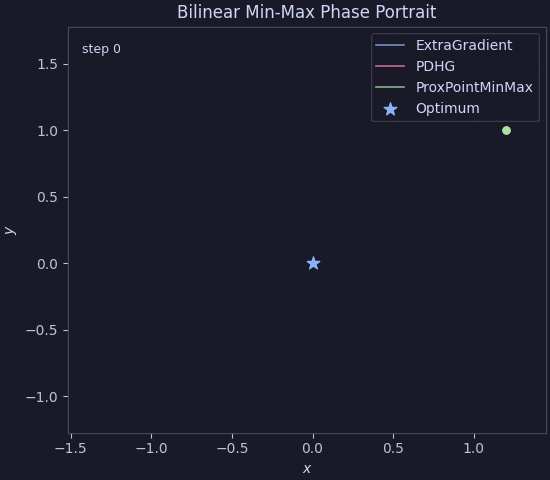

# Min-Max & Saddle-Point Optimization

This page demonstrates primal-dual saddle-point optimization in Proxax using
`px.MinMaxProblem`:

$$\min_{x \in \mathcal{X}} \max_{y \in \mathcal{Y}} \; \Phi(x, y) + h(x) - g(y)$$

All three solvers (`ExtraGradient`, `PDHG`, and `ProxPointMinMax`) return an
exact primal-dual stationarity certificate $(\hat{x}, \hat{y}, \hat{v}_x, \hat{v}_y)$
satisfying:

$$\hat{v}_x \in \nabla_x \Phi(\hat{x}, \hat{y}) + \partial h(\hat{x}), \qquad \hat{v}_y \in -\nabla_y \Phi(\hat{x}, \hat{y}) + \partial g(\hat{y}), \qquad \sqrt{\|\hat{v}_x\|_2^2 + \|\hat{v}_y\|_2^2} \le \rho.$$

All code on this page can be run directly via `examples/minmax.py`:

```bash
uv run python examples/minmax.py
```

---

## 1. Bilinear Two-Player Matrix Game over Simplices

Consider a zero-sum matrix game over probability simplices:

$$\min_{x \in \Delta^m} \max_{y \in \Delta^n} \; x^\top A y$$

```python
import jax.numpy as jnp
from proxax import px

payoff = jnp.array([[2.0, -1.0, 0.5], [-1.0, 1.5, 0.2], [0.0, -0.5, 1.0]])
problem = px.MinMaxProblem(
    coupling=lambda x, y: x @ payoff @ y,
    prox_x=px.prox.Simplex(scale=1.0),
    prox_y=px.prox.Simplex(scale=1.0),
    L_xy=float(jnp.linalg.norm(payoff, ord=2)),
)
x0 = jnp.ones(3) / 3.0
y0 = jnp.ones(3) / 3.0

sol = px.solve(problem, (x0, y0), method="extra_gradient", opt_tol=1e-4)
x_hat, y_hat = sol.x
print(sol.status_enum.name, float(sol.stats.opt_residual))
```

Both `method="extra_gradient"` (adaptive Mirror-Prox) and `method="pdhg"`
(over-relaxed Chambolle-Pock) solve this bilinear saddle-point problem with
exact simplex feasibility at every step. On an unconstrained bilinear game
(`px.plotting.animate_phase_trajectory`), you can also visualize cycling vs.
damping around `(0, 0)`:



---

## 2. Weakly Nonconvex–Strongly Concave Minimax

When $\Phi(x, y)$ is nonconvex in $x$, supply `m_x` (weak-convexity modulus) and
`px.solve` automatically dispatches to `ProxPointMinMax`, which solves a
sequence of regularized saddle-point subproblems via `ExtraGradient`:

$$\min_{x \in [-2, 2]^d} \max_{y \in [-2, 2]^d} \; \frac{1}{2}\|x\|_2^2 + 0.3 \sum_{i=1}^d \sin(2 x_i) + y^\top A x - \frac{1}{2}\|y\|_2^2$$

```python
import jax.numpy as jnp
from proxax import px

a_mat = jnp.array([[1.2, -0.4], [0.5, 1.0]])

def coupling(x, y):
  return (
      0.5 * jnp.sum(x**2)
      + 0.3 * jnp.sum(jnp.sin(2.0 * x))
      + jnp.dot(y, a_mat @ x)
      - 0.5 * jnp.sum(y**2)
  )

problem = px.MinMaxProblem(
    coupling=coupling,
    prox_x=px.prox.Box(lower=-2.0, upper=2.0),
    prox_y=px.prox.Box(lower=-2.0, upper=2.0),
    m_x=1.2,
)
sol = px.solve(
    problem,
    (jnp.array([0.5, -0.5]), jnp.zeros(2)),
    opt_tol=1e-4,
)
print(sol.status_enum.name, float(sol.stats.opt_residual))
```
