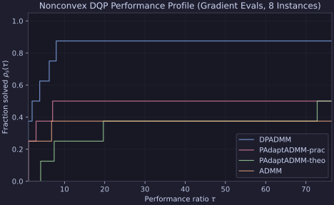

# `PAdaptADMM` CPU Benchmarks

This report evaluates Proxax's multi-block solvers on small-scale variants of the
nonconvex Distributed Quadratic Programming (DQP) benchmark from
Maia, Monteiro, and Silva ([arXiv:2611.00570](https://arxiv.org/abs/2611.00570),
Section 6.2, eq. 72).

## Problem Setup

Given $B$ blocks, $n$ variables per block, $m < Bn$ coupling constraints, and
$\ell_1$-ball radius $\omega = 100$:

$$
\min_{x = (x_1, \dots, x_B) \in \mathbb{R}^{Bn}} \;
\sum_{i=1}^B \left(\frac{1}{2}\langle x_i, P_i x_i\rangle + \langle x_i, r_i\rangle\right)
\quad \text{s.t.} \quad
\|x_i\|_1 \le \omega \; (i = 1, \dots, B), \quad
\sum_{i=1}^B A_i x_i = b,
$$

where:
- $A_i \in \mathbb{R}^{m \times n}$ has i.i.d. $\mathcal{N}(0, 1)$ entries;
- $P_i = Q_i^\top D_i Q_i$ with $Q_i$ orthonormal, $\lfloor n/3 \rfloor$ zero
  eigenvalues, and remaining eigenvalues uniform on $[-10, 10]$ (at least one
  negative);
- $r_i \sim \mathcal{N}(0, I_n)$, feasible $\hat{x}_i$ and starting point
  $x_i^0$ sampled inside $\{\|u\|_1 < 0.9\,\omega\}$, and
  $b = \sum_{i=1}^B A_i \hat{x}_i$.

### Solver Configurations & Stopping Criterion

All runs used `float64` (`jax_enable_x64=True`) on CPU, seed `0`, and
relative stopping tolerances $\rho = \eta = 10^{-3}$:

$$
\frac{\|v\|_2}{1 + \|\nabla f(x_0)\|_2} \le 10^{-3}, \qquad
\frac{\|Ax - b\|_2}{1 + \|Ax_0 - b\|_2} \le 10^{-3}.
$$

For an apples-to-apples comparison, every solver starts from the same
scale-normalized initial penalty $c_0 = \frac{1}{1 + \|Ax_0 - b\|_2}$:

- **`PAdaptADMM-prac`**: `px.solvers.PAdaptADMM` with Appendix B's 8-step
  adaptive $\tau$ bisection (`adaptive_tau=True`), `gamma_init=10.0`,
  `lmt_bound=1e3 * opt_tol`, `max_stage_iters=5000`, `time_limit=60.0`.
- **`PAdaptADMM-theo`**: Same as above with fixed theoretical
  $\bar{\tau} = \frac{1}{4(B-1)}$ (`adaptive_tau=False`).
- **`DPADMM`**: `px.solvers.DPADMM` with the experimental `DP1` settings from
  Kong & Monteiro ([arXiv:2110.12502](https://arxiv.org/abs/2110.12502),
  Section 5): `theta=0.0`, `chi=1.0`, `lam_init=0.5`, `c_init=c0`,
  `max_stage_iters=1000`, `time_limit=60.0`.
- **`ADMM`**: `px.solvers.ADMM` (cyclic linearized proximal ADMM) with fixed
  `rho=c0` and `max_iters=50000` (jitted via `jax.lax.while_loop`).

```{note}
Wall-clock times below are **sequential CPU** times (including first-call JIT
compilation), not the idealized parallel execution times ($\max_t T_t$) reported
in Maia–Monteiro–Silva (2026).
```

## Reproduction

```bash
uv run python experiments/maia2026_table1_dqp/run.py
```

Script: `experiments/maia2026_table1_dqp/run.py`

## Results

The scaling ladder starts at $B=2, (m,n)=(2,4)$ and advances until all four
methods fail to converge on an instance ($B=16, (m,n)=(16,16)$).

```{table}
:class: grouped-4-table
| $B$ | $(m, n)$ | $Bn$ | Solver | Status | Outer Iters | Inner Iters | Grad Evals | Objective | $\text{rel\_opt}$ | $\text{rel\_feas}$ | Time (s) |
|---:|:---|---:|:---|:---|---:|---:|---:|---:|---:|---:|---:|
| 2 | (2, 4) | 8 | `PAdaptADMM-prac` | CONVERGED | 137 | 910 | 2,126 | -3.1792e+04 | 9.63e-04 | 9.64e-04 | 3.25 |
| 2 | (2, 4) | 8 | `PAdaptADMM-theo` | CONVERGED | 304 | 2,363 | 5,386 | -3.1791e+04 | 7.62e-04 | 1.45e-04 | 4.34 |
| 2 | (2, 4) | 8 | `DPADMM` | CONVERGED | 137 | 574 | 1,420 | -3.1792e+04 | 6.65e-04 | 8.64e-04 | 2.95 |
| 2 | (2, 4) | 8 | `ADMM` | CONVERGED | 181 | 0 | 724 | -3.1792e+04 | 3.61e-04 | 9.87e-04 | **0.61** |
| 2 | (4, 6) | 12 | `PAdaptADMM-prac` | CONVERGED | 347 | 3,182 | 7,744 | -1.4132e+04 | 8.45e-04 | 2.17e-04 | **6.03** |
| 2 | (4, 6) | 12 | `PAdaptADMM-theo` | CONVERGED | 1,406 | 12,916 | 31,590 | -1.4133e+04 | 9.64e-04 | 1.39e-05 | 8.64 |
| 2 | (4, 6) | 12 | `DPADMM` | CONVERGED | 3,849 | 23,614 | 61,514 | -1.8123e+04 | 7.42e-04 | 8.29e-04 | 14.12 |
| 2 | (4, 6) | 12 | `ADMM` | MAX_ITER | 50,000 | 0 | 200,000 | -1.8809e+04 | 1.58e+00 | 7.53e+00 | 34.86 |
| 4 | (4, 6) | 24 | `PAdaptADMM-prac` | CONVERGED | 332 | 5,552 | 14,216 | -4.2154e+04 | 7.94e-04 | 3.99e-04 | 7.87 |
| 4 | (4, 6) | 24 | `PAdaptADMM-theo` | CONVERGED | 3,299 | 57,736 | 146,784 | -4.2154e+04 | 9.79e-04 | 2.35e-05 | 27.32 |
| 4 | (4, 6) | 24 | `DPADMM` | CONVERGED | 426 | 4,637 | 12,518 | -4.3136e+04 | 7.42e-04 | 9.50e-04 | 6.68 |
| 4 | (4, 6) | 24 | `ADMM` | CONVERGED | 252 | 0 | 2,016 | -4.3136e+04 | 8.29e-04 | 9.96e-04 | **1.14** |
| 4 | (4, 8) | 32 | `PAdaptADMM-prac` | CONVERGED | 412 | 5,121 | 11,894 | -6.3476e+04 | 9.73e-04 | 4.43e-04 | **8.74** |
| 4 | (4, 8) | 32 | `PAdaptADMM-theo` | CONVERGED | 7,700 | 100,157 | 233,746 | -5.7153e+04 | 1.00e-03 | 1.12e-05 | 48.38 |
| 4 | (4, 8) | 32 | `DPADMM` | CONVERGED | 1,997 | 18,446 | 45,726 | -5.9396e+04 | 3.43e-04 | 5.08e-04 | 18.89 |
| 4 | (4, 8) | 32 | `ADMM` | CONVERGED | 10,112 | 0 | 80,896 | -5.9064e+04 | 4.54e-04 | 9.49e-04 | 17.10 |
| 4 | (8, 12) | 48 | `PAdaptADMM-prac` | TIME_LIMIT | 8,250 | 166,310 | 447,102 | -3.3590e+04 | 6.66e-01 | 5.26e-03 | 61.30 |
| 4 | (8, 12) | 48 | `PAdaptADMM-theo` | TIME_LIMIT | 9,341 | 163,569 | 394,758 | -3.7564e+04 | 9.96e-04 | 4.83e+00 | 63.83 |
| 4 | (8, 12) | 48 | `DPADMM` | CONVERGED | 2,292 | 25,865 | 66,734 | -3.3733e+04 | 8.57e-04 | 6.98e-04 | **19.40** |
| 4 | (8, 12) | 48 | `ADMM` | MAX_ITER | 50,000 | 0 | 400,000 | -3.2000e+04 | 5.94e-01 | 2.02e+00 | 62.44 |
| 8 | (8, 16) | 128 | `PAdaptADMM-prac` | TIME_LIMIT | 6,817 | 230,954 | 594,944 | -9.1414e+04 | 7.88e-01 | 4.71e-02 | 99.99 |
| 8 | (8, 16) | 128 | `PAdaptADMM-theo` | TIME_LIMIT | 9,868 | 329,439 | 762,240 | -9.4846e+04 | 1.00e-03 | 7.24e+00 | 107.58 |
| 8 | (8, 16) | 128 | `DPADMM` | CONVERGED | 2,173 | 42,014 | 106,974 | -8.8389e+04 | 9.35e-04 | 9.01e-04 | **28.26** |
| 8 | (8, 16) | 128 | `ADMM` | MAX_ITER | 50,000 | 0 | 800,000 | -8.8372e+04 | 5.12e-01 | 9.87e-01 | 105.48 |
| 8 | (16, 16) | 128 | `PAdaptADMM-prac` | TIME_LIMIT | 8,346 | 283,636 | 714,470 | -8.1890e+04 | 4.44e-01 | 1.62e-02 | 111.14 |
| 8 | (16, 16) | 128 | `PAdaptADMM-theo` | TIME_LIMIT | 10,000 | 352,581 | 820,132 | -7.8585e+04 | 8.72e-02 | 7.47e+00 | 112.68 |
| 8 | (16, 16) | 128 | `DPADMM` | CONVERGED | 2,109 | 43,396 | 110,122 | -8.1733e+04 | 9.44e-04 | 7.75e-04 | **31.16** |
| 8 | (16, 16) | 128 | `ADMM` | MAX_ITER | 50,000 | 0 | 800,000 | -8.1976e+04 | 6.95e-01 | 3.07e+00 | 100.47 |
| 16 | (16, 16) | 256 | `PAdaptADMM-prac` | TIME_LIMIT | 2,022 | 116,747 | 276,988 | -2.0629e+05 | 9.83e-04 | 2.08e+00 | 67.78 |
| 16 | (16, 16) | 256 | `PAdaptADMM-theo` | TIME_LIMIT | 5,000 | 331,461 | 751,170 | -2.2206e+05 | 9.41e-02 | 9.29e+00 | 112.33 |
| 16 | (16, 16) | 256 | `DPADMM` | TIME_LIMIT | 3,000 | 120,282 | 306,598 | -1.9030e+05 | 9.79e-02 | 1.20e-01 | 67.37 |
| 16 | (16, 16) | 256 | `ADMM` | MAX_ITER | 50,000 | 0 | 1,600,000 | -2.0729e+05 | 1.73e+00 | 2.22e+00 | 189.44 |
```



## Key Observations

1. **`DPADMM` (`DP1`) was the most robust overall (7/8 converged):**
   It converged cleanly on every instance up through $B=8, (m,n)=(16,16)$ in
   `31.16s` (`2,109` outer iterations, `110,122` gradient evaluations), only
   hitting the `60s` stage boundary at $B=16, (m,n)=(16,16)$.
2. **Adaptive $\tau$ bisection (`PAdaptADMM-prac`) strongly outperforms fixed $\bar{\tau}$ (`PAdaptADMM-theo`):**
   On the four converged instances ($B \le 4, n \le 8$), Appendix B's 8-step
   bisection cut outer iterations by **2.2× to 18.7×** and gradient
   evaluations by **2.5× to 19.6×**, winning outright on $(4, 4, 8)$ in `8.74s`
   (`412` outer iters, `11,894` grads).
3. **Fixed-penalty `ADMM(rho=c0)` fails without penalty adaptation (3/8 converged):**
   Starting from the same scale-normalized $c_0 \approx 10^{-3}$ without
   penalty doubling, `ADMM` converged on three small instances (`(2, 2, 4)`,
   `(4, 4, 6)`, `(4, 4, 8)`), but hit `50,000` iterations without converging on
   `(2, 4, 6)` and every instance from `(4, 8, 12)` onward.
