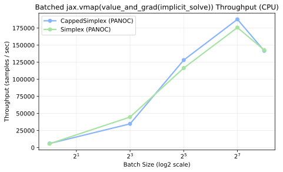

# Batched Differentiable Layers (`jax.vmap` + `implicit_solve`)

This report measures the forward + backward (`jax.vmap(jax.value_and_grad(...))`) throughput of `px.implicit_solve(..., method="panoc")` as a pure-JAX differentiable optimization layer across batch sizes $B \in \{1, 8, 32, 128, 256\}$ in dimension $n = 16$.

## Results

Executed on CPU (`JAX_PLATFORMS=cpu`) after JIT warmup via [`experiments/vmap_implicit_benchmarks/run.py`](https://github.com/wwkong/proxax/blob/main/experiments/vmap_implicit_benchmarks/run.py).

| Layer | Batch Size | ms / Batch | Samples / sec |
| --- | ---: | ---: | ---: |
| `CappedSimplex (PANOC)` | 1 | 0.167 | 5994.8 |
| `CappedSimplex (PANOC)` | 8 | 0.230 | 34788.3 |
| `CappedSimplex (PANOC)` | 32 | 0.250 | 128158.0 |
| `CappedSimplex (PANOC)` | 128 | 0.682 | 187782.8 |
| `CappedSimplex (PANOC)` | 256 | 1.806 | 141757.6 |
| `Simplex (PANOC)` | 1 | 0.175 | 5702.1 |
| `Simplex (PANOC)` | 8 | 0.179 | 44742.2 |
| `Simplex (PANOC)` | 32 | 0.275 | 116479.8 |
| `Simplex (PANOC)` | 128 | 0.728 | 175718.3 |
| `Simplex (PANOC)` | 256 | 1.793 | 142789.0 |

## Throughput Scaling

Vectorizing `px.implicit_solve` with `jax.vmap` and `jax.jit` scales throughput from ~6k samples/sec at batch size 1 to **187.8k samples/sec** at batch size 128 on CPU.
