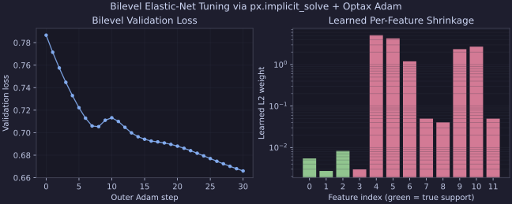

# Implicit Differentiation & Layers

When an optimization problem depends on differentiable hyperparameters or
upstream neural-network outputs $\theta$, `px.implicit_solve` differentiates
through the optimal solution $x^*(\theta)$ via the implicit function theorem —
solving a matrix-free linear system (`gmres`, `cg`, or `bicgstab`) rather than
unrolling solver iterations.

---

## 1. Differentiating Through `px.solve` (`px.implicit_solve`)

Pass a callable `problem_fn(params)` that builds a `CompositeProblem`,
`BlockProblem`, or `MinMaxProblem` from any PyTree `params`, along with an
initial guess `x0`:

```python
import jax
import jax.numpy as jnp
from proxax import px


def problem_fn(theta: jax.Array) -> px.CompositeProblem:
  return px.CompositeProblem(
      smooth=lambda x: 0.5 * jnp.sum((x - theta) ** 2),
      proximal=px.prox.Box(0.0, 1.0),
  )


def outer_loss(theta: jax.Array) -> jax.Array:
  x_star = px.implicit_solve(
      problem_fn,
      jnp.zeros_like(theta),
      theta,
      method="apd",
      opt_tol=1e-6,
  )
  return 0.5 * jnp.sum((x_star - 0.5) ** 2)


theta0 = jnp.array([-0.5, 0.3, 1.5])
grad_theta = jax.grad(outer_loss)(theta0)
```

`px.implicit_solve` is compatible with `jax.jit`, `jax.grad`, `jax.value_and_grad`,
and `jax.vmap` across problem batches.

---

## 2. Constrained Problems & Min-Max Differentiation

For constrained `CompositeProblem` and `BlockProblem` instances, `px.implicit_solve`
differentiates through the primal-dual KKT fixed-point map:

- Pass `return_dual=True` if your downstream loss also depends on the optimal
  dual multiplier $p^*(\theta)$ (returns `(x_star, dual_star)`).
- For `MinMaxProblem`, `px.implicit_solve` differentiates through the
  saddle-point solution `(x_hat, y_hat)`.

---

## 3. Linear-Solver & Damping Options

By default, the backward pass solves the Jacobian linear system using matrix-free
GMRES (`linear_solver="gmres"`). You can tune the backward linear solve via
keyword arguments:

| Argument | Default | Purpose |
| :--- | :--- | :--- |
| `linear_solver` | `"gmres"` | Matrix-free Krylov solver: `"gmres"`, `"cg"` (symmetric positive definite), or `"bicgstab"`. |
| `linear_tol` | `1e-5` | Relative tolerance for the backward Krylov solve. |
| `linear_maxiter` | `100` | Maximum Krylov iterations per backward pass. |
| `damping` | `1e-6` | Tikhonov regularization added to the Jacobian operator for ill-conditioned or degenerate active sets. |
| `step_size` | `1.0` | Fixed-point proximal step size used to form the implicit residual map. |

---

## 4. Drop-In Differentiable Layers (`px.layers`)

For 1-line neural-network integration, `px.layers` wraps `px.implicit_solve`
with `__call__(scores)` and `.batched(scores_batch)` (via `jax.vmap`):

- `px.layers.ProxLayer` — generic differentiable proximal projection layer
- `px.layers.BoxLayer` — box-constrained projection layer
- `px.layers.SimplexLayer` — probability simplex projection layer
- `px.layers.CappedSimplexLayer` — capped simplex projection layer
- `px.layers.QPLayer` — differentiable quadratic programming layer

```python
layer = px.layers.CappedSimplexLayer(scale=2.0, upper=1.0)
probs = jax.jit(layer.batched)(logits)  # shape (batch, dim)
```

---

## 5. Bilevel Optax Example

For a complete bilevel Elastic-Net tuning loop combining `px.implicit_solve`
with `optax.adam`, see `examples/bilevel_optax.py` (as well as
`examples/implicit_solve.py`, `examples/diff_capped_simplex.py`, and
`examples/nn_structured_layer.py`):

```bash
uv run python examples/bilevel_optax.py
```


