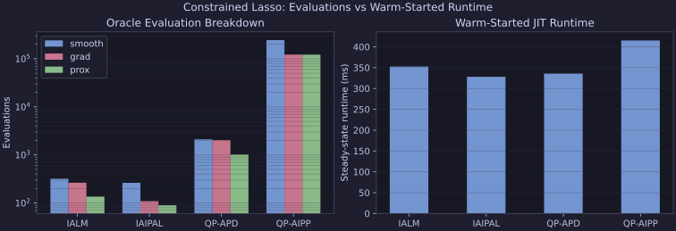
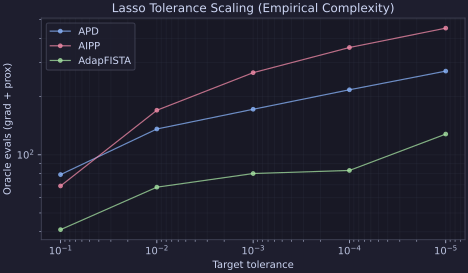
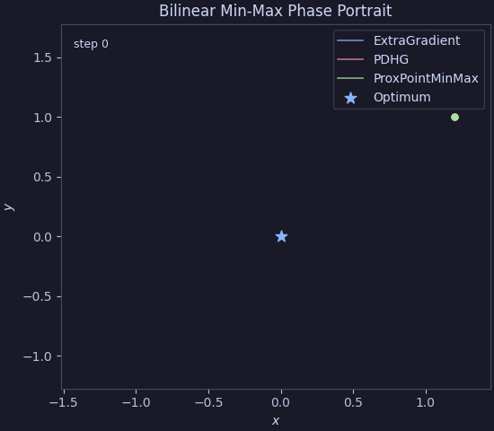
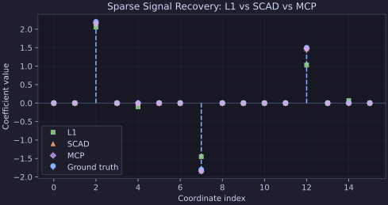

# Plotting & Diagnostics

Proxax includes an optional Matplotlib-based plotting module (`px.plotting`)
alongside `.plot()` convenience methods on `px.HistoryTracker` and
`px.Solution`.

Install Matplotlib support with:

```bash
pip install proxax[plot]
```

---

## 1. Plotting Convergence Curves (`sol.plot()` / `history.plot()`)

Pass `track_history=True` to `px.solve(...)` to attach a
`px.HistoryTracker` to `sol.history` (works with `jit=True` via
`jax.debug.callback`), then call `sol.plot()`:

```python
from proxax import px

sol = px.solve(
    problem,
    x0,
    method="ialm",
    opt_tol=1e-5,
    feas_tol=1e-5,
    track_history=True,
)
fig, axes = sol.plot(x_axis="evals", title="IALM Convergence")
```

You can choose the horizontal axis via `x_axis`:

- `"iter"`: outer solver iterations (default),
- `"time"`: wall-clock elapsed seconds,
- `"evals"`: cumulative gradient + proximal evaluations.

---

## 2. Comparing Multiple Solvers (`px.plotting.plot_histories`)

Use `px.plotting.plot_histories` to overlay multiple `HistoryTracker` runs on
shared objective and log-residual axes (automatically adding a third panel for
feasibility residuals on constrained problems):

```python
histories = {}
for label, method in [
    ("IALM", "ialm"),
    ("IAIPAL", "iaipal"),
    ("QP-APD", "qp_apd"),
    ("QP-AIPP", "qp_aipp"),
]:
  res = px.solve(
      c_prob,
      x0,
      method=method,
      opt_tol=1e-4,
      feas_tol=1e-4,
      track_history=True,
  )
  histories[label] = res.history

fig, axes = px.plotting.plot_histories(
    histories,
    x_axis="evals",
    log_x=True,
    title="Constrained Lasso: IALM vs IAIPAL vs QP-APD vs QP-AIPP",
)
```


Note that step 0 already consumes a small number of oracle evaluations for the
initial proximal refinement certificate (`x_hat in dom(h)`), and `IAIPAL` starts
from a slightly different step-0 point because it refines on the initial
penalized oracle whereas `IALM`, `QP-APD`, and `QP-AIPP` refine on the base
oracle.

---

## 3. Matrix Singular-Value Spectrum (`plot_spectrum`)

For 2D matrix problems such as `px.SpectralProblem`, call `sol.plot_spectrum()`
(or `px.plotting.plot_spectrum(matrix)`) to inspect the singular-value decay
$\sigma_i(X)$:

```python
sol = px.solve(spectral_prob, x0, method="da_icg", opt_tol=1e-5)
fig, ax = sol.plot_spectrum(title="DAICG Low-Rank Spectral Recovery")
```


---

## 4. Benchmark Performance Profiles (`plot_performance_profile`)

To compare solvers across a suite of benchmark problems, pass a mapping of
per-problem costs (runtime or oracle evaluations, with `math.inf` for unsolved
instances) to `px.plotting.plot_performance_profile`:

```python
fig, ax = px.plotting.plot_performance_profile(
    perf_evals,
    title="Lasso Benchmark Performance Profile (Oracle Evals)",
)
```


## 5. Oracle Evaluation Breakdown (`plot_eval_breakdown`)

To see where each solver spends its computational budget — smooth function
evaluations, gradient evaluations, proximal evaluations, and optionally
warm-started steady-state runtime — pass a mapping of `Solution` objects (and
optional `runtimes`) to `px.plotting.plot_eval_breakdown`:

```python
fig, axes = px.plotting.plot_eval_breakdown(
    solutions,
    runtimes=runtimes,
    title="Lasso Solver Oracle Breakdown & Steady-State Runtime",
)
```



## 6. Tolerance Scaling (`plot_tolerance_scaling`)

To inspect empirical complexity (how oracle evaluations grow as the optimality
tolerance `opt_tol` is tightened), pass the tolerance sequence and a mapping of
per-solver evaluation counts to `px.plotting.plot_tolerance_scaling`:

```python
fig, ax = px.plotting.plot_tolerance_scaling(
    tols,
    evals_by_solver,
    title="Lasso Oracle Complexity vs. Tolerance",
)
```



## 7. Min-Max Phase Trajectory (`plot_phase_trajectory` / `animate_phase_trajectory`)

For 2D saddle-point problems, enable `record_iterates=True` on
`px.HistoryTracker` and pass the `(x_k, y_k)` trajectories to
`px.plotting.plot_phase_trajectory` (static) or
`px.plotting.animate_phase_trajectory` (animated) to visualize cycling vs.
convergence around the saddle point:

```python
fig, ax, anim = px.plotting.animate_phase_trajectory(
    trajectories,
    optimum=(0.0, 0.0),
    title="Bilinear Min-Max Phase Portrait",
    save_path="minmax_phase.gif",
)
```



## 8. Sparse Signal Recovery (`plot_sparse_recovery`)

To compare sparse solutions recovered by convex (`L1`) and folded-concave
(`SCAD`, `MCP`) regularizers against a ground-truth vector, pass the estimate
mapping and `truth` to `px.plotting.plot_sparse_recovery`:

```python
fig, ax = px.plotting.plot_sparse_recovery(
    estimates,
    truth=x_true,
    title="Sparse Signal Recovery: L1 vs. SCAD vs. MCP",
)
```


