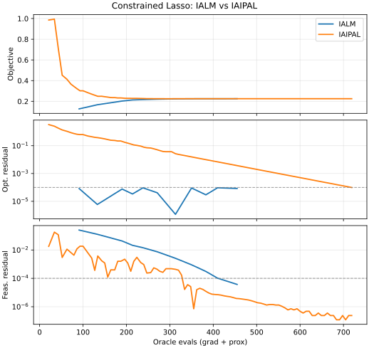
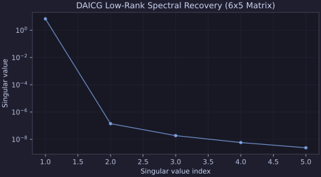
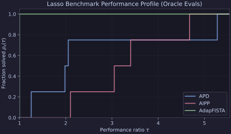

# Plotting & Diagnostics

Proxax includes an optional Matplotlib-based plotting module (`px.plotting`)
alongside `.plot()` convenience methods on `px.HistoryTracker` and
`px.Solution`.

Install Matplotlib support with:

```bash
pip install proxax[plot]
```

---

## 1. Plotting Convergence Curves (`sol.plot()` / `history.plot()`)

Pass `track_history=True` with `jit=False` to `px.solve(...)` to attach a
`px.HistoryTracker` to `sol.history`, then call `sol.plot()`:

```python
from proxax import px

sol = px.solve(
    problem,
    x0,
    method="ialm",
    opt_tol=1e-5,
    feas_tol=1e-5,
    jit=False,
    track_history=True,
)
fig, axes = sol.plot(x_axis="evals", title="IALM Convergence")
```

You can choose the horizontal axis via `x_axis`:

- `"iter"`: outer solver iterations (default),
- `"time"`: wall-clock elapsed seconds,
- `"evals"`: cumulative gradient + proximal evaluations.

---

## 2. Comparing Multiple Solvers (`px.plotting.plot_histories`)

Use `px.plotting.plot_histories` to overlay multiple `HistoryTracker` runs on
shared objective and log-residual axes (automatically adding a third panel for
feasibility residuals on constrained problems):

```python
histories = {}
for label, method in [("IALM", "ialm"), ("IAIPAL", "iaipal")]:
  res = px.solve(
      c_prob,
      x0,
      method=method,
      opt_tol=1e-4,
      feas_tol=1e-4,
      jit=False,
      track_history=True,
  )
  histories[label] = res.history

fig, axes = px.plotting.plot_histories(
    histories,
    x_axis="evals",
    title="Constrained Lasso: IALM vs IAIPAL",
)
```



---

## 3. Matrix Singular-Value Spectrum (`plot_spectrum`)

For 2D matrix problems such as `px.SpectralProblem`, call `sol.plot_spectrum()`
(or `px.plotting.plot_spectrum(matrix)`) to inspect the singular-value decay
$\sigma_i(X)$:

```python
sol = px.solve(spectral_prob, x0, method="da_icg", opt_tol=1e-5)
fig, ax = sol.plot_spectrum(title="DAICG Low-Rank Spectral Recovery")
```



---

## 4. Benchmark Performance Profiles (`plot_performance_profile`)

To compare solvers across a suite of benchmark problems, pass a mapping of
per-problem costs (runtime or oracle evaluations, with `math.inf` for unsolved
instances) to `px.plotting.plot_performance_profile`:

```python
fig, ax = px.plotting.plot_performance_profile(
    perf_evals,
    title="Lasso Benchmark Performance Profile (Oracle Evals)",
)
```


