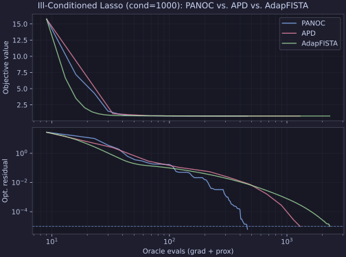

# Problems & Solvers

This guide walks through the day-to-day workflow of Proxax in plain English:
importing the unified `px` namespace, building problems over arrays or nested
PyTrees, picking a solver, tuning tolerances, logging progress, and inspecting
solutions.

---

## 1. Unified Namespace (`from proxax import px`)

You only need a single import line (`from proxax import px`, or equivalently
`import proxax as px`) to access the entire library:

- **Core entry points:** `px.CompositeProblem`, `px.SpectralProblem`,
  `px.solve`, `px.Solution`, `px.SolveStatus`, `px.StoppingConfig`
- **Qualified submodules:** `px.prox`, `px.constraints`, `px.solvers`,
  `px.oracle`, `px.optax_compat`, `px.certificates`, `px.tree`, `px.typing`

---

## 2. Building a Problem

### `px.CompositeProblem` (Most Problems)

Use `px.CompositeProblem` whenever you want to minimize a smooth function
`smooth`, a nonsmooth regularizer or simple set `proximal`, and/or linear/cone
constraints `constraints`. For example, to solve the L1-regularized
least-squares problem

$$\min_{x \in \mathbb{R}^n} \; \frac{1}{2}\|x - 1.5\|_2^2 + 0.2 \|x\|_1$$

write:

```python
import jax.numpy as jnp
from proxax import px

def smooth_fn(x):
  return 0.5 * jnp.sum((x - 1.5) ** 2)


problem = px.CompositeProblem(
    smooth=smooth_fn,
    proximal=px.prox.L1(weight=0.2),
    constraints=None,  # omit or pass a constraint from `px.constraints`
)
```

All three arguments are optional:

- Omit `smooth` (or pass `None`) for pure feasibility / projection problems.
- Omit `proximal` for smooth unconstrained or smooth linearly-constrained
  problems.
- Omit `constraints` when there is no coupling constraint $\mathcal{A}(x) \in \mathcal{C}$.

### Using PyTree Variables (`dict`, `tuple`, Dataclasses)

Your optimization variable `x` does **not** have to be a flat 1D vector. Any
JAX PyTree works out of the box—for instance, sparse linear regression with
weights $w \in \mathbb{R}^2$ and unpenalized scalar bias $b \in \mathbb{R}$:

$$\min_{w \in \mathbb{R}^2,\; b \in \mathbb{R}} \; \frac{1}{2N}\|X w + b \mathbf{1} - y\|_2^2 + 0.1\|w\|_1$$

```python
import jax
import jax.numpy as jnp
from proxax import px

features = jnp.array([[1.0, 2.0], [0.5, -1.0], [-1.5, 0.5]])
targets = jnp.array([1.2, -0.4, -0.8])

def regression_loss(params: dict[str, jax.Array]) -> jax.Array:
  preds = features @ params["w"] + params["b"]
  return 0.5 * jnp.mean((preds - targets) ** 2)

# Penalize weights `w` with L1, leave scalar bias `b` unpenalized:
problem = px.CompositeProblem(
    smooth=regression_loss,
    proximal=px.prox.MultiProx({"w": px.prox.L1(weight=0.1), "b": px.prox.Zero()}),
)

x0 = {"w": jnp.zeros(2), "b": jnp.asarray(0.0)}
sol = px.solve(problem, x0, method="apd")
print(sol.x["w"], sol.x["b"])
```

### Other Problem Classes (`SpectralProblem`, `MinMaxProblem`, `BlockProblem`)

- **`px.SpectralProblem(f1=..., f2_vec=..., prox_vec=...)`:** Matrix singular-value
  optimization $\min_X f_1(X) + (f_2^{\mathcal{V}} + h^{\mathcal{V}})(\sigma(X))$
  using one thin SVD per outer step (`DAICG` / `IAICG`). See
  {doc}`../examples/spectral` and `examples/spectral_matrix_completion.py`.
- **`px.MinMaxProblem(coupling=..., prox_x=..., prox_y=...)`:** Saddle-point
  problems $\min_x \max_y \Phi(x, y) + h_x(x) - h_y(y)$ solved with
  `ExtraGradient`, `PDHG`, or `ProxPointMinMax`. See {doc}`../examples/minmax`.
- **`px.BlockProblem(blocks=(...), rhs=...)`:** Multi-block splitting
  $\min \sum_i (f_i(x_i) + h_i(x_i))$ s.t. $\sum_i \mathcal{A}_i(x_i) = b$
  using `BlockTerm` and `ADMM` / `DPADMM` / `PAdaptADMM`. See
  {doc}`../examples/block`.

---

## 3. Calling `px.solve`

You can invoke `px.solve` in two ways:

::::{tab-set}

:::{tab-item} Quick String Name (`method=...`)
Pass `method="..."` along with `opt_tol` and `feas_tol` to use sensible default
hyperparameters:

```python
sol = px.solve(problem, x0, method="apd", opt_tol=1e-5)
```
:::

:::{tab-item} Configured Solver Object (`solver=...`)
Instantiate any class from `px.solvers` when you want fine-grained control over
iteration budgets, norm kinds, or penalty schedules:

```python
solver = px.solvers.APD(
    opt_tol=1e-6,
    norm_kind="linf",
    max_iters=500,
    max_inner_iters=1000,
)
sol = px.solve(problem, x0, solver=solver)
```
:::

::::

---

## 4. Which Solver Should I Pick?

If you just want a fast, reliable answer without tuning anything, start with
these three defaults:

| Problem Type | Recommended Default | `method=` String | Why Start Here? |
| :--- | :--- | :--- | :--- |
| **Unconstrained** (`constraints=None`) | `px.solvers.APD` | `"apd"` | Completely parameter-free; automatically adapts to both convex and nonconvex regions. |
| **Constrained** (`constraints=...`) | `px.solvers.IALM` or `px.solvers.QPAPD` | `"ialm"` / `"qp_apd"` | Both are parameter-free out of the box; `IALM` updates dual multipliers for moderate penalties, while `QPAPD` uses pure quadratic penalties. |
| **Matrix Spectral** (`SpectralProblem` or `NuclearNorm`) | `px.solvers.DAICG` | `"da_icg"` | Doubly accelerated; requires only one thin SVD per outer iteration. |
| **Min-Max / Saddle-Point** (`MinMaxProblem`) | `px.solvers.ExtraGradient` or `px.solvers.ProxPointMinMax` | `"extra_gradient"` / `"prox_point"` | Adaptive Mirror-Prox (`ExtraGradient`) for convex-concave games, `PDHG` for bilinear/alternating steps, and `ProxPointMinMax` for weakly monotone/nonconvex saddle points. |
| **Block-Constrained** (`BlockProblem`) | `px.solvers.DPADMM`, `px.solvers.PAdaptADMM`, or `px.solvers.ADMM` | `"dp_admm"` / `"p_adapt_admm"` / `"admm"` | `DPADMM` (cyclic dampened) and `PAdaptADMM` (parallel Jacobi adaptive) provide certified $\mathcal{O}(\varepsilon^{-3})$ convergence on nonconvex problems; `ADMM` is fast for fixed-penalty convex splitting. |

### Solver Selection Flowchart

```text
What problem class are you solving?
├── CompositeProblem (f(x) + h(x))
│   ├── Unconstrained (constraints=None)
│   │   ├── Ill-conditioned / quasi-Newton? ──▶ method="panoc" (L-BFGS + FBE)
│   │   ├── Known curvatures (m, M)?          ──▶ method="aipp" or "nc_fista"
│   │   └── Parameter-free default?           ──▶ method="apd" (or "adap_fista")
│   └── Constrained (constraints=...)
│       ├── Ill-conditioned / conic?          ──▶ method="panoc_alm"
│       ├── Parameter-free ALM / penalty?     ──▶ method="ialm" / "qp_apd"
│       └── Known curvatures?                 ──▶ method="iaipal" / "qp_aipp"
├── SpectralProblem (singular-value penalty)  ──▶ method="da_icg" / "ia_icg"
├── MinMaxProblem (saddle-point game)
│   ├── Convex-concave / bilinear?          ──▶ method="extra_gradient" / "pdhg"
│   └── Weakly nonconvex-strongly concave?    ──▶ method="prox_point"
└── BlockProblem (multi-block splitting)      ──▶ method="p_adapt_admm" / "dp_admm"
```

### Full Solver Catalog at a Glance (`px.solvers`)

- **Unconstrained solvers:**
  - **Parameter-free (no curvature constants needed):** `APD` (`"apd"`),
    `PANOC` (`"panoc"`, composite L-BFGS over the Forward-Backward Envelope),
    `AdapFISTA` (`"adap_fista"`), `AdapAPG` (`"adap_apg"`), `UPFAG` (`"upfag"`),
    `ACACG` (`"ac_acg"`), and `ECG` (`"ecg"`, simple backtracking proximal
    gradient).



See `examples/exotic_and_panoc.py` for an end-to-end comparison of `PANOC`
against first-order solvers alongside `Spectrahedron` and `CappedSimplex`
examples.
  - **Curvature-guided (fastest when `px.oracle.SmoothTerm` supplies
    `lower_curvature` / `upper_curvature`):** `AIPP` (`"aipp"`), `NCFISTA`
    (`"nc_fista"`), and `AG` (`"ag"`).
- **Set/cone-constrained solvers:**
  - `IALM` (`"ialm"` / `"panoc_alm"`): Inexact proximal augmented Lagrangian;
    supports `APD` (`"ialm"`), `PANOC` (`subproblem_solver="panoc"`, preset
    `method="panoc_alm"`), or `AIPP` inner solvers and optional multiplier
    dampening (`dampen` in $[0, 1)$, also available via preset
    `method="aidal"`).
  - `QPAPD` (`"qp_apd"`) & `QPAIPP` (`"qp_aipp"`): Quadratic penalty methods
    driven by `APD` or `AIPP`.
  - `IAIPAL` (`"iaipal"`): Classical proximal augmented Lagrangian taking a
    single inner `ACG` step per outer iteration when curvatures are known.
  - `SProxALM` (`"s_prox_alm"`): Single-loop smoothed proximal ALM for linear
    equality and box/polyhedral constraints.
- **Matrix spectral solvers:** `DAICG` (`"da_icg"`) and `IAICG` (`"ia_icg"`).
- **Min-max & saddle-point solvers:** `ExtraGradient` (`"extra_gradient"`),
  `PDHG` (`"pdhg"`), and `ProxPointMinMax` (`"prox_point"`).
- **Block-constrained splitting solvers:** `ADMM` (`"admm"`),
  `DPADMM` (`"dp_admm"`, Kong–Monteiro 2024 cyclic dampened proximal ADMM), and
  `PAdaptADMM` (`"p_adapt_admm"`, Maia–Monteiro–Silva 2026 parallel adaptive
  Jacobi proximal ADMM).

For theoretical complexity bounds and literature references behind each method,
see {doc}`../appendices/literature_and_theory`.

---

## 5. Compilation, Callbacks, History Tracking & Time Limits (`jit=True` vs `jit=False`)

By default, `px.solve(..., jit=True)` compiles the entire solver loop with
`jax.lax.while_loop`. This gives minimal Python overhead on CPU/GPU and makes
every solver compatible with `jax.jit` and `jax.vmap`.

When debugging interactively in Python — or when you want a custom Python
per-iteration `callback(state)` — pass `jit=False`. Both `track_history=True`
and a wall-clock `time_limit` (in seconds) work under both `jit=True` and
`jit=False`.

### Tracking Function Values & Tolerances (`px.HistoryTracker`)

Use `px.HistoryTracker` as your `callback` to record objective values,
optimality/feasibility residuals, effective tolerances, oracle counts, and
wall-clock times at every outer iteration (and optionally print a live progress
table with `verbose=True`):

```python
import jax.numpy as jnp
from proxax import px

a_mat = jnp.array([[2.0, 1.0, -1.0], [0.5, -1.5, 2.0], [1.0, 1.0, 1.0]])
b_vec = jnp.array([1.0, -1.5, 0.5])
c_mat = jnp.array([[1.0, 1.0, 1.0]])
d_vec = jnp.array([1.0])

problem = px.CompositeProblem(
    smooth=lambda x: 0.5 * jnp.sum((a_mat @ x - b_vec) ** 2),
    proximal=px.prox.L1(weight=0.1),
    constraints=px.constraints.equality(c_mat, d_vec),
)

history = px.HistoryTracker(verbose=True, print_every=1)
sol = px.solve(
    problem,
    jnp.zeros(3),
    method="ialm",
    opt_tol=1e-6,
    feas_tol=1e-6,
    jit=False,
    callback=history,
)

# Inspect or export recorded trajectories (for plotting, DataFrames, etc.):
data = history.to_dict()
print(history.obj_vals[-1], history.opt_residuals[-1], history.opt_tols[-1])

# Plot convergence curves (requires `pip install proxax[plot]`):
fig, axes = history.plot(x_axis="iter", title="IALM convergence")
```

Or pass `track_history=True` directly to `px.solve(...)` (works with `jit=True`
via `jax.debug.callback`) to attach the history to `sol.history` and call
`sol.plot()` or `px.plotting.plot_histories`:

```python
sol_ialm = px.solve(problem, x0, method="ialm", track_history=True)
sol_qp = px.solve(problem, x0, method="qp_aipp", track_history=True)

sol_ialm.plot(x_axis="evals")
px.plotting.plot_histories(
    {"IALM": sol_ialm.history, "QP-AIPP": sol_qp.history},
    x_axis="time",
)
```

For matrix `SpectralProblem` solutions and benchmark suites, `px.plotting` also
provides `sol.plot_spectrum()` (or `px.plotting.plot_spectrum`) and
`px.plotting.plot_performance_profile`.

With `verbose=True`, `HistoryTracker` prints an aligned table as the solver
runs:

```text
  iter |   inner |          obj |         opt_res (tol) |        feas_res (tol) |    time
----------------------------------------------------------------------------------------
     1 |      27 |   1.2693e-01 |  7.50e-07 ( 1.00e-06) |  2.53e-01 ( 1.00e-06) |   1.26s
   ...
    15 |     274 |   2.2500e-01 |  9.12e-07 ( 1.00e-06) |  6.37e-07 ( 1.00e-06) |   2.92s
```

See `examples/history_tracker.py` for the full runnable script.

### Custom Callbacks & Time Limits

Pass `time_limit` (in seconds) to stop cleanly with `TIME_LIMIT_REACHED` under
either `jit=True` or `jit=False`. For custom Python per-iteration hooks
`callback(state)` (return `True` to stop early), pass `jit=False`:

```python
from proxax import px

def log_outer_step(state: object) -> None:
  print(state.outer_iters, state.best_obj)

sol = px.solve(
    problem,
    x0,
    solver=px.solvers.APD(opt_tol=1e-6),
    jit=False,
    callback=log_outer_step,
    time_limit=5.0,
)
```

---

## 6. Inspecting Solutions & Verifying KKT Residuals

`px.Solution` provides a compact `__repr__` summarizing status, objective,
residuals, iteration/oracle counts, and variable shapes without dumping full
arrays:

```python
print(sol)
# Solution(
#   status=CONVERGED,
#   obj=2.249996e-01,
#   opt_res=9.117e-07,
#   feas_res=6.373e-07,
#   iters=15 (inner=274),
#   evals=(smooth=711, grad=624, prox=317),
#   x=float64[3],
#   dual=float64[1],
# )
```

Every `px.Solution` object also exposes numeric fields and an independent KKT
check:

```python
assert sol.status_enum == px.SolveStatus.CONVERGED

print("Objective value:      ", float(sol.stats.obj_val))
print("Stationarity ||v||:   ", float(sol.stats.opt_residual))
print("Feasibility residual: ", float(sol.stats.feas_residual))
print("Outer / inner iters:  ", int(sol.stats.outer_iters), int(sol.stats.inner_iters))
print("Grad / prox evals:    ", int(sol.stats.grad_evals), int(sol.stats.prox_evals))

# Independently re-evaluate KKT residuals on (sol.x, sol.subgrad):
kkt = problem.evaluate_residuals(sol.x, sol.subgrad, norm_kind="l2")
print("Verified stationarity:", float(kkt.stationarity_norm))
```
